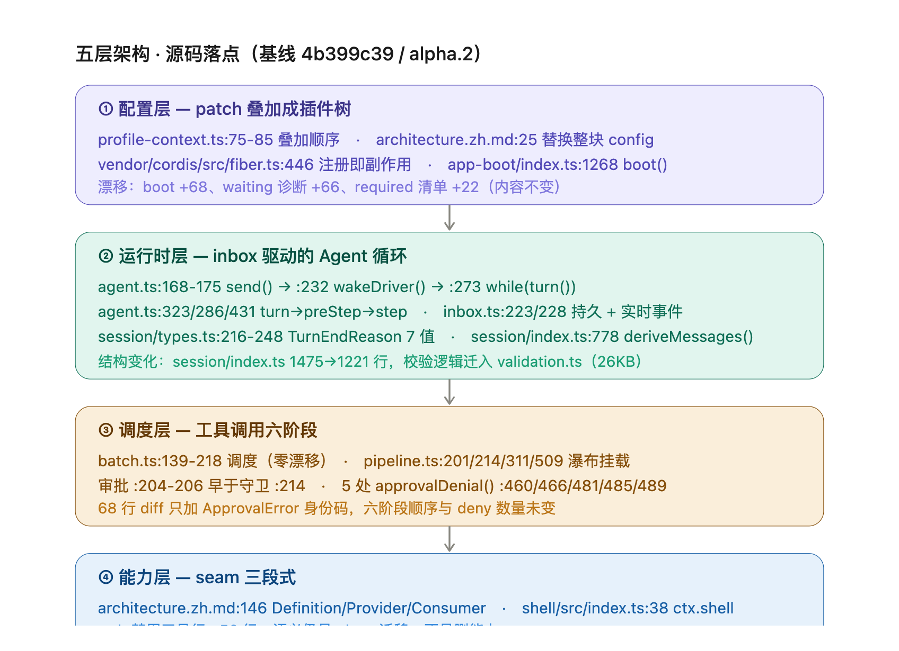

# DeepSeek Harness 技术架构与源码对应

## 证据范围

本文记录 DeepSeek Harness 的技术架构，以及每个架构概念对应的源码文件和行号。分析基线为 commit `4b399c39`，版本 `0.2.3-alpha.2`。对比基线为 commit `fcc0ad4`，版本 `0.2.2-rc.1`。界面截图版本为 `0.2.2-rc.5`，与两条源码基线都不完全一致。

行号只对分析基线负责。按界面字段反查行号之前，先对齐 commit。

源码位置来自官方文档和源码文件。标注「重构」和「加功能」的条目来自两个 commit 的逐文件比对。标注「未核对」的条目表示只确认结构存在，未逐行追踪。

## 架构总览

DeepSeek Harness 没有内核。启动时，多层 YAML patch 叠加成一棵插件条目树。Cordis 按依赖关系把这棵树结算成共享上下文 `ctx`。所有行为都是插件之间的服务调用与事件瀑布，包括收消息、调模型、跑工具、写日志和渲染 UI。不同的 patch 组合对应不同的产品形态。会话事实只保存在一份 append-only 日志里。



五层结构如下。

1. 配置层。patch 叠加成插件树，Cordis 结算，启动审计。
2. 运行时层。inbox 入口，Agent 循环，三类事件域，Session 日志投影。
3. 调度层。工具调用六阶段。
4. 能力层。seam 三段式。
5. 边界层。进程形态，通信契约，持久化，权限四层。

## 配置层

配置层由 patch 叠加与插件内核构成。

### 配置叠加

| 架构概念 | 源码位置 | 与对比基线的差异 |
|---|---|---|
| `parseDshArgs()` 入口 | `apps/cli/src/args.ts:146`，解析体 `:205-209` | 漂移 -1 行 |
| `prepareProfile()` | `apps/cli/src/profile-boot.ts:192` | 对比基线标注的 `81-85` 指向 `PROFILE_ROOT_CONFIG` 常量，当前位于 `:79` |
| 叠加顺序 bundle、profile、home、--patch、telemetry | `packages/boot/app-boot/src/profile-context.ts:75-85` | 漂移 +1 行。`context.overlays` 改为 `overlayPaths.flatMap(loadOverlayPatches)` |
| patch 按 id 替换整个 config，不做深度合并 | `docs/architecture.zh.md:25` | 零漂移 |
| `--dump-config` 渲染 | `packages/boot/app-boot/src/index.ts:648` 的 `renderConfigDump`，`:718` 的 `groupedDump` | 漂移 +17 至 +22 行。`collectConfigDumpLayers` 拆至 CLI 侧 |
| `dump-config.ts` | `apps/cli/src/dump-config.ts:32` 的 `runDumpConfig`，`:51` 的 `collectConfigDumpLayers` | 零漂移 |
| `--from-default-profile` | `apps/cli/src/profile-boot.ts:106-175` 的 `initializeProfileFromDefault` | 漂移 -2 行 |

以上条目在两条基线中都存在。

### Cordis 插件内核

| 架构概念 | 源码位置 | 与对比基线的差异 |
|---|---|---|
| 插件形态，Service 子类即插件 | `docs/cordis-tutorial/03-services.zh.md:20-42` | 零漂移 |
| 条目状态机 PENDING、LOADING、ACTIVE、UNLOADING、DISPOSED | `docs/cordis-tutorial/02-lifecycle-and-effects.zh.md:68-80` | 零漂移。文件名由通配写法改为具体名称 |
| `fiber.dispose()` 递归卸载 | `docs/cordis-api/fiber.zh.md:104-124` | 零漂移 |
| effect 注册，卸载即撤销 | `vendor/cordis/src/fiber.ts:446` | 未做跨版本对照 |
| waterfall 与 serial 事件 | `vendor/cordis/src/events.ts:250` 为 waterfall，`:218` 为 serial，`:250-274` 含 register | 未做跨版本对照 |

### 启动审计

| 架构概念 | 源码位置 | 与对比基线的差异 |
|---|---|---|
| `boot()` | `packages/boot/app-boot/src/index.ts:1268` | 漂移 +68 行 |
| required 清单，10 个 id | `index.ts:968-979` | 漂移 +22 行。列表内容一致 |
| waiting 诊断 | `index.ts:1179` 的 `startupDiagnostic`，`:1195` 的 `Plugins waiting for services` | 漂移 +66 行。签名由 `Set<Entry>` 改为 `Set<InactiveEntry>` |

启动链顺序为 `new Context()`，`ctx.plugin(Loader)`，挂载 patches，`loader.await()`，`auditStartupEntries()`。任一 required 插件未激活时抛出 `StartupError`，dispose 整棵树，进程以 exit(1) 结束。optional 插件失败只产生警告。

## 运行时层

运行时层覆盖 Agent 循环与事件域。

### inbox 入口与唤醒

| 架构概念 | 源码位置 | 与对比基线的差异 |
|---|---|---|
| `followup()` | `agent-loop/src/agent.ts:177` | 漂移 -2 行 |
| `send()` | `agent.ts:168-175`，其中 `:174` 同步调用 `wakeDriver()` | 漂移 -2 行 |
| inbox 落盘 | `agent-loop/src/inbox.ts:166-231` | 零漂移 |
| 持久事件 `agent/inbox/spliced` | `inbox.ts:223` | 零漂移 |
| 实时派发 `agent/inbox/inserted` | `inbox.ts:228` | 零漂移 |

唤醒不经事件。`send()` 同步调用 `wakeDriver()`。`agent/inbox/inserted` 是旁路通知，监听者为 `goal-round-driver`、`tool-jobs` 和 `subagent` 等插件。

### 循环结构与 turn 步骤

| 架构概念 | 源码位置 | 与对比基线的差异 |
|---|---|---|
| `wakeDriver()` | `agent.ts:232-254` | 漂移 +2 至 +3 行 |
| `kick()` 中的 `while (await turn())` | `agent.ts:273` | 漂移 +3 行 |
| `kick()` 的 finally 回到 idle | `agent.ts:280` | 漂移 +3 行 |
| `turn()`、`preStep()`、`step()` | `agent.ts:323`、`:286`、`:431` | 分别为 -4、+3、-4 行 |
| `prepareRequest()`、`buildRequest()` | `agent.ts:603`、`:646` | 均为 -10 行 |
| system 与 user 消息落盘 | `agent.ts:450-468` | 漂移约 -9 行 |
| 先落 assistant 消息再执行工具 | `agent.ts:564-572`，工具位于 `:580` | 漂移约 -9 行 |
| `deriveMessages()` 调用 | `agent.ts:718` | 漂移 -10 行 |
| `turn/end` 落盘 | `agent.ts:418` | 漂移 -4 行 |

循环通过向 inbox 写入下一段输入推进。`kick()` 使用 while 循环，不使用递归调用栈。循环把 `additionalContexts` 拼接进 `next-step` inbox，成为下一步的输入。

### 事件域与结束原因

| 架构概念 | 源码位置 | 与对比基线的差异 |
|---|---|---|
| `TurnEndReason` 的 7 个值 | `core/session/src/types.ts:216-248` | 漂移 +10 行。值为 completed、aborted、blocked、error、max-tokens、interrupted 和 forked |
| 三类事件域划分 | `docs/architecture.zh.md:110-118`，核心在 `:112` | 零漂移 |
| waterfall 要求 `next()` | `vendor/cordis/src/events.ts:250-265` | 未做跨版本对照 |
| compaction-basic 的三个 waterfall 挂载 | `compaction/compaction-basic/src/index.ts:172`、`:198`、`:228` | 漂移 +15 行。三处都保留 `next()` 委托 |

三类事件域的定义如下。

- 持久会话事件包括 `turn/*`、`step/*`、`system/message`、`user/message`、`assistant/message`、`assistant/attempt` 和 `tool/*`。这些事件进入日志，是唯一真相来源。
- waterfall 事件包括 `agent/pre-step`、`agent/request`、`llm/stream`、`tools/pre-execute`、`tools/execute` 和 `tools/post-execute`。监听器必须调用 `next()` 才能委托下去，因此可以短路、改写或包裹。
- serial 与实时事件包括 `agent/turn-stopping` 和 `agent/assistant-stream`。前者没有 `next()`。后者是进程本地事件，只用于 UI 增量。

`TurnEndReason` 定义位于 `session/src/types.ts`。`agent.ts` 只导入该类型。`interrupted` 和 `forked` 两个值不会在循环中实时发出。

### Session 日志投影

| 架构概念 | 源码位置 | 与对比基线的差异 |
|---|---|---|
| `deriveMessages()` 定义 | `core/session/src/index.ts:778`，注释位于 `:758-777` | 漂移 -221 行。对比基线位于 `:999` |
| 模型可见即已记录 | `docs/architecture.zh.md:138` | 漂移 +4 行 |
| 校验逻辑 | 新增 `core/session/src/validation.ts`，26,495 字节，以及 `fork-error.ts` | 结构性变化 |
| `#appendEvents` 批量追加 | `session/src/index.ts:578` | 新增 |

`session/src/index.ts` 在对比基线中为 1475 行，在分析基线中为 1221 行。diff 为删除 374 行，增加 120 行。删除集中在 `:94-159`、`:200-382` 和 `:1037-1057`，内容为校验逻辑，整体迁入 `validation.ts`。

投影核心逻辑逐句保留，位置前移 221 行。该逻辑包括 `surface.nodes`、`contentGeneration` 缓存、`deriveEventMessage` 和深冻结共享消息。这次变化的主体是代码抽取，不是新增架构能力。新增功能只有批量追加方法 `#appendEvents`。

模型可见即已记录的语义未变。所有模型可见输入先追加为 `SessionEvent`。`deriveMessages()` 只从日志投影。内存中没有第二份聊天记录。

### 中断与检查点

| 架构概念 | 源码位置 | 与对比基线的差异 |
|---|---|---|
| `raceAbort` 与 `raceAbortCall` | `agent-loop/src/index.ts:112`、`:128` | 约 +1 行 |
| `FactoryOwnership` | `agent-loop/src/index.ts:54` | 两条基线一致 |
| `session-checkpoint-policy` | `session/session-checkpoint-policy/src/index.ts:20-83` | 逐字节相同 |

## 调度层

调度层对应工具执行流水线。

| 架构概念 | 源码位置 | 与对比基线的差异 |
|---|---|---|
| 调度骨架 | `packages/core/tools/src/batch.ts:139-218` | 零漂移。两库 diff 为 0 行 |
| startCall 先记 tool/call 再 prepare | `batch.ts:154-159`，settlement.start 在 `:157`，pipeline.prepare 在 `:159` | 零漂移 |
| pre 有序，execute 并发，post 按模型序 | `batch.ts:186-201`、`:208-210`、`:139-150` | 零漂移 |
| 阶段链 createExecution、pre、审批、守卫、execute、post、result | `pipeline.ts:192`、`:201`、`:204-206`、`:214`、`:311`、`:509` | 顺序未变 |
| 审批在守卫之前 | `pipeline.ts:204-206` 的 serviceAsk 早于 `:214` 的 checkGuards。文档位于 `docs/tool-execution-pipeline.zh.md:66` | 仍成立，文档零漂移 |
| 缺席即拒绝，5 处 | `pipeline.ts:460`、`:466`、`:481`、`:485`、`:489` 为 `approvalDenial()` 调用，`:712` 为工厂定义 | 数量和语义不变。对比基线为 5 处字面量 `kind:'deny'` |
| user-approval 默认 unavailable | `packages/interaction/user-approval/src/index.ts:310-318` | 漂移约 +9 行 |
| 未知 executionMode 回退到 exclusive | `pipeline.ts:106-115` | 漂移 +1 行 |
| 无 toolSet 返回 UNKNOWN_TOOL | `tools/src/index.ts:249-255` | 零漂移 |
| 执行器缺席异常 | `tools/src/index.ts:358-367`，throw 位于 `:366` | index.ts 的 diff 为 11 行 |

`pipeline.ts` 的 diff 为 68 行，内容集中在四个变化。deny 增加 `ApprovalError` 身份，取值为 `APPROVAL_REJECTED`、`APPROVAL_CANCELLED` 和 `APPROVAL_UNAVAILABLE`。新增 `approvalDenial` 工厂。新增 `wrapperFailureResult` 与 `isUnclassifiedCancellation` 取消分类。`checkGuards` 改为返回 `ToolGuardDenial`。六阶段顺序和 deny 数量未变。

按 `kind: 'deny'` 做文本检索时，只命中工厂定义 `pipeline.ts:713` 和类型声明 `:42`。实际拒绝决策点是 5 处 `approvalDenial()` 调用。

## 能力层

能力层对应 seam 三段式。

| 架构概念 | 源码位置 | 与对比基线的差异 |
|---|---|---|
| seam 三段式 Definition、Provider、Consumer | `docs/architecture.zh.md:146`，标题在 `:144` | 漂移 +4 行 |
| bash seam 的 Definition | `packages/shell/shell/src/index.ts:2`、`:38`，定义 `ctx.shell` | 仍成立 |
| bash seam 的 Provider | `bash-local`、`bash-sandbox` 和 `pwsh-local` | 未逐行核对，包存在 |
| bash seam 的 Consumer | `packages/shell/tool-bash` | 未逐行核对 |
| web 禁用进程级工具行 | `web-app/cordis.patch.yml:551-558`，tool-bash 在 `:554-555`，pwsh 在 `:557-558` | 漂移约 +56 行。文件 diff 为 104 行，来自 UI 插件行插入 |
| web preset 重新启用 | `web-app/presets/standard.patch.yml:21-33` | 零漂移 |

一个 seam 由三部分组成。Service Definition 声明接口。Service Provider 实现接口。Consumer 是面向模型的工具。更换 Provider 会把 Bash、PTY 和 LSP 一起搬到远程沙箱，无需为每个工具建立分支，模型看到的 schema 不变。

web 层把 `disabled: true` 设在进程级工具行上。这不是删除能力，而是 plane 迁移。web 层禁用 base 中的行，agent preset 名录重新启用这些工具。

## 边界层

边界层覆盖进程与数据。

### 进程形态与通信

| 架构概念 | 源码位置 | 与对比基线的差异 |
|---|---|---|
| 随附 profile 清单 acp、web、headless、sdk、sdk-minimal | `packages/util/official-bundles/src/bundles.ts:10-24` | 模板定义收敛到 official-bundles |
| sdk-minimal 不叠加 base | `bundles.ts:23-24` | 仍成立 |
| desktop 保留 profile | `docs/architecture.zh.md:51` | 仍成立 |
| Host 树与 node:http | `packages/host/webserver/src/index.ts:15`、`:672` | 仍成立 |
| 浏览器 client 树 | `packages/client/web/src/boot-client.ts` | 仍成立 |
| `ctx.remote.<namespace>` 调用 Host 的 @Remote 方法 | `packages/extensions/ui-cordis/src/client/index.ts:8`、`:47`、`:58` | 仍成立 |
| 一元调用 /api | `packages/api/gateway/src/index.ts:257` | 结构已变。路径重组为 gateway 与 remotes |
| 流式调用 /api/remote.mux | `gateway/src/index.ts:280`、`:287`。协议位于 `stream-protocol.ts` | 仍成立，路径重组 |
| Typert 从 Host ts.Program 生成两侧描述符 | `packages/typert/generator/src/analyzer.ts:384`、`:625`、`:666` | 仍成立 |
| token 到签名 cookie 与 Host、Origin 栅栏 | `host/authentication-token/src/browser-auth.ts:197`、`:203`、`:257`。`index.ts:56`、`:82` | 仍成立 |

`webserver/src/index.ts` 注入 script src，传递启动图和 `/plugins/<id>/client.js`。启动图的具体数据结构未直接读取。

### 持久化

| 架构概念 | 源码位置 | 与对比基线的差异 |
|---|---|---|
| append-only 写入 JSONL，使用 zstd 帧，版本 v0 与 vN | `session-persistence-jsonl/src/format.ts:35`、`:42`、`:52`、`:58`。`docs/architecture.zh.md:136` | 仍成立 |
| 已提交 generation 不重命名 | `architecture.zh.md:136`。`session-persistence-jsonl/src/generation.ts` | 仍成立 |
| 迁移链 v0 到 v4 无缺口 | `packages/session/session-format-v{0-to-1,1-to-2,2-to-3,3-to-4}/`。`session-format-catalog/src/generated.ts:26`、`:47` | 仍成立 |
| Session 核心代码 | `core/session/src/index.ts` 为 1221 行，对比基线为 1475 行 | 格式与迁移链的包结构一致，格式未变 |
| SQLite 定位 | 新增 `session-persistence-sqlite/README.md` | 结构性变化 |

SQLite 包的 README 原文如下。

> Save Session histories in SQLite and reopen them through the existing persistence API. Existing JSONL histories import on first open while their source files remain intact. Readers can share a database with an active writer; each Session permits one writer. Choose this provider explicitly: shipped profiles continue to use JSONL.

对比基线中，SQLite 只做全文检索索引和非会话应用数据，不保存会话。分析基线新增可选的会话持久化 provider。随附 profile 仍默认使用 JSONL。

### 权限四层

| 架构概念 | 源码位置 | 与对比基线的差异 |
|---|---|---|
| seam 层的 ctx.fs、ctx.shell、ctx.subprocess 和 ctx.sandbox | `docs/architecture.zh.md:148`、`:161`、`:167`。`packages/{fs,shell,subprocess,sandbox}/` | 仍成立 |
| 执行层三档 read-only、workspace-write 和 danger-full-access | `sandbox/sandbox-policy/src/session-mode.ts:42`。`index.ts:126-128`、`:140` | 仍成立 |
| 审批层 user-approval 与 permission-presets | `interaction/user-approval/src/index.ts`。`interaction/permission-presets/src/index.ts:118-120`、`:163-168`、`:185-190` | 行号漂移。对比基线为 `119-120`、`163`、`191-197` |
| 传输层 remote-access 按 role 限制 | `api/remote-access/src/index.ts:38`。`types.ts:29`、`:45` | 仍成立 |

权限档位由两个参数构成。sandbox 决定可读写范围。approval 决定是否需要审批。`permission-presets/src/index.ts:118-120` 定义三档字面量。`:185-190` 的 preset 表把 sandbox 与 approval 绑定。

## 三条不变量

| 不变量 | 保证方式 | 破坏后果 |
|---|---|---|
| 模型可见即已记录 | 模型可见输入先追加 `SessionEvent`。`deriveMessages()` 只从日志投影，位于 `session/src/index.ts:778`。规则见 `architecture.zh.md:138` | UI 与模型看到不同内容，无法复跑 |
| 注册即副作用，dispose 即撤销 | Cordis fiber 管理注册项生命周期，位于 `vendor/cordis/src/fiber.ts:446`。`fiber.dispose()` 递归卸载，见 `docs/cordis-api/fiber.zh.md:104-124` | HMR 失效，插件卸载留残留 |
| 策略不进工具本体，缺席即拒绝 | 策略位于 waterfall、guard 和 approval 插件，见 `pipeline.ts:201`、`:214`。5 处 `approvalDenial()` 位于 `:460`、`:466`、`:481`、`:485`、`:489`。无 toolSet 返回 UNKNOWN_TOOL，见 `tools/src/index.ts:249-255` | 工具作者各写一套权限判断，漏一处即越权 |

压缩、终端、子代理和任务板不是主干。它们是建立在这三条不变量上的可选 seam。

## 版本漂移

核心机制在两个 commit 之间保持稳定，以下条目零漂移或接近零漂移。

- patch 替换整块 config，Cordis 插件形态与 fiber 状态机，waterfall 与 serial 实现。
- inbox 落盘与实时派发，三类事件域划分，session-checkpoint-policy 逐字节相同。
- 工具六阶段调度骨架，pre、execute 和 post 顺序，审批早于守卫，fail-closed 规则。
- web preset 重新启用，JSONL 格式与迁移链，权限四层结构。

小幅漂移在 -10 至 +22 行之间，涉及配置叠加、args 解析、profile 重建、required 清单、Agent 循环各函数、TurnEndReason 定义、compaction 挂载点、user-approval、能力 seam 文档和 permission-presets。

大漂移和结构变化条目如下。

| 位置 | 变化 | 定性 |
|---|---|---|
| `boot()` | +68 行 | 插入代码，结构未变 |
| waiting 诊断 | +66 行，`Set<Entry>` 改为 `Set<InactiveEntry>` | 类型收紧 |
| `session/src/index.ts` | 1475 行降为 1221 行，删除 374 行，增加 120 行 | 重构。校验逻辑迁入 `validation.ts`，投影逻辑保留 |
| `deriveMessages()` | -221 行 | 位置前移，机制未变 |
| web 禁用工具行 | +56 行 | UI 插件行插入，语义未变 |
| deny 5 处 | +21 行，写法改为工厂调用 | 增加错误身份码，数量与语义未变 |
| SQLite | 新增可选 provider | 新增功能，默认仍为 JSONL |
| 一元 /api | 路径重组为 gateway 与 remotes | 包结构变化 |

## 核对边界

以下条目未做完整核对。

1. 对比基线缺少 `vendor/cordis` 目录。两处 vendor 行号不做跨版本对照。
2. bash seam 的 Provider 与 Consumer 精确源码落点未逐行验证。只确认包与 `ctx.shell` 定义存在。
3. web 启动图的传递由 script 注入旁证推断。具体数据结构未直接读取。
4. `capability-seams.zh.md` 中三段式的行文行号未逐行核对。
5. `#appendEvents` 是新增能力还是旧内联逻辑抽取，未逐行追踪旧批处理路径。
6. 本次为静态源码核对，未运行测试验证运行时行为。

## 复现方法

```sh
git clone https://github.com/deepseek-ai/deepseek-harness.git
cd deepseek-harness

# 分析基线
git checkout 4b399c39
git log -1 --oneline
sed -n '770,790p' packages/core/session/src/index.ts
sed -n '450,495p' packages/core/tools/src/pipeline.ts

# 对比基线，需保留完整 git 历史
git show fcc0ad4:packages/core/session/src/index.ts | wc -l
diff <(git show fcc0ad4:packages/core/session/src/index.ts) \
     packages/core/session/src/index.ts | head -60
```
