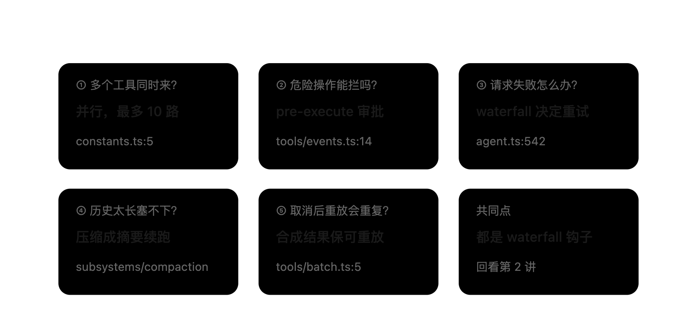

# DeepSeek Harness 工具调用链路：从注册到回灌的五个关键问题

## 证据范围

本文把围绕工具的一系列问题整理成一条完整链路：工具从哪来、缺工具时怎么办、模型的决策逻辑、如何检索工具，以及决定调用是否安全可靠、能否长久运行的五个关键问题。分析基线为 commit [`4b399c39`](https://github.com/deepseek-ai/deepseek-harness/tree/4b399c39a6d1479cd84ca591b4d7c88e24d38a96)，版本 `0.2.3-alpha.2`。

源码落点均可点击，直接跳转到上游仓库固定 commit 的对应行——链接锁定在分析基线上，不会随上游更新而漂移。行号是查证入口，标注「设计意图」的条目来自源码注释或文档陈述，未逐行追踪全部执行分支。源码不在本库内，按 [基线记录](../../meta/sources.md) 的 commit 可复现。

## 总览：一次工具调用的六个环节

图中六个卡片对应链路上的五个关键问题和一条共同主线，文字对照如下。

| 环节 | 关键问题 | 结论 | 源码落点 |
|---|---|---|---|
| 注册 | 工具从哪来 | 插件在 `apply(ctx)` 中注册，卸载即注销 | [`docs/cookbook/adding-a-tool.zh.md:18-39`](https://github.com/deepseek-ai/deepseek-harness/blob/4b399c39a6d1479cd84ca591b4d7c88e24d38a96/docs/cookbook/adding-a-tool.zh.md#L18-L39) |
| 清单 | 模型怎么知道有哪些工具 | 每步解析工具集，组装进系统提示词 | [`agent-loop/src/agent.ts:295-297`](https://github.com/deepseek-ai/deepseek-harness/blob/4b399c39a6d1479cd84ca591b4d7c88e24d38a96/packages/core/agent-loop/src/agent.ts#L295-L297) |
| 闸门 | 危险操作能拦吗 | `pre-execute` waterfall 裁决，失败关闭 | [`tools/src/events.ts:14`](https://github.com/deepseek-ai/deepseek-harness/blob/4b399c39a6d1479cd84ca591b4d7c88e24d38a96/packages/core/tools/src/events.ts#L14) |
| 执行 | 多个工具一起来怎么办 | 并行池加屏障，上限 10 路 | [`tools/src/batch.ts:3`](https://github.com/deepseek-ai/deepseek-harness/blob/4b399c39a6d1479cd84ca591b4d7c88e24d38a96/packages/core/tools/src/batch.ts#L3)、[`constants.ts:5`](https://github.com/deepseek-ai/deepseek-harness/blob/4b399c39a6d1479cd84ca591b4d7c88e24d38a96/packages/core/agent-loop/src/constants.ts#L5) |
| 回灌 | 请求失败怎么办 | `request-error` waterfall 决定是否重试 | [`agent-loop/src/agent.ts:542-552`](https://github.com/deepseek-ai/deepseek-harness/blob/4b399c39a6d1479cd84ca591b4d7c88e24d38a96/packages/core/agent-loop/src/agent.ts#L542-L552) |
| 延续 | 历史太长、中途取消怎么办 | 压缩与可重放日志 | [`docs/subsystems/compaction.zh.md`](https://github.com/deepseek-ai/deepseek-harness/blob/4b399c39a6d1479cd84ca591b4d7c88e24d38a96/docs/subsystems/compaction.zh.md)、[`tools/src/batch.ts:5`](https://github.com/deepseek-ai/deepseek-harness/blob/4b399c39a6d1479cd84ca591b4d7c88e24d38a96/packages/core/tools/src/batch.ts#L5) |

五个问题中有三个是 waterfall 钩子（`pre-execute`、`execute`、`request-error`），加上审批的 `approval/request`——凡是需要拦截、否决、加工的地方，都是 waterfall。这条主线接第 2 讲的五种事件派发方式。

## 前置：工具从哪来

工具不是内核内置的，是插件贡献的一种能力。

| 环节 | 源码位置 | 发生什么 |
|---|---|---|
| 工具定义 | [`docs/cookbook/adding-a-tool.zh.md:18-36`](https://github.com/deepseek-ai/deepseek-harness/blob/4b399c39a6d1479cd84ca591b4d7c88e24d38a96/docs/cookbook/adding-a-tool.zh.md#L18-L36) | 插件在 `apply(ctx)` 里 `ctx.tools.register(defineTool({...}))`，声明 name、description、parameters、execute |
| 解析工具集 | [`agent-loop/src/agent.ts:295`](https://github.com/deepseek-ai/deepseek-harness/blob/4b399c39a6d1479cd84ca591b4d7c88e24d38a96/packages/core/agent-loop/src/agent.ts#L295) | 每一步 `tools.resolve({ agent, modelSelection, signal })` 解析出当前可用的 `ResolvedToolSet` |
| 清单进提示词 | [`agent-loop/src/agent.ts:297`](https://github.com/deepseek-ai/deepseek-harness/blob/4b399c39a6d1479cd84ca591b4d7c88e24d38a96/packages/core/agent-loop/src/agent.ts#L297) | `systemPrompt.assemble({..., toolSet})` 把工具 schema 写进系统提示词——这是模型「认识」工具的方式 |
| 模型返回调用 | [`agent-loop/src/agent.ts:576`](https://github.com/deepseek-ai/deepseek-harness/blob/4b399c39a6d1479cd84ca591b4d7c88e24d38a96/packages/core/agent-loop/src/agent.ts#L576) | 模型产出 `block.type === 'tool-call'` 的内容块 |
| 执行 | [`agent-loop/src/agent.ts:578-583`](https://github.com/deepseek-ai/deepseek-harness/blob/4b399c39a6d1479cd84ca591b4d7c88e24d38a96/packages/core/agent-loop/src/agent.ts#L578-L583) | `tools.execute({ calls: toolCalls, ... })` 按名字找到 `execute` 函数 |
| 结果回灌 | [`agent-loop/src/agent.ts:584-586`](https://github.com/deepseek-ai/deepseek-harness/blob/4b399c39a6d1479cd84ca591b4d7c88e24d38a96/packages/core/agent-loop/src/agent.ts#L584-L586) | 结果写入 `next-step` inbox，循环回到模型 |

两个容易被忽略的细节：

- `description` 才是模型判断依据（[`adding-a-tool.zh.md:20`](https://github.com/deepseek-ai/deepseek-harness/blob/4b399c39a6d1479cd84ca591b4d7c88e24d38a96/docs/cookbook/adding-a-tool.zh.md#L20) 称其为 "what the model sees"）。模型不关心工具名，读的是描述。
- 注册是副作用：dispose 插件 fiber 即注销该工具（[`adding-a-tool.zh.md:39`](https://github.com/deepseek-ai/deepseek-harness/blob/4b399c39a6d1479cd84ca591b4d7c88e24d38a96/docs/cookbook/adding-a-tool.zh.md#L39)）。这是第 2 讲 effect 机制的又一次应用，工具随插件卸载自动消失。

上游把能力做成独立工具插件包：`tool-bash`、`tool-web`、`tool-fs`、`tool-lsp`、`tool-office`、`tool-todo` 等。加载哪个，模型就多哪种能力。

## 当工具不在场

### 三种「没有」是三件不同的事

| 缺什么 | 谁来解决 | 行为 |
|---|---|---|
| 缺某个具体能力 | 部署方加载工具插件 | 模型在提示词里看不到它，正常情况下不会请求调用 |
| 工具注册了但没执行器 | 部署配置 | [`tools/src/index.ts:358-367`](https://github.com/deepseek-ai/deepseek-harness/blob/4b399c39a6d1479cd84ca591b4d7c88e24d38a96/packages/core/tools/src/index.ts#L358-L367) 的 `selectExecutor()` 抛 `ToolExecutorUnavailableError`，模型没机会请求 |
| 模型幻觉出不存在的工具 | 模型自己纠正 | [`pipeline.ts:278,534,603`](https://github.com/deepseek-ai/deepseek-harness/blob/4b399c39a6d1479cd84ca591b4d7c88e24d38a96/packages/core/tools/src/pipeline.ts#L278) 抛 `ToolNotFoundError`，code 为 `UNKNOWN_TOOL`（[`contracts.ts:292-307`](https://github.com/deepseek-ai/deepseek-harness/blob/4b399c39a6d1479cd84ca591b4d7c88e24d38a96/packages/core/tools/src/contracts.ts#L292-L307)），作为结构化 `tool/result` 回灌 |

第三种值得展开：错误也是数据，走正常回灌通道（[`agent.ts:584-586`](https://github.com/deepseek-ai/deepseek-harness/blob/4b399c39a6d1479cd84ca591b4d7c88e24d38a96/packages/core/agent-loop/src/agent.ts#L584-L586)）进入 `next-step` inbox。模型在下一轮看到「unknown tool weather」，有机会改用现有工具或改用文本回答。这是第 3 讲「结果回灌」那条循环的的价值——错误同样驱动下一轮。

[`tools/src/index.ts:347`](https://github.com/deepseek-ai/deepseek-harness/blob/4b399c39a6d1479cd84ca591b4d7c88e24d38a96/packages/core/tools/src/index.ts#L347) 的注释记了一个有意的设计：卸载执行器后保留不可用的选择，不让程序悄悄落到另一个执行器上。避免「工具好像能调，其实跑在错误后端」。这是配置问题，不是模型能自愈的。

### 模型侧的决策逻辑

先厘清一个前提：模型没有「想要一个工具」这个动作。它的输出只有两种——文本，或调用清单里某个工具的 tool-call。它不能申请新工具，也不能执行清单外的函数。

用户要查天气但没有天气工具时，模型按实际发生概率走四条路：

1. **直接用文本回答，最常见**。工具清单里没有能查天气的东西，模型如实说自己无法获取实时天气。文本里没有 tool-call，第 3 讲的完成判定（[`agent.ts:576-577`](https://github.com/deepseek-ai/deepseek-harness/blob/4b399c39a6d1479cd84ca591b4d7c88e24d38a96/packages/core/agent-loop/src/agent.ts#L576-L577)）判 `completed`，turn 正常结束。对框架来说这是一次正常完成。
2. **用别的工具间接满足**。如果清单里有 `web_search`，模型可能判断「我能用它查」。它读的是 description，不关心工具名。通用工具能覆盖很多「没有专用工具」的场景，精确度和安全性不如专用工具。
3. **幻觉出不存在的工具，少数情况**。框架按上表第三种接住，回灌 `UNKNOWN_TOOL`，模型下一轮自我纠正。
4. **连执行器都没装**。框架在 dispatch 前先崩，模型没机会决策。

模型的决策被两层约束框住：**输入约束**——只看得到提示词里的工具 schema（[`system-prompt/README.zh.md:99-101`](https://github.com/deepseek-ai/deepseek-harness/blob/4b399c39a6d1479cd84ca591b4d7c88e24d38a96/packages/core/system-prompt/README.zh.md#L99-L101) 明确工具 schema 提供方在每次组装时求值）；**输出约束**——只能生成文本或清单内的 tool-call，没有第三种输出能表达「给我加个工具」。

`repeat-tool-reminder` 插件（[`packages/guard/repeat-tool-reminder/README.md:12,32`](https://github.com/deepseek-ai/deepseek-harness/blob/4b399c39a6d1479cd84ca591b4d7c88e24d38a96/packages/guard/repeat-tool-reminder/README.md#L12)）处理模型卡在重复调用的情况：连续重复 3/5/8 次时插入提醒，请模型检查上次结果、换方法或收尾。它是建议性（advisory）的，不阻断合法重复调用——和第 3 讲的取消形成对照：一个柔性提醒，一个硬性中断，都不替模型决策。

### 检索：本地源码与运行时

这是两个不同场景，方法不一样。

**在源码里查**，三层从快到慢：

1. 先查 [`docs/tool-catalog.zh.md`](https://github.com/deepseek-ai/deepseek-harness/blob/4b399c39a6d1479cd84ca591b4d7c88e24d38a96/docs/tool-catalog.zh.md)。它是工具名到插件包、依赖、副作用的映射表，由生成器真正启动每个工具插件、读取 `ctx.tools.schemas()` 得到（`:3-9`），并有 glob 匹配 `packages/*/tool-*` 的完整性守卫——漏一个包就构建失败，所以不会过期。
2. 按包结构定位。33 个工具包命名有规律 `tool-<能力>`：联网搜索去 `packages/web/tool-web/`，文件读写去 `packages/fs/tool-fs/`，命令行去 `packages/shell/tool-bash/`。
3. 全文搜索兜底，且**搜能力描述而不是工具名**。找「能联网的东西」要搜 `fetch|search|http`，而不是猜它叫什么。

实测：本地 30 多个工具包中搜索 `weather|天气`，产品工具零命中，只有 examples 里的 `token-weather` 演示插件。所以确实没有产品级天气工具。

**运行时**，Agent 不会「检索」工具，它是被「喂」工具的：每步 `tools.resolve()` 解析、`systemPrompt.assemble()` 全量写进提示词，模型读 description 自己判断。工具多时成本是真实的——[`system-prompt/README.zh.md:189-193`](https://github.com/deepseek-ai/deepseek-harness/blob/4b399c39a6d1479cd84ca591b4d7c88e24d38a96/packages/core/system-prompt/README.zh.md#L189-L193) 明确 schema token 每次请求都重复。真正的检索只在专门的元数据工具上：

| 工具 | 检索什么 | 工具目录位置 |
|---|---|---|
| `cordis_inspect` | 运行时有哪些 provider、方法 | [`docs/tool-catalog.zh.md:34`](https://github.com/deepseek-ai/deepseek-harness/blob/4b399c39a6d1479cd84ca591b4d7c88e24d38a96/docs/tool-catalog.zh.md#L34) |
| `plugin_market` | 可安装的插件（含新工具） | [`docs/tool-catalog.zh.md:24`](https://github.com/deepseek-ai/deepseek-harness/blob/4b399c39a6d1479cd84ca591b4d7c88e24d38a96/docs/tool-catalog.zh.md#L24) |
| `glob`、`grep` | 文件系统里的文件和内容 | [`docs/tool-catalog.zh.md:39`](https://github.com/deepseek-ai/deepseek-harness/blob/4b399c39a6d1479cd84ca591b4d7c88e24d38a96/docs/tool-catalog.zh.md#L39) |
| `session_event_search`、`session_search` | 历史事件和会话 | [`docs/tool-catalog.zh.md:48`](https://github.com/deepseek-ai/deepseek-harness/blob/4b399c39a6d1479cd84ca591b4d7c88e24d38a96/docs/tool-catalog.zh.md#L48) |

`cordis_inspect` 让模型查「系统有什么能力」，`plugin_market` 让模型找「还能装什么」——这是「模型自己找工具」的落地，但不是检索后直接调用，而是先查目录、再决定装插件，装完工具才进提示词。

## 五个关键问题

### 一、一次返回多个工具调用，并行还是串行

不是简单的二选一。[`tools/src/batch.ts:3`](https://github.com/deepseek-ai/deepseek-harness/blob/4b399c39a6d1479cd84ca591b4d7c88e24d38a96/packages/core/tools/src/batch.ts#L3) 的调度器把调用分两类：`parallel` 的进有界滚动池，`exclusive` 的做屏障，必须等当前池排空才轮到它。默认最多 10 路并发（[`agent-loop/src/constants.ts:5`](https://github.com/deepseek-ai/deepseek-harness/blob/4b399c39a6d1479cd84ca591b4d7c88e24d38a96/packages/core/agent-loop/src/constants.ts#L5)，`DEFAULT_MAX_PARALLEL_TOOL_CALLS = 10`）。

三个关键细节：

- 执行可以乱序，**结果按模型顺序提交**（[`batch.ts:4`](https://github.com/deepseek-ai/deepseek-harness/blob/4b399c39a6d1479cd84ca591b4d7c88e24d38a96/packages/core/tools/src/batch.ts#L4)），模型看到的结果顺序和发出调用的顺序一致。
- 每个调用启动前重新判定模式（[`batch.ts:76`](https://github.com/deepseek-ai/deepseek-harness/blob/4b399c39a6d1479cd84ca591b4d7c88e24d38a96/packages/core/tools/src/batch.ts#L76)），所以注册表半路改了工具策略，会影响尚未启动的调用。
- 取消时停止新启动、排空已启动的调用，并给被跳过的调用记录合成错误结果（[`batch.ts:5-7`](https://github.com/deepseek-ai/deepseek-harness/blob/4b399c39a6d1479cd84ca591b4d7c88e24d38a96/packages/core/tools/src/batch.ts#L5-L7)），目的是让 replay 保持有效。

这是「工具能力」之外的「工具调度」层，直接决定延迟和成本。

### 二、危险操作能在执行前拦下来吗

能，靠三条 waterfall 钩子（[`tools/src/events.ts`](https://github.com/deepseek-ai/deepseek-harness/blob/4b399c39a6d1479cd84ca591b4d7c88e24d38a96/packages/core/tools/src/events.ts)）：

| 事件 | 位置 | 作用 |
|---|---|---|
| `tools/pre-execute` | [`events.ts:14`](https://github.com/deepseek-ai/deepseek-harness/blob/4b399c39a6d1479cd84ca591b4d7c88e24d38a96/packages/core/tools/src/events.ts#L14) | dispatch 前裁决 allow / deny / cancel / ask |
| `tools/execute` | [`events.ts:20`](https://github.com/deepseek-ai/deepseek-harness/blob/4b399c39a6d1479cd84ca591b4d7c88e24d38a96/packages/core/tools/src/events.ts#L20) | 围绕 dispatch 的瀑布，用于 timeout、retry、metrics |
| `tools/post-execute` | [`events.ts:30`](https://github.com/deepseek-ai/deepseek-harness/blob/4b399c39a6d1479cd84ca591b4d7c88e24d38a96/packages/core/tools/src/events.ts#L30) 起 | 接受、替换、加工或阻断归一化后的结果 |

审批走 `approval/request` waterfall，应答者可以是 UI 通道或 ACP 自动化桥接。关键是**失败关闭**：`ApprovalOutcome` 只有 `allowed-once`、`rejected`、`cancelled`、`unavailable` 四种，除 `allowed-once` 外一律拒绝；缺失、不负责、抛异常的应答者产生 `unavailable`，也不放行（[`docs/subsystems/approval.zh.md`](https://github.com/deepseek-ai/deepseek-harness/blob/4b399c39a6d1479cd84ca591b4d7c88e24d38a96/docs/subsystems/approval.zh.md)）。`allowed-once` 只授权当次操作。会话级策略 `never` 确定性拒绝所有请求，用于无人值守场景。

这解释了一个设计选择：`approval/request` 用 waterfall 而不是 serial，因为它需要「第一个能给出裁决的应答者认领，后续可加工或否决」——这正是 waterfall 的语义，也是第 2 讲小测考查的点。

### 三、请求失败怎么办，重试内置吗

**不内置。** [`agent.ts:542`](https://github.com/deepseek-ai/deepseek-harness/blob/4b399c39a6d1479cd84ca591b4d7c88e24d38a96/packages/core/agent-loop/src/agent.ts#L542) 抛一个 `agent/request-error` waterfall，插件可以返回 `{ kind: 'retry' }` 让循环 `continue` 重跑这一步（`:550-552`），否则转成 `LlmError` 抛出。

也就是说重试是插件贡献的策略，不是循环的内建行为——连「失败要不要重试」都是外挂的，和第 2 讲「内核不认识具体功能」是同一条哲学。

### 四、对话越来越长，提示词塞不下怎么办

靠压缩 seam（`packages/compaction/`）。它明确写着「**可选能力，不属于 agent loop 主干**」，分为 Service Definition（`ctx.compaction`）、Service Provider（如 `compaction-basic` 后端）、Consumer（如 `command-compact`）三段。

做法：三个 `compaction/start → summary → end` 事件都只写日志，真正送进模型上下文的是一条带 `surfaceOp: replace` 的 `user/message`，摘要替换掉被遮蔽的历史区间（[`docs/subsystems/compaction.zh.md`](https://github.com/deepseek-ai/deepseek-harness/blob/4b399c39a6d1479cd84ca591b4d7c88e24d38a96/docs/subsystems/compaction.zh.md)）。锁括住整个操作，中途崩溃会留下「有 start 没 end」的遗留锁，可被检测出来，而不是假装压缩成功。

第 3 讲讲「循环怎么停」，压缩回答配套的另一半——「循环怎么一直跑下去」。长任务的真正敌人不是步数（上游没有 `maxSteps`），是上下文窗口。

### 五、取消或崩溃后重放，会不会把工具执行两遍

源码明确处理了这件事（[`tools/src/batch.ts:5-7`](https://github.com/deepseek-ai/deepseek-harness/blob/4b399c39a6d1479cd84ca591b4d7c88e24d38a96/packages/core/tools/src/batch.ts#L5-L7)）：abort 时给被跳过的调用写入合成错误结果，目的是让 replay 保持 valid——重放时每个调用都有确定结果，不会悬空。

配合第 3 讲的 durable 日志（每次 claim、每个 turn/step 边界都写盘），上游走的是事件溯源加投影这条路：状态不存快照，靠日志重算。

## 移植到自己的平台

| 平台要回答的问题 | 上游的做法 | 取舍 |
|---|---|---|
| 工具怎么进来 | 插件注册，卸载自动注销 | 值得抄。能力可独立装卸，模型每步看到实时清单 |
| 多个调用怎么跑 | 并行池加屏障，按模型顺序回结果 | 值得抄。有上限，避免失控；顺序稳定，模型不会错乱 |
| 危险操作谁批 | waterfall 裁决，失败关闭 | 必须抄。默认拒绝而不是默认放行，避免静默越权 |
| 失败要不要重试 | 插件决定，内核不管 | 值得抄。策略外挂，换策略不改循环 |
| 历史太长怎么办 | 压缩 seam，摘要替换历史 | 长任务必做。可选能力，不影响简单场景 |
| 取消后怎么恢复 | 日志加合成结果，可重放 | 值得抄。崩溃和取消走同一套可重放语义 |

一条贯穿的判断标准：**凡是需要拦截、否决、加工的地方，都用 waterfall**。第 2 讲学的五种派发方式在这里全部落地——`emit` 用于通知（如 `agent/inbox/inserted`），`parallel` 用于汇总，`serial` 用于顺序认领，`bail` 用于同步短路，`waterfall` 用于拦截加工。工具链路上出现频率最高的是最后一种。

## 事实边界

- 本文的行号来自 commit `4b399c39`。压缩与审批部分主要依据子系统文档和源码注释，「设计意图」类表述未逐行追踪全部执行分支。
- 工具目录的包数量为实测统计（33 个），随上游版本变化。
- 「没有产品级天气工具」是本次基线的检索结论，不排除后续版本新增。
- 教学用的 mini-harness 不含真实工具执行链路。第 3 讲的 `weather`、`map`、`fx` 是脚本中的占位符，用来演示循环如何转动，不代表真实工具调用。
- 配图为脱敏后的技术示意图，内容仅含机制名称与源码文件名，无界面截图、账号或路径信息。
