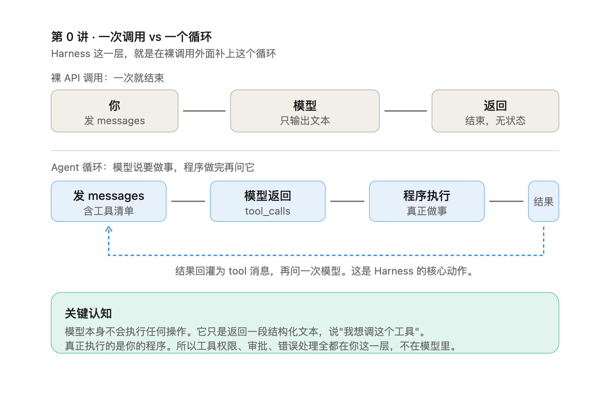

# 第 0 讲：一次 LLM 调用的本质



这一讲只回答一个问题：一次模型调用到底做了什么。答案分两层。裸 API 调用一次就结束。Agent 循环在裸调用外面补上一段重复动作。Harness 这一层补的就是这个循环。

## 裸 API 调用：一次就结束

调用方发 `messages`，模型输出文本，请求返回，然后结束。服务端不保存这次调用的状态。下一次调用必须带上全部历史，模型才会记得前面说过什么。

这就是「无状态」的含义。它不是模型的缺点，是 HTTP 接口的性质。记忆要由调用方自己保存和重新发送。

## messages 的三种角色

DeepSeek API 使用与 OpenAI 兼容的格式。`messages` 数组里的每个元素有一个 `role` 字段。

| role | 作用 |
|---|---|
| `system` | 设定模型的行为和边界 |
| `user` | 用户说的话 |
| `assistant` | 模型之前输出的话 |

官方示例用 `system` 写一句 `You are a helpful assistant.`，再用 `user` 写 `Hello!`。模型根据整个数组生成下一条 `assistant` 消息。

## tool_calls 是结构化文本

模型不会执行任何操作。它返回的是一段文本。当请求里带了 `tools` 清单，模型可能不返回自然语言，而是返回一段结构化文本，说明它想调用哪个工具、参数是什么。这段文字放在 `tool_calls` 字段里。

一次典型返回长这样。

```json
tool_calls: [{ "name": "read_file", "arguments": { "path": "a.txt" } }]
```

这段话的意思是「我想调 `read_file`，参数是 `a.txt`」。它不是函数调用本身。文件没有被读，程序还没有动。真正读文件的是你的代码。

官方文档在 Tool Calls 示例后写明：`get_weather` 函数由用户提供，模型本身不执行具体函数。这是理解 Harness 的关键事实。所有工具权限、审批和错误处理都在调用方这一层，不在模型里。

## Agent 循环：模型说要做，程序做完再问它

把裸调用的返回结果接回输入，就得到循环。一次完整的工具调用分两步请求。

第一步，发 `messages`，附带 `tools` 清单。模型返回 `tool_calls`。

第二步，你的程序执行工具，把结果作为一条 `role` 为 `tool` 的消息追加进 `messages`，再次调用模型。模型看到结果后，返回自然语言或下一个 `tool_calls`。

循环就是「请求、返回、执行、回灌、再请求」的重复。它一直转到模型不再要求调用工具为止。这段重复逻辑就是 Agent 循环，也是 Harness 的核心动作。

## 用脚本看到原始返回

这一讲的产出是一个脚本：调一次 API，把原始返回打印出来。目标不是得到漂亮回答，是看清返回体里到底有哪些字段。

运行环境需要 API key。官方文档要求先把 key 放进环境变量 `DEEPSEEK_API_KEY`，再执行请求。

```bash
curl https://api.deepseek.com/chat/completions \
  -H "Content-Type: application/json" \
  -H "Authorization: Bearer ${DEEPSEEK_API_KEY}" \
  -d '{
        "model": "deepseek-flash",
        "messages": [
          {"role": "system", "content": "You are a helpful assistant."},
          {"role": "user", "content": "Hello!"}
        ],
        "stream": false
      }'
```

这一步能观察到三件事。返回体里有 `choices` 数组。`choices[0].message` 里是模型输出。请求体里没有 `tools` 时，返回体里没有 `tool_calls`。

加上 `tools` 清单后，再发一次请求，观察 `tool_calls` 字段的形状。此时模型只是在请求调用工具，脚本不做任何执行动作。这就是下一讲的起点。

## 本讲小测

1. 一次裸 API 调用结束后，服务端记得上一轮说过什么吗？
2. `messages` 里的三种 `role` 各写谁的话？
3. 模型返回 `tool_calls` 时，文件被读了吗？谁负责读？
4. Agent 循环和裸调用相比，多出来的那一步是什么？

## 边界说明

文中接口行为、字段名和模型名来自 DeepSeek API 一手文档。模型名会更新，调用方式保持不变。当前文档列出的模型名是 `deepseek-flash`，旧名 `deepseek-v4-flash` 等仍可调用，但由同一个模型提供服务。

循环、权限、审批和错误处理属于 Harness 层的设计判断，不属于 API 文档内容。这部分参照 DSH 的实现，在后续各讲展开。
