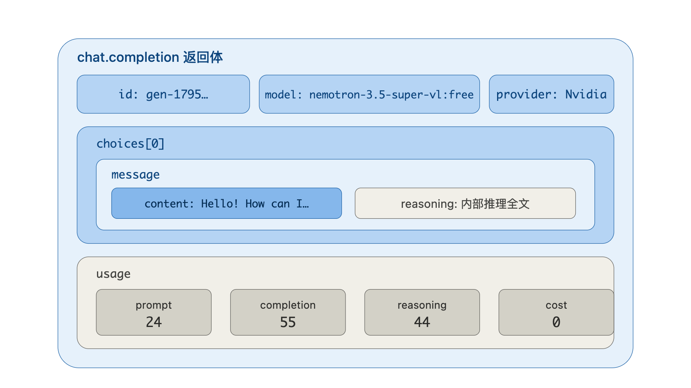
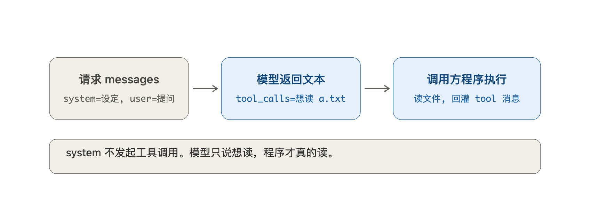

# 第 0 讲：实践篇

本文记录第 0 讲的动手过程。目标是调一次真实 API，打印原始返回，逐字段读懂，再用小测验证理解。讲义讲概念，这篇讲实测。

## 用免费模型做测试

学习阶段不需要付费模型。OpenRouter 聚合多家服务商的模型，列表中标 `:free` 的条目可以免费调用。免费模型适合跑通流程和观察返回结构。验证代码逻辑也够用。

选模型的步骤：

1. 打开 OpenRouter 的模型列表页 `https://openrouter.ai/models`。
2. 筛选带 `:free` 后缀的条目。
3. 在控制台申请 API key，放进环境变量 `OPENROUTER_API_KEY`。
4. 把模型标识填进请求的 `model` 字段。

本次实测用的是 `nvidia/nemotron-3.5-super-vl:free`。模型名会更新，以模型列表页当前显示的标识为准。免费模型通常有速率限制，返回 429 时等待片刻再试。

## 发起一次调用

把第 0 讲讲义里的 DeepSeek 命令换成 OpenRouter 地址。只有三处不同：地址、鉴权头里的环境变量名、`model` 名。`messages` 结构完全不变。

```bash
export OPENROUTER_API_KEY='<在 OpenRouter 控制台申请的 key>'

curl https://openrouter.ai/api/v1/chat/completions \
  -H "Content-Type: application/json" \
  -H "Authorization: Bearer ${OPENROUTER_API_KEY}" \
  -d '{
    "model": "nvidia/nemotron-3.5-super-vl:free",
    "messages": [
      {"role": "system", "content": "You are a helpful assistant."},
      {"role": "user", "content": "Hello!"}
    ],
    "stream": false
  }'
```

key 只通过环境变量传入，不写进脚本文件，也不提交到仓库。

## 原始返回

一次实测的原始返回如下。请求编号和时间戳来自这次调用，重新调用会变化。

```json
{
  "id": "gen-1795366161-Xe1vgvhBinnsnHcauT9g",
  "object": "chat.completion",
  "created": 1795366161,
  "model": "nvidia/nemotron-3.5-super-vl:free",
  "provider": "Nvidia",
  "system_fingerprint": null,
  "service_tier": null,
  "choices": [
    {
      "index": 0,
      "logprobs": null,
      "finish_reason": "stop",
      "native_finish_reason": "stop",
      "message": {
        "role": "assistant",
        "content": "Hello! How can I help you today?",
        "refusal": null,
        "reasoning": "The user said \"Hello!\" which is a standard greeting. I should respond in a friendly, helpful manner and ask how I can assist them today. No special instructions or complex context here. Keep it simple and welcoming.",
        "reasoning_details": [
          {
            "type": "reasoning.text",
            "text": "The user said \"Hello!\" which is a standard greeting. I should respond in a friendly, helpful manner and ask how I can assist them today. No special instructions or complex context here. Keep it simple and welcoming.",
            "format": "unknown",
            "index": 0
          }
        ]
      }
    }
  ],
  "usage": {
    "prompt_tokens": 24,
    "completion_tokens": 55,
    "total_tokens": 79,
    "cost": 0,
    "is_byok": false,
    "prompt_tokens_details": {
      "cached_tokens": 0,
      "cache_write_tokens": 0,
      "audio_tokens": 0,
      "video_tokens": 0
    },
    "cost_details": {
      "upstream_inference_cost": 0,
      "upstream_inference_prompt_cost": 0,
      "upstream_inference_completions_cost": 0
    },
    "completion_tokens_details": {
      "reasoning_tokens": 44,
      "image_tokens": 0,
      "audio_tokens": 0
    }
  }
}
```

## 返回体结构



返回体分四层。顶层是状态与统计。`choices` 是生成结果，`message` 是模型输出，`usage` 是 token 与费用。

## 字段索引

字段分三类。OpenAI 兼容格式的标准字段构成主体。OpenRouter 加了路由与计费字段。Nemotron 作为推理模型加了思考过程字段。

### 顶层字段

| 字段 | 本次值 | 含义 |
|---|---|---|
| `id` | `gen-1795366161-...` | 本次生成的唯一标识。用于追踪、反馈、去重。 |
| `object` | `chat.completion` | 对象类型。非流式固定为此值，流式是 `chat.completion.chunk`。 |
| `created` | `1795366161` | Unix 秒级时间戳。实测换算为 2026-11-23 00:49:21 北京时间。 |
| `model` | `nvidia/nemotron-3.5-super-vl:free` | 实际使用的模型标识，与请求传入的一致。 |
| `provider` | `Nvidia` | OpenRouter 扩展字段。真正执行推理的服务商。 |
| `system_fingerprint` | `null` | 后端配置指纹，用于复现同一份输出。本次服务未提供。 |
| `service_tier` | `null` | 服务层级，如 `default`、`priority`、`flex`。本次未指定。 |
| `choices` | 数组 | 生成结果。默认一条，请求带 `n` 参数时有多条。 |
| `usage` | 对象 | 本次调用的 token 与费用统计。 |

### choices 元素

| 字段 | 本次值 | 含义 |
|---|---|---|
| `index` | `0` | 该结果在 `choices` 数组中的序号。 |
| `logprobs` | `null` | 每个 token 的候选概率。请求未开启时为空。 |
| `finish_reason` | `stop` | 停止原因。`stop` 表示模型自然结束。其他常见值有 `length`、`tool_calls`、`content_filter`。 |
| `native_finish_reason` | `stop` | OpenRouter 扩展字段。上游服务商原始返回的停止原因。 |
| `message` | 对象 | 模型本轮输出的消息。 |

`finish_reason` 是循环的判断开关。当前值为 `stop`，所以第 0 讲的裸调用到此结束。加入 `tools` 请求后，这个值会变成 `tool_calls`，见第 1 讲。

### message 对象

| 字段 | 本次值 | 含义 |
|---|---|---|
| `role` | `assistant` | 消息角色。模型输出固定为 `assistant`。 |
| `content` | 英文问候语 | 给用户的正文。模型要求调用工具时，此字段常为 `null`。 |
| `refusal` | `null` | 模型拒绝回答时的说明。空值表示没有拒绝。 |
| `reasoning` | 思考文本 | OpenRouter 扩展字段。推理模型的思考过程全文。 |
| `reasoning_details` | 数组 | OpenRouter 扩展字段。结构化推理明细。 |

### reasoning_details 元素

| 字段 | 本次值 | 含义 |
|---|---|---|
| `type` | `reasoning.text` | 明细类型。此处为文本推理。 |
| `text` | 思考文本 | 推理文本，内容与 `reasoning` 相同。 |
| `format` | `unknown` | OpenRouter 识别的上游推理格式。本次未识别。 |
| `index` | `0` | 该明细在数组中的序号。 |

### usage 对象

| 字段 | 本次值 | 含义 |
|---|---|---|
| `prompt_tokens` | `24` | 输入 token 数，即请求里两条 messages 合计。 |
| `completion_tokens` | `55` | 输出 token 数，包含推理。 |
| `total_tokens` | `79` | 总 token 数，等于输入加输出。 |
| `cost` | `0` | 本次费用，单位为美元。免费模型为零。 |
| `is_byok` | `false` | 是否使用自带密钥。`false` 表示使用平台 key。 |
| `prompt_tokens_details` | 对象 | 输入 token 细分。 |
| `cost_details` | 对象 | 费用细分。 |
| `completion_tokens_details` | 对象 | 输出 token 细分。 |

输入细分：

| 字段 | 本次值 | 含义 |
|---|---|---|
| `cached_tokens` | `0` | 命中缓存的输入 token。命中部分通常更便宜。 |
| `cache_write_tokens` | `0` | 写入缓存的 token。 |
| `audio_tokens` | `0` | 音频输入 token。本次为纯文本。 |
| `video_tokens` | `0` | 视频输入 token。本次为纯文本。 |

费用细分：

| 字段 | 本次值 | 含义 |
|---|---|---|
| `upstream_inference_cost` | `0` | 上游推理总费用。 |
| `upstream_inference_prompt_cost` | `0` | 上游输入费用。 |
| `upstream_inference_completions_cost` | `0` | 上游输出费用。 |

输出细分：

| 字段 | 本次值 | 含义 |
|---|---|---|
| `reasoning_tokens` | `44` | 推理消耗的 token。输出 55 个 token 中有 44 个用于思考。 |
| `image_tokens` | `0` | 图像输出 token。本次为纯文本。 |
| `audio_tokens` | `0` | 音频输出 token。本次为纯文本。 |

## 三个实测结论

1. `created` 换算为 2026-11-23 00:49:21 北京时间，与调用时刻吻合。这证明返回来自本次请求。
2. `finish_reason` 为 `stop`。没有工具调用，所以裸调用一次结束。
3. `reasoning_tokens` 为 44，占输出 token 的绝大部分。推理模型的思考过程计入输出，也计入费用。换成非推理模型时，`reasoning` 相关字段会消失。

## 责任链路

模型返回 `tool_calls` 时只写出文本，文件没有被读。执行工具的是调用方程序。



`system` 是 `messages` 里的一条角色，只设定模型行为，不发起调用。发起调用的是模型，执行调用的是程序。三者的分工见小测第 3 题。

## 小测与批改

第 0 讲共四题，另有一道追加观察题。每题先列题目和正确答案，再记录当时的回答与判定。学习者可以先自测，再对照答案。

### 第 1 题：服务端是否记得上一轮

**题目。** 一次裸 API 调用结束后，服务端记得上一轮说过什么吗？

**正确答案。** 不记得。服务端不保存调用状态。调用方保存全部历史消息，下一轮请求时重新发送全部历史，模型才能接续上下文。

**当时的回答。** 服务端不记得，需要本地记忆，下一轮带上。

**判定。** 正确。

### 第 2 题：三种角色各写谁的话

**题目。** `messages` 里的三种 `role` 各写谁的话？

**正确答案。** - `system` 写模型行为和边界的设定。
- `user` 写用户说的话。
- `assistant` 写模型先前输出的话。
- 工具执行结果用第四个角色 `tool` 回灌。

**当时的回答。** 只说出三个角色名，没有说明各自写谁的话，也没有提到 `tool`。补全后回答为：`system` 写行为设定，`user` 写用户输入，`assistant` 写模型输出，`tool` 回灌工具执行结果。

**判定。** 补全后正确。

### 第 3 题：tool_calls 与执行责任

**题目。** 模型返回 `tool_calls` 时，文件被读了吗？谁负责读？

**正确答案。** 文件没有被读。模型只在返回里写出 `tool_calls` 文本，表示想调用哪个工具。真正执行读取的是调用方程序。`system` 是 `messages` 里的一条角色，只设定模型行为，不发起工具调用。发起调用的是模型，执行调用的是程序。

**当时的回答。** 初始答案把 `system` 当成发起调用的角色。修正后回答为：文件没有被读，真正读文件的是调用方程序，`system` 只设定行为，模型写出 `tool_calls` 文本，调用方程序执行读取。

**判定。** 修正后正确。

### 第 4 题：Agent 循环多出来的步骤

**题目。** Agent 循环和裸调用相比，多出来的那一步是什么？

**正确答案。** 多出来的是执行工具并把结果回灌。程序执行模型要求的工具，把结果作为一条 `tool` 消息追加进 `messages`，再次请求模型。循环按请求、返回、执行、回灌、再请求重复，直到模型不再要求调用工具。

**当时的回答。** 循环就是请求、返回、执行、回灌、再请求的重复，直到不再要求调用工具为止，Agent 循环结束。

**判定。** 正确。

### 追加观察题：加上 tools 后的返回变化

**题目。** 请求里加上 `tools` 清单再发一次，返回体的 `finish_reason` 最可能变成什么值，`message` 里会多出哪个字段？

**正确答案。** `finish_reason` 变成 `tool_calls`。`message` 里多出 `tool_calls` 字段，内容是模型想调用的工具名和参数。此时模型只是请求调用工具，程序还没有执行。

**当时的回答。** 本题不阻挡过关，当时没有作答。答案可以直接从第 1 讲的循环代码里观察到。

**判定。** 未作答，参考答案如上。

### 批改说明

四道必答题中，第 1 题和第 4 题一次通过。第 2 题漏答角色分工与 `tool` 角色，补全后通过。第 3 题初始答案混淆了 `system` 与模型的责任，修正后通过。按课程规则，错题重做答对才过关。

## 验收记录

| 项 | 结果 |
|---|---|
| 不看文档讲清裸调用与 Agent 循环的区别 | 通过 |
| 讲清 `tool_calls` 是文本、执行在调用方 | 通过 |
| 讲清 `messages` 的四种角色 | 通过 |
| 脚本调通并打印原始返回 | 通过 |

四项全部通过，第 0 讲过关。

## 事实边界

字段含义来自 OpenAI 兼容格式约定与 OpenRouter 公开文档。时间戳换算与 token 数值来自本次实测。字段集合随服务商和模型变化，换模型时以实际返回为准。请求编号每次调用都不同，本文记录的是其中一次。
