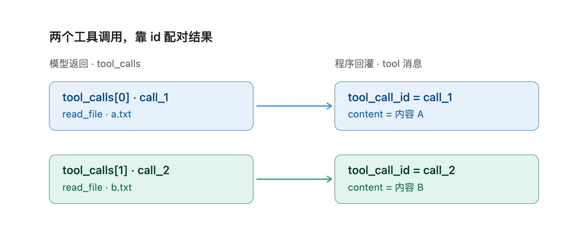

# 第 1 讲实践篇

本文记录第 1 讲的动手过程。目标是把一次调用扩展成 Agent 循环，先离线看清结构，再用真实模型跑通，最后用小测验证理解。讲义讲机制，这篇讲实测。

代码在 `mini-harness/lecture-1/`，共五个文件，按练习顺序排列。

| 文件 | 用途 |
|---|---|
| [agent_loop.py](../../mini-harness/lecture-1/agent_loop.py) | 假模型示例。纯内存，不联网，不需要 key。 |
| [a.txt](../../mini-harness/lecture-1/a.txt) | 示例数据，内容一行 `hello from real file`。 |
| [agent_loop_real.py](../../mini-harness/lecture-1/agent_loop_real.py) | 真实 I/O 对照版。真的读文件，模型回复取工具结果。 |
| [agent_loop_api.py](../../mini-harness/lecture-1/agent_loop_api.py) | 真 API 版。接 OpenRouter 模型，逐轮打印原始报文。 |
| [api-run-sample.log](../../mini-harness/lecture-1/api-run-sample.log) | 真 API 两轮循环的原始报文日志。含 tool_calls 返回、tool 消息回灌与 token 增长，key 已遮蔽。 |

## 循环多出来的五个动作

裸调用是一次请求一次返回。Agent 循环在中间插入工具执行与结果回灌，形成五步。

1. 发请求。请求里带 `tools` 清单，声明模型可以调用哪些工具。
2. 收返回。看 `finish_reason`。值为 `tool_calls` 说明模型要求调工具，值为 `stop` 说明模型说完了。
3. 执行工具。程序按 `tool_calls` 里的工具名和参数执行真实动作。
4. 回灌结果。把执行结果作为一条 `tool` 消息追加进 `messages`。
5. 再请求。带着完整历史回到第 1 步，直到 `finish_reason` 为 `stop`。

`while True` 配 `finish_reason` 判断实现这个循环。次数不预设，由模型决定何时结束。

## 用假模型看清结构

假模型不联网。它按轮次返回固定结果：第一轮返回 `tool_calls` 要求读 `a.txt`，第二轮返回 `stop` 给出回答。

```bash
cd mini-harness/lecture-1
python3 agent_loop.py
```

实测输出：

```
--- 第 1 轮 ---
finish_reason: tool_calls
执行工具 read_file，结果：hello

--- 第 2 轮 ---
finish_reason: stop
模型回复： a.txt 的内容是：hello

=== 完整 messages ===
[0] role=system
[1] role=user
[2] role=assistant
[3] role=tool
[4] role=assistant
```

结果 `hello` 是写死的。假模型从不碰文件系统，`a.txt` 当时也不存在。五条 `messages` 的顺序正是第 0 讲说的「调用方保存全部历史」。循环每转一轮，历史多两条。

## 换成真实文件读取

第二个脚本只改了两处，让示例自洽。

| 位置 | `agent_loop.py` | `agent_loop_real.py` |
|---|---|---|
| `execute_tool` | 返回写死的 `hello` | `open()` 真实读取 `a.txt` |
| 假模型第二轮 `content` | 写死的「内容是 hello」 | 从 `tool` 消息取真实结果 |

只改第一处会自相矛盾。工具读到 `hello from real file`，模型却回答「内容是 hello」。所以第二处也要改，让模型回复用上回灌的结果。

```bash
python3 agent_loop_real.py
```

两版输出只有两行不同。

```
原版     执行工具 read_file，结果：hello
         模型回复： a.txt 的内容是：hello

对照版   执行工具 read_file，结果：hello from real file
         模型回复： a.txt 的内容是：hello from real file
```

这两行一致，证明程序碰了磁盘，也证明模型回复消费了工具结果。相对路径按脚本所在目录解析，运行目录不同也能找到文件。改 `a.txt` 内容再运行，模型回复会跟着变，因为回复取自工具结果。

## tool_calls 的返回形状

真 API 的第一轮返回里，模型的意图写在 `tool_calls` 字段。

```json
{
  "finish_reason": "tool_calls",
  "message": {
    "role": "assistant",
    "content": null,
    "tool_calls": [
      {
        "id": "call-40916370-3803-4fdb-a24c-50d374d2b962",
        "type": "function",
        "function": {
          "name": "read_file",
          "arguments": "{\"path\":\"a.txt\"}"
        }
      }
    ]
  }
}
```

三个要点。`content` 为 `null`，因为这一轮模型不回答用户，只请求调用工具。`arguments` 是字符串，程序要先 `json.loads` 解出参数。`id` 用来对应回灌消息，下一节展开。请求里不带 `tools` 时，返回里不会有这个字段。

## tool_call_id 的配对作用

一轮返回里可能有多个工具调用，每个有唯一 id。回灌消息带同一个 id，模型才知道哪条结果属于哪次调用。



`call_1` 的执行结果带 `tool_call_id: call_1` 回灌，`call_2` 的带 `call_2`。缺了 id，模型分不清内容 A 来自读 a.txt 那次调用，还是读 b.txt 那次。循环体遍历 `tool_calls` 数组逐个执行、逐个回灌，两个调用就执行两次、回灌两条消息，代码不用改。

## 真 API 实测

第三个脚本接真实模型。OpenRouter 聚合多家服务商，列表中标 `:free` 的条目可免费调用。本次用 `nvidia/nemotron-3.5-super-vl:free`。模型名会更新，以列表页当前标识为准。

key 只从环境变量读取，不写进脚本，也不提交到仓库。key 以 `sk-or-` 开头。格式不符会返回 HTTP 401。

```bash
export OPENROUTER_API_KEY='<在 OpenRouter 控制台申请的 key>'
python3 agent_loop_api.py
```

脚本逐轮打印完整请求与响应报文。原始日志存于 `mini-harness/lecture-1/api-run-sample.log`，key 已遮蔽为 `Bearer <redacted>`。下面摘两轮的关键部分。

### 第 1 轮：模型要求调工具

请求带两条消息和 `tools` 清单。响应 `finish_reason` 为 `tool_calls`，`content` 为 `null`，`tool_calls` 要求读 `a.txt`。

```
usage: prompt=318 completion=65 cost=0
finish_reason: tool_calls
content: None
tool_calls: 调用 read_file，参数 {"path":"a.txt"}

执行工具 read_file，结果：hello from real file
```

程序读到真实文件内容，把它作为一条 `tool` 消息回灌。这条消息带 `tool_call_id`，与第 1 轮的调用对应。

### 第 2 轮：模型给出回答

请求里的 `messages` 变成四条：`system`、`user`、上一轮的 `assistant`（带 `tool_calls`）、`tool`（带文件结果）。响应 `finish_reason` 为 `stop`，模型用自己的语言组织回答。

```
usage: prompt=404 completion=44 cost=0
finish_reason: stop
content: a.txt 文件里的内容是：

hello from real file
```

第 2 轮的 `prompt_tokens` 从 318 涨到 404，增量 86 来自回灌的 assistant 消息与 tool 消息。这是「历史在增长」的报文级证据。两轮 `cost` 均为 0，免费模型生效。

### 三版对照

| 版本 | 第 1 轮 finish_reason | 模型回复来源 |
|---|---|---|
| `agent_loop.py` | tool_calls | 写死的字符串 |
| `agent_loop_real.py` | tool_calls | 从 tool 消息取真实结果，机械拼接 |
| `agent_loop_api.py` | tool_calls | 真实模型读 tool 结果后自行组织语言 |

第三个版本是完整闭环。前两个版本用于离线看清循环结构。

## 回答第 0 讲的遗留问题

第 0 讲留过一题：请求加上 `tools` 后，`finish_reason` 变成什么，`message` 多出哪个字段？

实测答案是三处变化。`finish_reason` 从 `stop` 变成 `tool_calls`。`message.content` 变成 `null`。`message` 多出 `tool_calls` 字段，内容是模型想调用的工具名和参数。三处与讲义预测一致。

## 小测与批改

第 1 讲共四题。每题先列题目和正确答案，再记录当时的回答与判定。学习者可以先自测，再对照答案。

### 第 1 题：为什么用 while True

**题目**：循环里为什么要用 `while True`，而不是固定次数？

**正确答案**：因为循环次数不确定。终止条件是 `finish_reason` 为 `stop`，由模型决定何时结束，不由调用方预设次数。模型可能第一轮就说话，也可能连续要求调用多个工具，固定次数会提前截断或空转。`while True` 配 `finish_reason` 判断，能覆盖任意轮次。

**当时的回答**：循环次数不能固定，终止靠判断 `finish_reason` 是否为 `stop`。模型要一步步推进交互和执行，也就是思考、行动、观察。模型不一定按假模型的轮次返回，可能第一轮就说话，也可能连续要求调用多个工具，`while True` 配 `finish_reason` 判断正好覆盖。

**判定**：正确。

### 第 2 题：tool_calls 时的 content

**题目**：`finish_reason` 为 `tool_calls` 时，`message.content` 通常是什么值？为什么？

**正确答案**：`message.content` 通常是 `null`。因为模型这一轮的目的是请求调用工具，不是回答用户。它没有给用户的话可说，正文留空，意图全部放在 `tool_calls` 字段。这个字段写给调用方程序，程序据此执行工具。工具执行完、结果回灌后，下一轮模型才产出正文给 user。

**当时的回答**：初始答案贴的是请求侧的 `messages`，说明如何把需求传给模型，答错了方向。第一次重做给出 `content` 为 `null` 的正确值，但把 `tool_calls` 说成「返回给 user」。修正后回答为：`content` 为 `null`，因为这一轮模型的目的不是回答用户而是请求调用工具，正文留空，意图放在 `tool_calls`。工具执行、结果回灌后，下一轮才产出正文给 user。

**判定**：修正后正确。

### 第 3 题：tool_call_id 的配对作用

**题目**：回灌消息为什么要带 `tool_call_id`？

**正确答案**：`tool_call_id` 用来把执行结果和某一个具体的 `tool_calls` 对应起来。一轮返回里可能有多个工具调用，每个有唯一 id。回灌的 `tool` 消息带上同一个 id，模型才知道哪条结果属于哪次调用。缺了它，模型分不清结果对应关系。

**当时的回答**：初始答案只说「处理连贯性」，方向对但没有说到配对粒度。修正后按配对图回答：`call_1` 的结果带 `tool_call_id: call_1` 回灌，`call_2` 的带 `call_2`。一轮多个调用各有唯一 id，回灌带同一个 id，模型才知道内容 A 来自读 a.txt 那次调用，内容 B 来自读 b.txt 那次。缺了它，模型分不清哪条结果属于哪次调用。

**判定**：修正后正确。

### 第 4 题：多个 tool_calls 的处理

**题目**：模型返回两个 `tool_calls` 时，循环代码要改吗？

**正确答案**：不用改。循环体本来就遍历 `tool_calls` 数组逐个执行、逐个回灌，两个调用就执行两次、回灌两条消息，`for` 循环自然覆盖。`while True` 配 `finish_reason` 判断也不用变，因为两个 `tool_calls` 在同一轮返回里，执行完一起回灌，下一轮再请求。

**当时的回答**：初始答案只说「不需要」，结论对但没有理由。补全后回答为：循环体遍历 `tool_calls` 数组逐个执行、逐个回灌，两个调用就执行两次、回灌两条消息，代码不用改，`for` 循环自然覆盖。`while True` 配 `finish_reason` 判断也不用变，因为两个 `tool_calls` 在同一轮返回里，执行完一起回灌，下一轮再请求。

**判定**：补全后正确。

### 批改说明

四道必答题中，第 1 题一次通过。第 2 题答错方向，经两次修正后通过。第 3 题初始答案过于笼统，第 4 题初始答案缺少理由，两题补全后通过。按课程规则，错题重做答对才过关。

## 验收记录

| 项 | 结果 |
|---|---|
| 讲清 `while True` 的必要性 | 通过 |
| 讲清 `tool_calls` 时 `content` 为 `null` 及原因 | 通过 |
| 讲清 `tool_call_id` 的配对作用 | 通过 |
| 讲清多个 `tool_calls` 的处理 | 通过 |
| 三个脚本全部跑通，真 API 两轮报文核对 | 通过 |

五项全部通过，第 1 讲过关。

## 事实边界

工具清单与返回字段来自 OpenAI 兼容格式约定。假模型的轮次行为是本讲为演示设定的，不代表任何真实模型。真 API 的调用方式、报文结构与 token 数值来自本次 OpenRouter 实测。模型名、字段集合与费率随服务商变化，换模型时以实际返回为准。请求编号每次调用都不同，本文记录的是其中一次。key 只走环境变量，报文日志里已遮蔽。
