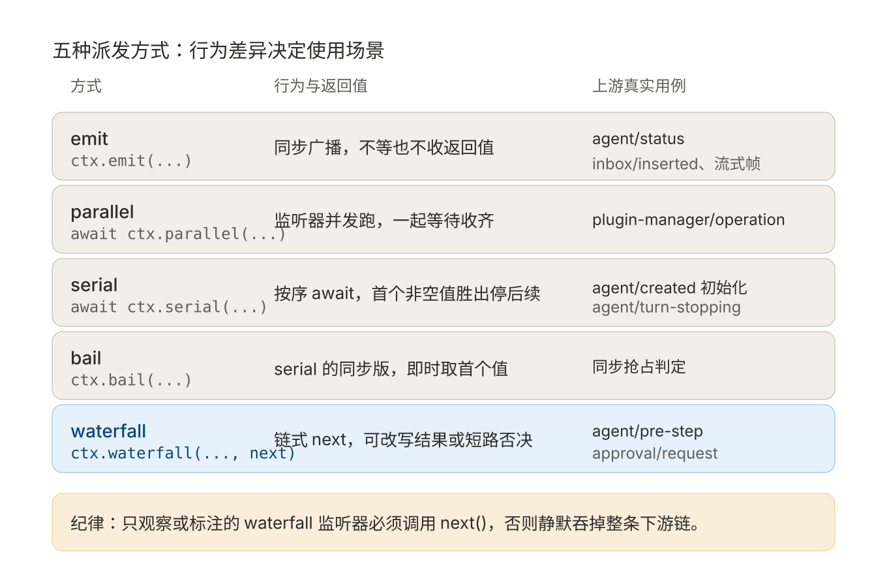

# 第 2 讲：插件化，一切皆插件

前两讲搭出了 Agent 循环。循环里的工具、模型、权限都是写死在代码里的。这一讲解决一个新问题：功能怎么加进来，又不改内核。答案是插件化。

## 它解决什么问题

一个平台会不断加功能。工具、模型后端、权限策略、界面入口，都在变。如果每加一个功能都改内核，内核会越来越臃肿，改动也会互相冲突。

插件化把这件事反过来。内核只提供一套注册机制和生命周期，不认识任何具体功能。功能自己声明"我提供什么"，在加载时注册进去。卸载时，它贡献的一切自动撤销。

这样做有三条收益。功能与内核解耦，加功能不改内核。功能之间互相不知道对方存在，通过事件协作。功能可以独立卸载，不留残留。

代价也明确。间接层变多，一次调用会经过事件分发，调试路径变长。加载顺序由依赖决定，不再由代码位置决定，心智负担上升。

## 三层概念

理解插件化要抓住三个词：插件、上下文、生命周期。

**插件**是一段自我描述的逻辑。它不启动自己，只声明自己贡献什么。上游支持三种形态：函数、带 `apply` 方法的对象、继承 `Service` 的类。需要公开服务时用类，其余情况用函数。

**上下文**是框架交给插件的句柄，通常记作 `ctx`。插件通过它注册工具、监听事件、挂载子插件。插件不直接访问内核对象，只拿到这个受限句柄。

**生命周期**描述一个插件实例从加载到卸载的过程。每个实例有一个运行时句柄，上游称为 fiber。fiber 有六种状态。

| 状态 | 含义 |
|---|---|
| `PENDING` | 已声明，等待依赖就绪 |
| `LOADING` | 插件函数正在执行 |
| `ACTIVE` | 加载完成，正在提供服务 |
| `FAILED` | 插件函数或配置校验抛异常 |
| `UNLOADING` | 清理函数正在执行 |
| `DISPOSED` | 全部拆除完毕 |

## effect：让卸载自动发生

插件化最难的不是加载，是卸载。插件注册了定时器、连接、事件监听、子插件，卸载时必须全部撤销。靠人手写清理代码，漏一个就留一个残留。

上游的解法是 effect。规则是：通过 ctx 注册 API 建立的东西，框架自动跟踪；框架管不到的外部资源，插件用 `ctx.effect()` 包起来，返回一个清理函数。

```python
def setup():
    timer = start_timer()
    def cleanup():
        stop_timer(timer)
    return cleanup

ctx.effect(setup)
```

`setup` 在加载时立即运行，返回的 `cleanup` 在卸载时被调用。插件不需要自己记着何时清理。

这次构建的最小框架把这条规则实现为 `Fiber.add_disposer()`。清理函数按注册顺序的逆序执行。子插件先于父插件卸载。

## 事件：插件之间不互相认识

插件 A 要通知别人，不需要知道谁在听。它发一个事件，感兴趣的插件自己监听。上游把事件称为插件间协作的主要方式。

上游提供五种派发方式，各有用途。

| 方式 | 语义 |
|---|---|
| `emit` | 同步广播，不等待返回值，也不收集 |
| `parallel` | 并发运行所有监听器，一起等待 |
| `serial` | 按序运行，第一个返回非空值的监听器胜出并终止后续 |
| `bail` | `serial` 的同步版本 |
| `waterfall` | 链式转换，监听器拿到 `next`，可改写或短路 |

`waterfall` 最值得注意。每个监听器拿到当前值和 `next()`，调用 `next()` 把值传给下游，拿到返回值后再加工。它也可以不调用 `next()` 直接返回，这样下游和默认值都被短路。上游把这种行为称为否决。

有一条纪律：只观察或标注的监听器必须调用 `next()`。忘了调用会静默吞掉整条下游链路。

### 五种方式的使用场景



选择派发方式时依次问两个问题。第一，要不要返回值。第二，要返回值时，多个监听器是争抢还是协作。答案决定用哪一种。

| 方式 | 典型场景 | 判断标准 |
|---|---|---|
| `emit` | 状态播报、审计日志、流式帧推送 | 只是告知，没有监听器需要拿结果影响主流程 |
| `parallel` | 多个互不依赖的监听器都要完成 | 要等所有人做完，顺序无所谓，结果互不覆盖 |
| `serial` | 有序初始化、认领式处理 | 依赖顺序，或第一个给出有效结果的监听器负责处理 |
| `bail` | 同步权限检查、同步配置命中 | 不能等待的同步路径，且只需首个有效值 |
| `waterfall` | 拦截、包装、策略接管 | 一个决定需要多层加工，或某个插件要能拦下请求自行作答 |

`emit` 的监听器同步执行一遍。返回的 Promise 和值都不等待、不收集。上游的 `agent/status` 播报状态翻转，`agent/inbox/inserted` 播报消息进入收件箱，`agent/assistant-stream` 发布流式帧，三者都标注为 `emit`。

`parallel` 并发运行全部监听器，`await` 后一起等待完成。上游的 `plugin-manager/operation` 用它，让多个订阅者独立响应一次管理调用。

`serial` 按序 `await`。第一个返回非 `null`、`false`、`undefined` 的监听器胜出，后续不再执行。它适合两类场景。一类是有序初始化，例如 `agent/created` 按顺序完成所有监听器后才 resolve，其中一个抛错就使创建失败并跳过后续。另一类是认领式处理，按序询问谁能处理，谁先接住谁负责。

`bail` 是 `serial` 的同步版本。行为相同，但不返回 Promise，用于不能等待的同步路径。

`waterfall` 把请求交给一条链。监听器收到当前值和 `next()`。调用 `next()` 时，请求进入下游，监听器拿到返回值后可再加工。不调用 `next()` 就直接返回时，下游和默认值都不执行，这叫否决。上游的 `agent/pre-step` 用它拒绝某一步或替换进入步骤的消息，`approval/request` 用它让策略插件代替用户给出审批结果，`agent/request-error` 用它让监听器接管失败恢复或委派给下游。

有一处事实边界要说明。`bail` 的适用场景由语义推出。本次查阅的上游子系统文档里，没有找到标注为 `bail` 的具体事件。其余四种的用例都能在源码标注或教程中定位。

记住一句话。只通知用 `emit`，都要做用 `parallel`，抢着做用 `serial`，同步抢用 `bail`，要加工或拦截用 `waterfall`。

## 上游源码落点

本节的事实来自本地源码副本（alpha.2，commit `4b399c39`）。

| 事实 | 位置 |
|---|---|
| 插件三种形态、`apply(ctx)` 约定、`ctx.plugin()` 返回 fiber | `docs/cordis-tutorial/01-first-plugin.zh.md:5,53-77,64` |
| effect 与 disposer、`fiber.dispose()` 递归卸载、逆序清理 | `docs/cordis-tutorial/02-lifecycle-and-effects.zh.md:5,64-66,94` |
| 六种 fiber 状态 | `vendor/cordis/src/fiber.ts:177-183` |
| 五种事件派发方式的语义 | `docs/cordis-tutorial/04-events.md:82-90` |
| 派发模式的源码枚举 | `vendor/cordis/src/events.ts:31` |
| waterfall 短路与必须调用 `next()` 的纪律 | `docs/cordis-tutorial/04-events.md:96,136-138` |

源码里状态枚举的实际顺序是 `PENDING`、`LOADING`、`ACTIVE`、`FAILED`、`DISPOSED`、`UNLOADING`。教程示意图把 `UNLOADING` 画在 `DISPOSED` 之前，是执行顺序的表达，不是枚举顺序。本节以源码为准。

## 移植到骨架

代码在 `mini-harness/lecture-2/`，两个文件。

| 文件 | 内容 |
|---|---|
| `plugin_core.py` | 最小框架。`FiberState`、`Fiber`、`Context`、`App` 四个类。 |
| `demo.py` | 演示插件。加载、事件广播、waterfall 拦截、卸载。 |

动手任务扩展代码 `demo_task2.py` 与 `demo_task4.py` 的实测见第 2 讲实践篇。

运行：

```bash
cd mini-harness/lecture-2
python3 demo.py
```

实测输出：

```
=== 加载插件 ===
[加载] greeter
  [heartbeat] 启动定时器
  [greeter] 打开连接
  [greeter] 启动计时器
[加载] shouter

=== 事件广播 emit ===
  [greeter] 收到 greet: world
  [shouter] 收到 greet: world

=== 链式拦截 waterfall ===
  render('hello') -> 'HELLO'
  render('blocked words') -> '** VETO **'

=== 卸载主插件（子插件随父一起）===
  greeter 卸载前状态: ACTIVE
  [heartbeat] 清理定时器
  [greeter] 停止计时器
  [greeter] 关闭连接
  greeter 卸载后状态: DISPOSED

=== 卸载后事件监听已移除 ===
  [shouter] 收到 greet: again
```

输出里有四个要点。

第一，两个插件都收到 `greet`，但它们互不认识。它们只是在自己的 `apply` 里 `ctx.on("greet", ...)`。

第二，`render('blocked words')` 返回 `** VETO **`。第二个监听器短路了，没有调用 `next()`，默认值没执行。但第一个监听器仍在返回路上做了大写，所以结果是 `** VETO **` 而不是 `** veto **`。短路只截断下游，不跳过已经在外层的加工。

第三，卸载 `greeter` 时，先清理子插件 `heartbeat` 的定时器，再按注册逆序清理 greeter 自己的两个 effect：先停后启动的计时器，再关先打开的连接。子插件随父卸载，不用单独记。

第四，卸载后再发 `greet`，只有 `shouter` 收到。`greeter` 的监听器随 fiber 一起被移除。这是 effect 自动撤销的可见证据。

## 要不要这样做

插件化不是没有代价。判断是否采用，看三个条件。

功能会不会持续增加。如果功能固定，直接写代码更简单，插件层是多余的间接。

功能之间是否需要独立演进。如果所有功能总是一起发布，拆成插件的收益有限。

是否需要运行时装卸。热重载、按需加载、第三方扩展，这些场景才真正需要完整的生命周期。没有这些需求，可以先只留注册机制，不做卸载。

对要建的平台，建议先保留"功能自描述并注册"这一层，把完整生命周期作为后续能力。理由是可逆性：注册机制先加上成本很低，将来要卸载时再补 effect 和 disposer，不需要推翻已有结构。

## 动手任务

1. 运行 `python3 demo.py`，确认输出与本讲一致。
2. 在 `demo.py` 里加一个插件，也监听 `greet`，观察它是否自动收到事件。
3. 给 `greeter` 再加一个 `ctx.effect()`，确认卸载时它的清理函数也执行。
4. 选做：写一个不调用 `next()` 的 waterfall 监听器，观察默认值被吞掉的效果。

任务 1 到 3 不需要网络。本讲代码全部离线运行。

## 本讲小测

1. 插件化解决的核心问题是什么？
2. `ctx.effect()` 的作用是什么？为什么外部资源要包起来？
3. fiber 卸载时，子插件和清理函数的执行顺序是什么？
4. waterfall 监听器不调用 `next()` 会发生什么？这条纪律为什么重要？
5. `approval/request` 为什么用 waterfall，而不用 serial？提示：策略插件要代替用户作答，需要的是首个胜出，还是决定返回什么？

## 事实边界

插件三形态、`apply(ctx)` 约定、effect 与 disposer、五种派发方式的语义来自上游中文教程。六种 fiber 状态来自 `vendor/cordis/src/fiber.ts` 的枚举。最小框架是本讲为演示自己写的简化实现，行为与上游对齐但不覆盖依赖注入、配置覆盖与热重载。要不要采用插件化的判断是设计取舍，不是源码事实。
