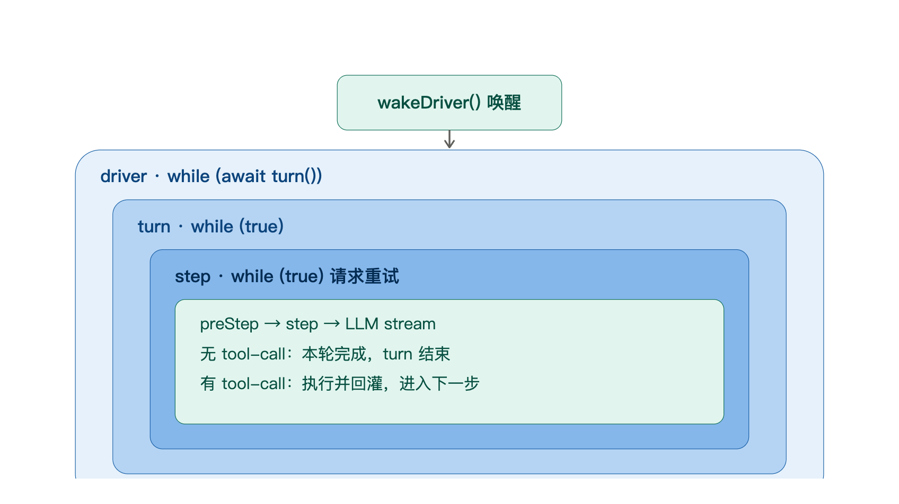

# 第 3 讲：Agent 循环与状态机，长任务怎么被驱动、怎么停

前两讲搭出了循环和插件。这一讲回答一个更根本的问题：一个可能跑很久、调很多次工具的任务，靠什么一层层驱动下去，又靠什么停下来。

先给结论：上游的「Agent 循环」不是一个 `while` 加一个步数上限，而是**三层嵌套循环 + 事件唤醒**。源码里没有 `maxSteps` 或轮次预算。停止不看步数，看数据。

## 三层循环



同一个 Agent 从被唤醒到安静下来，经过三层循环。每层管一件事，互不越界。

| 层级 | 代码位置 | 管什么 |
|---|---|---|
| driver | `agent-loop/src/agent.ts:273` `while (await this.turn()) {}` | 一个任务跨多个 turn 时，要不要再跑一轮 |
| turn | 同文件 `:340` `while (true)` | 一个回合内的多步：调工具后再问模型 |
| step | 同文件 `:439` `while (true)` | 单次请求失败后的重试 |

入口不是直接调循环，而是 `wakeDriver()` → `kick()`（`:232`、`:271`）。`kick()` 的 `finally` 把 phase 归位到 idle；如果期间又有人请求唤醒且 inbox 里还有输入，就再调一次 `wakeDriver()`（`:281`）。闭环就在这里合上。

**工具调用和追加消息分属不同层**，这是最容易混的一点。一次回答里调 3 次工具，3 次都在同一个 turn 的 step 循环里（`:340`）：每调一次工具就是一步，结果回灌后再进入下一步。用户追加一条消息让同一个 Agent 再跑一轮，那是 driver 层（`:273`）的事——`turn()` 返回 `true`，driver 才开下一轮。

分界点是 `turn()` 的返回值：

```ts
if (!this.inbox.hasPending) return false
// ...
phase.step = 0
return true
```

`:423` 这一行说明白了：inbox 里没有待处理输入，turn 返回 `false`，driver 循环结束。有新输入就返回 `true`，driver 再跑。而工具调用根本不经过 driver——它在 turn 内部靠 `target = 'next-step'`（`:396`）回到 step 循环。

一句话：**工具调用是「一个回合内的多步」（turn 层），新消息是「多个回合」（driver 层）**。

## 怎么停：数据判定，不数步数

这是本讲最反直觉的一点。上游包文档明确写着 **"No built-in turn budget"**（`agent-loop/README.md:238`）——没有 `maxSteps`，没有轮次预算。

真正的完成判定是本步没有 tool-call block（`agent.ts:576-577`）：

```ts
const toolCalls = message.content.filter(block => block.type === 'tool-call')
if (toolCalls.length === 0) return { kind: 'completed' }
```

换句话说，模型这一轮没要求调工具，就算答完了。模型自己决定何时停，框架不设上限。对比第 1 讲：我们写的最小循环靠 `finish_reason == "stop"` 停；这里不看那个字段，看「有没有工具调用」。

不过「没有步数上限」不等于「停不下来」。终止原因汇入 `TurnEndReason`（`session/src/types.ts:216-245`），源码里是一个可合并扩展的联合类型，共 7 种：

| 原因 | 含义 | 由谁产生 |
|---|---|---|
| `completed` | 本步无工具调用 | loop 运行时 |
| `max-tokens` | 至少一个 step 触顶输出上限 | loop 运行时 |
| `error` | 步骤失败，`error` 是结构化失败 | loop 运行时 |
| `aborted` | 取消请求打断当前 turn | loop 运行时 |
| `blocked` | `agent/pre-step` 拒绝进入 | loop 运行时 |
| `interrupted` | 崩溃遗留的未闭合 turn 被补记 | 恢复逻辑，**非运行时产生** |
| `forked` | fork 边界处补记源会话的未闭合 turn | fork 种子，**非运行时产生** |

运行时真正常见的是前五类；后两类是崩溃恢复与分叉时补写的收尾标记，loop 本身不会 emit。之前口头讲解简化为「completed / max-tokens / error / aborted 四类」，是略去了 `blocked` 和两个恢复标记，以源码这个表为准。

### max-tokens 为什么是粘性的

输出触顶后，即使后面某一步正常完成，turn 的结果仍然算 `max-tokens`，不会被降级成 `completed`（`:364-369`）：

```ts
// max-tokens is sticky: once any step hits the ceiling, later steps
// that complete normally must not downgrade the turn outcome.
if (turnEnds === null || turnEnds.kind !== 'max-tokens') turnEnds = stepEnd
```

原因在 `turn/end` 日志的语义：它是这个 turn 写盘的唯一终态结论，会被投影读取。如果某一步被截断了，后续 step 正常完成后把它改成 `completed`，等于抹掉「这次输出不完整」这个事实，下游无从知道内容被截断。粘性是为了保住这个信号。

所以用户看到输出被截断后追问一句，这一轮的结论仍是 `max-tokens`——先到的信号被保护，不会被后续 completed 覆盖。

### 停止前的可拦截点

turn 结束前有一个检查点 `agent/turn-stopping`（`:390-396`），用 `serial` 派发。监听器可以在这里塞入新输入，让循环续跑：

```ts
if (turnEnds && this.inbox.nextStep.length === 0) {
  await this.dispatch.serial('agent/turn-stopping', { turn, signal })
  signal.throwIfAborted()
}
if (turnEnds && this.inbox.nextStep.length === 0) break
```

这说明**停止条件本身也是 inbox 数据**：监听器塞一条 `next-step` 输入，第二个 `if` 就不成立，循环继续。

## 状态：两半分开，没有大状态机

找一个叫 `paused` 的任务状态，是找不到的。上游把「状态」拆成两半。

**一半是 driver 生命周期**，一个显式的小状态机 `Phase`（`:52-60`）：

```ts
type Phase =
  | { kind: 'idle'; lastTurn: number }
  | { kind: 'maintenance'; abort: AbortController; lastTurn: number; wakeRequested: boolean }
  | { kind: 'running'; abort: AbortController; turn: number; step: number; wakeRequested: boolean }
```

对外只暴露 `idle / running` 两种（`runtime-types.ts:129-136`），`maintenance` 是内部维护态。这三者描述的是「driver 现在有没有在干活」，不是「任务进行到哪一步」。

**另一半是任务进展**，写进 session 日志：`turn/start`、`step/start`、`step/end`、`turn/end`（`:332`、`:357`、`:384`、`:418`）。这些是不可变事件，由纯函数投影折叠出当前视图（`agent/src/projection.ts:31-43`）：

```ts
case 'turn/start': return { ...state, openTurnStartSeq: event.seq, lastTurn: event.data.turn }
case 'turn/end':   return { ...state, openTurnStartSeq: null }
```

日志是唯一真相。没有 `paused` 这样的可写任务状态——所谓「暂停/恢复」靠 durable 日志 + inbox 队列 + AbortSignal 三者配合实现，不需要一个可变状态位。

## 取消：协作式，默认清空输入

`cancel()` 的实现很短（`agent.ts:189-199`）：

```ts
cancel(cause: AgentCancelCause, options: CancelOptions = {}): void {
  try {
    if (!options.keepInbox) this.inbox.clear()
  } finally {
    if (this.phase.kind !== 'idle') {
      if (!options.keepInbox) this.phase.wakeRequested = false
      this.phase.abort.abort(cause)
    }
  }
}
```

三件事要分清。

**取消粒度**：`abort(cause)` 把当前 phase 的 `AbortController` abort 掉。`signal.throwIfAborted()` 贯穿 step 各环节，实现协作式取消。结果是当前 turn 提前结束，记为 `{ kind: 'aborted', reason: cause }`（`:400-403`），turn 仍正常写 `turn/end`。agent 本身没销毁，下次还能被唤醒。

**cause 分类**：`user / parent / hook / disposed`（`:93-108`），由 `abortedCancelCause()` 从 signal 的 reason 里拷出可写字段。

**未消费输入**：默认清空——`if (!options.keepInbox) this.inbox.clear()`。这是关键开关。取消的语义是「这个请求作废」，所以默认连输入一起丢弃；只有明确传 `keepInbox: true` 表示「暂停待续」时才不清。

把这三节连起来看，第 3 讲的主线是：**日志是唯一真相，但入口数据是会被显式处理的**——终态写完就不改（粘性），取消默认清输入（`inbox.clear()`），新输入决定要不要再开一轮（`hasPending`）。

## 上游源码落点

本节事实来自本地源码副本（alpha.2，commit `4b399c39`）。

| 事实 | 位置 |
|---|---|
| driver 循环 `while (await turn())` | `packages/core/agent-loop/src/agent.ts:273` |
| turn 内 step 循环 | 同文件 `:340` |
| step 内重试循环 | 同文件 `:439` |
| 完成判定：无 tool-call block | 同文件 `:576-577` |
| 无内置轮次预算 | `packages/core/agent-loop/README.md:238` |
| max-tokens 粘性与保护 | `agent.ts:364-369` |
| `agent/turn-stopping` 拦截点 | 同文件 `:390-396` |
| turn 返回值与 `hasPending` | 同文件 `:423-428` |
| 终止原因七种枚举 | `packages/core/session/src/types.ts:216-245` |
| `Phase` 三态 | `agent.ts:52-60` |
| 对外暴露 idle/running | `packages/core/runtime-types.ts:129-136` |
| 日志投影纯函数 | `packages/core/agent/src/projection.ts:31-43` |
| `cancel()` 与 `keepInbox` | `agent.ts:189-199` |

## 移植到骨架

本讲代码做一个**带终止条件的会话驱动器**，把三层循环、inbox 驱动、终止判定和取消都跑一遍。代码与实测见第 3 讲：实践篇。

设计上保留四件事：inbox 分 `next-turn` 与 `next-step` 两级；日志只追加不改写；完成判定看有没有工具调用；取消默认清 inbox。省略的是重试、并发工具、崩溃恢复和插件拦截——这些留给后续讲次。

## 要不要这样做

不设轮次上限，把停止权交给模型，是一条有前提的设计。

前提是模型会自己停。在工具调用能被正确回灌、上下文不会被撑爆的前提下，让模型判断「答完了」是可行的。若模型陷入反复调同一工具的循环，框架这一层没有步数兜底，需要靠工具的幂等性、预算插件或外部超时来兜。

前提是日志完整。停止结论、截断信号都写进不可变日志，代价是存储与投影的复杂度；换来的是可恢复、可审计、可 fork。如果任务短到不需要恢复，直接用一个内存状态变量更简单。

对要建的平台，建议保留「日志投影 + inbox 驱动」这一层，把崩溃恢复和 fork 作为后续能力。理由和第 2 讲一样：日志先加上成本可控，将来要恢复时数据已经在，不需要改结构。

## 动手任务

1. 运行基线脚本，确认输出与本讲一致，重点看三层循环各自的边界。
2. 让假模型在一次回答里连续调 3 次工具，确认 3 次都在同一个 turn 内，stop 后回到 driver。
3. 在不同 turn 各追加一条消息，观察 driver 如何再开一轮；把 inbox 清空后确认 driver 停止。
4. 选做：模拟一次输出触顶（max-tokens），再让后续 step 正常完成，确认 turn 结论不被降级。

本讲代码全部离线运行，不需要网络。

## 本讲小测

1. 一个 Agent 回答用户前先调了 3 次工具。这 3 次发生在哪层循环？用户追加一条消息让它再跑一轮，又在哪层？
2. 有人说「这个 Agent 设了 `maxSteps=20`，超过就停」。这句话对不对？真正的完成判定是什么？
3. `max-tokens` 是粘性的，代码专门加了保护不让它被后续 completed 覆盖。为什么？用户看到截断后追问一句，这轮算 completed 还是 max-tokens？
4. 上游没有 `paused` 状态。用户取消时会怎样？取消的是 step、turn 还是 agent？未消费的输入去哪？

## 事实边界

三层循环、终止判定、粘性保护、取消语义、状态投影均来自本地源码副本的实测行号。最小会话驱动器是本讲为演示自己写的简化实现，行为与上游对齐但不覆盖重试、并发工具、崩溃恢复与插件拦截。要不要设轮次上限的判断是设计取舍，不是源码事实。
