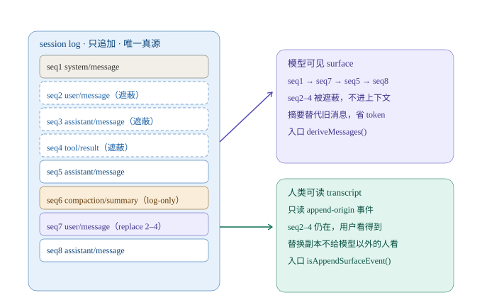

# 第 4 讲：实践篇

本文记录第 4 讲的动手过程。讲义讲 append-only 日志、双投影、surfaceOp 与重放即重算，这篇讲实测。目标是跑通一个最小日志与投影实现，验证四件事：两个投影何时一致、遮蔽式压缩不删事件、不写事件的内容不进模型视图、崩溃补记走同一条折叠路径。最后记录小测批改。

代码在 `mini-harness/lecture-4/`，共两个文件，全部离线运行，不需要网络和 key。

| 文件 | 用途 |
|---|---|
| [session_core.py](../../mini-harness/lecture-4/session_core.py) | 最小日志核心。`Session` 只追加日志、`fold_surface()` 纯折叠、`derive_messages()` 模型视图、`transcript()` 人类视图、`interrupted_closers()` 崩溃补记、`replay()` 重放。 |
| [demo.py](../../mini-harness/lecture-4/demo.py) | 四个场景：基础双投影、遮蔽式压缩、模型可见不变量、崩溃恢复。 |

讲义里的概念图 seq 从 0 起；下面这张实测对照图的 seq 从 1 起，与本文 demo 输出逐条对齐。两图结构相同，仅编号起点不同。



## 任务 1：跑通基线

```bash
cd mini-harness/lecture-4
python3 demo.py
```

四个场景一次跑完。下面按场景贴关键输出并解读。

## 场景 1：基础 append + 双投影

```
[日志] 共 5 条事件，seq 1..5
[模型视图 derive_messages]
    system/message: 你是助手
    user/message: 查一下北京天气
    assistant/message: 我来查
    tool/result: 晴 25℃
    assistant/message: 北京今天晴，25℃
[人类视图 transcript]
    system/message: 你是助手
    user/message: 查一下北京天气
    assistant/message: 我来查
    tool/result: 晴 25℃
    assistant/message: 北京今天晴，25℃
   → 此时两个视图一致：都是 5 条消息
```

五条事件依次追加。两个投影此刻完全一致——因为还没有 `replace` 事件，surface 的节点序列就是所有 surface 事件的 seq 顺序。

对应上游：`fold_surface()` 的 `append` 分支只做一件事（`surface.ts:582-583`）——`state.nodes.push(plan.seq)`。没有遮蔽时，模型视图 = surface 事件的有序投影。

一个细节：`tool/call` 这类事件没有加进来，因为场景 1 只追加了五类 surface 事件中的四类（system/user/assistant/tool-result）。日志里非 surface 事件再多，也不影响这两个视图。

## 场景 2：压缩 replace —— 遮蔽不是删除

```
[log#06] compaction/summary {...}
[log#07] user/message {'text': '[摘要] 用户问北京天气，查到晴 25℃'}
[log#08] assistant/message {'text': '已为你查询完毕'}

[日志] 共 8 条事件（压缩没有删任何一条）
[surface nodes]  [1, 7, 5, 8]
[replace 记录]  [{'seq': 7, 'start': 2, 'end': 4, 'shadowed': [2, 3, 4]}]

[模型视图] —— seq2-4 不见了，被 seq7 的摘要取代
    system/message: 你是助手
    user/message: [摘要] 用户问北京天气，查到晴 25℃
    assistant/message: 北京今天晴，25℃
    assistant/message: 已为你查询完毕
[人类视图] —— seq2-4 是 append-origin，仍然在
    system/message: 你是助手
    user/message: 查一下北京天气
    assistant/message: 我来查
    tool/result: 晴 25℃
    assistant/message: 北京今天晴，25℃
    assistant/message: 已为你查询完毕
   → 同一份日志，模型看到 4 条、用户看到 6 条，谁都没改日志
```

这是本讲最重要的一屏。三点要读出来：

**第一，日志没变。** 追加摘要前后，事件从 5 条变成 8 条——`compaction/summary`（seq6）、摘要消息（seq7）、新的助手消息（seq8）都是**新增**的。原来的 seq2–4 一条没少。这就是「遮蔽不是删除」在事实层的证据。

**第二，模型视图变了。** `surface nodes` 从 `[1,2,3,4,5]` 变成 `[1,7,5,8]`——seq2–4 三个索引被 seq7 一个索引替换。模型看到的从 5 条变成 4 条，旧的三轮对话被一条摘要顶替。省的是模型的 token，不是磁盘的数据。

**第三，人类视图没变。** `transcript()` 只读 `surface_op == 'append'` 的事件。seq7 的 `surfaceOp` 是 `replace`（字典），不是 `'append'`，所以它作为「摘要副本」不进人类视图；而 seq2–4 是 append-origin，仍然完整可读。用户看过的对话不会因为一次压缩而消失。

这正是小测第 1、2 题的实测答案：**事件还在 `log` 里，模型看不到是因为 `nodes` 被 `splice` 遮蔽，两个视图读同一份日志但口径不同**。

一个实现细节：`nodes` 里存的是 seq 索引，不是事件本体。所以 `splice` 只改一个整数数组，代价是 O(区间长度)，完全不碰事件数据。

## 场景 3：模型可见 ⟺ 已记录

```
[日志] 共 3 条；seq2 有文本但没有 surfaceOp
[模型视图] —— 临时指令没有 surfaceOp，被 derive 正确跳过
    user/message: 正常问题
    assistant/message: 回答
   → 重放这段日志，得到的模型输入一模一样：可复现
```

脚本往日志里塞了一条有文本、但**没有 `surfaceOp`** 的 `system/message`（seq2），模拟「临时拼一段系统提示进请求，但不写事件」。结果它被 `derive_messages()` 正确跳过——因为 `fold_surface()` 对没有 `surfaceOp` 的事件直接 `continue`，不让它进节点序列。

这就是不变量 `Model-visible ⟺ logged` 的实测。上游 `index.ts:761-768` 的注释说得很清楚：没有标记的原始事件（一个 chunk、一个 turn 边界）**正确地缺席**模型历史。

价值在重放时显现：如果这段临时指令真的进了模型请求却没记进日志，重放时它就会消失，同样的请求两次结果不同。禁止它进来，保住的是可复现性。这也是小测第 3 题用户用自己的话答出的那层——**日志是记录事实、可审计可溯源的地方，绕过它的内容破坏了溯源，也就破坏了复现**。

## 场景 4：崩溃恢复 —— 补记事件走同一条折叠路径

```
[log#01] turn/start {'turn': 1}
[log#02] step/start {'turn': 1, 'step': 1}
[log#03] user/message {'text': '开始任务'}
[log#04] tool/call {'id': 'c1', 'name': 'weather'}

[补记事件] 崩溃检测出 3 条缺失收尾：
    step/end {'turn': 1, 'step': 1}
    turn/end {'turn': 1, 'reason': 'interrupted'}
    tool/result {'id': 'c1', 'text': '结果未知（崩溃）', 'is_error': True}

[重放恢复后] 日志 4 条 → 7 条
[崩溃前视图]  ['user/message: 开始任务']
[恢复后视图]  ['user/message: 开始任务', 'tool/result: 结果未知（崩溃）']
[两次重放一致?]  False
```

模拟一次崩溃：写了 `turn/start`、`step/start`、`user/message`、`tool/call`，但没有 `step/end`、`turn/end`、`tool/result`。`interrupted_closers()` 检测出三个缺口，各补一条收尾事件。

**「两次重放一致? False」是预期结果，不是错误。** 补记的 `tool/result` 是新增事实——「这个工具调用没有拿到结果」。恢复后模型应当看到这条错误结果，而不是假装它不存在。视图从 1 条变成 2 条，正是恢复起作用的证据。

**关键不在视图是否改变，而在补记事件怎么进来**：`replay()` 直接把补记事件追加进日志，然后调用同一个 `derive_messages()` / `fold_surface()`。没有「恢复专用分支」，没有第二份聊天记录。对应上游 `validation.ts:381-390` 的注释——种子事件通过**与实时追加、整段折叠完全相同的转换**被接受。

这也是小测第 4 题的实测答案：**补记的是普通事件，走同一条 fold 路径进入状态**。

## 小测与批改

第 4 讲共四题。首轮第 1 题只答了半句，第 2–4 题答案与讲义原文高度接近，用户被要求用自己的话补一句复述；补答后四题全部通过。每题先列题目和正确答案，再记录作答与判定。

### 第 1 题：摘要压缩后原始事件

**题目**：模型上下文里有一段摘要，把之前 10 轮对话压缩了。那 10 轮对话的原始事件还在吗？在哪个数据结构里？模型为什么看不到它们？

**正确答案**：三问分别答。在——原始事件完整保留在 `log`（`SessionEvent[]`，`index.ts:305`）里。哪个结构——`log`。为什么看不到——surface 折叠时 `replace` 把这些区间从 `nodes` 里 `splice` 掉（`surface.ts:585`），而 `deriveMessages()` 只遍历 `nodes`（`index.ts:779-787`），被遮蔽的 seq 不在遍历范围内。

**当时的回答**：只答「事件还在」，缺数据结构和机制两问。

**重答**：补全——是 `log`（`SessionEvent[]`），被遮蔽的 seq1–3 完整保留；折叠时 `replace` 把它们从 `nodes` 里 splice 掉，`deriveMessages()` 只遍历 `nodes`，所以不进模型上下文。

**判定**：重答后正确。

### 第 2 题：replace 是不是删除

**题目**：`replace` 用 `splice` 改动了 `nodes`。有同学说「这就是删除，日志被改了」。指出他错在哪，并说出 `nodes` 和 `log` 的关系。

**正确答案**：`splice` 改的是 `nodes`（视图节点序列），不是 `log`。原始事件完整留在 `log` 里。精度补充：`nodes` 存的是 seq 索引，不是事件本体；两者是「视图指针 vs 事实存储」的关系。

**当时的回答**：答对核心——replace 是遮蔽不是删除，splice 动的是 nodes，原始事件还在 log 里，两份投影读同一份日志各取所需。但答案与讲义原文逐字一致。

**判定**：正确。补精度点：`nodes` 存的是 seq 索引，遮蔽是 O(区间) 操作，不碰事件数据。

### 第 3 题：模型可见 ⟺ 已记录

**题目**：按「模型可见 ⟺ 已记录」不变量，如果想在发请求前临时插一句系统提示（不写日志），可以吗？说出理由与正确做法。

**正确答案**：不可以。任何进入模型请求的内容都必须能从日志重建；新内容必须先写成事件才能可见（`AGENTS.md:139`）。规则不是「不能给模型看新东西」，而是「新东西必须先写事件」。正规路径：先追加 `compaction/summary`，再追加带 `surfaceOp:replace` 的 `user/message`（`region.ts:497-515`），顺序不能反。

**当时的回答**：答对——不可以，必须能从日志重建，想给模型看新东西先写事件。但与讲义原文高度一致。

**判定**：正确。补充边界：不是不能给模型看新内容，而是必须先记录后可见。

### 第 4 题：崩溃恢复

**题目**：Agent 跑到一半崩溃，`step/start` 写了但没有 `step/end`。重启后系统怎么处理这个「半截 turn」？补记的事件走什么路径进入状态？

**正确答案**：`repair.ts:53-97` 补 `step/end`、`turn/end`（reason 为 `interrupted`），`repair.ts:187-193` 给未出结果的工具合成错误 `tool/result`；补记仍是普通事件，走 `replaySurfaceEvent`（`validation.ts:381-390`）进入同一折叠路径。重放不是「加载聊天记录」，是把日志重新折叠一遍。

**当时的回答**：完整正确——补记机制、行号、同一折叠路径、重放即重算都答到了。

**判定**：正确，四题中答得最完整的一题。

### 复述要求与补答

因为第 2–4 题答案与讲义原文逐字接近，用户被要求用自己的话补一句：为什么必须先写事件。补答如下：

> 既然是日志的原理，那么日志就是追加，记录事实的地方，数据可以审计，可以溯源。

**判定**：过关。这句抓住了本质——日志 = 追加 + 事实 → 可审计、可溯源。接上场景就是：临时拼接不写日志，重放时这段内容凭空消失，同样请求第一次和第二次结果不同；「可溯源」破了，「可复现」也没了。

### 批改说明

首轮四题结论层面对的占三题，第 1 题只答半句；用户多数答案照抄讲义原文，被要求做一次不照抄的复述。补答过关。四题共同指向本讲主线：**只存事实，不存结论；结论随时能从事实重算**。

## 验收记录

| 项 | 结果 |
|---|---|
| 跑通 `demo.py`，四个场景输出与讲义一致 | 通过 |
| 基础 append：两个投影一致 | 通过 |
| 遮蔽式压缩：日志不删事件，模型视图遮蔽、人类视图保留 | 通过 |
| 不写 surfaceOp 的事件不进模型视图 | 通过 |
| 崩溃补记 3 条收尾事件，走同一 fold 路径 | 通过 |
| 小测四题通过（含第 1 题补全与一次自主复述） | 通过 |

六项全部通过，第 4 讲过关。

## 事实边界

所有输出来自本地 Python 3 实测，脚本只用标准库，离线运行。最小日志与双投影实现是教学简化版，结构对齐上游 `packages/core/session`，但不覆盖 generations 缓存、完整性校验全套规则、durable 持久化与插件扩展类型。「补记事件走同一 fold 路径」来自上游 `validation.ts:381-390` 的注释。要不要做可恢复、可审计的判断是设计取舍，不是源码事实。
