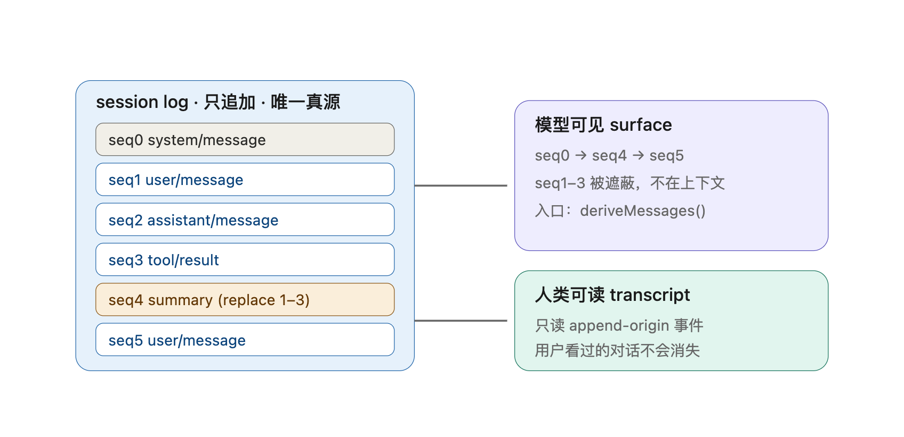

# 第 4 讲：上下文与 Session 日志，记忆只存一份怎么保证不乱

第 3 讲讲清了循环怎么驱动、怎么停。这一讲回答下一个问题：循环跑起来的对话历史存在哪。

先给结论：上游**没有单独存"聊天记录"**。它只存一份只追加（append-only）的事件日志。模型看到的消息、用户看到的对话、会话标题，全是从这份日志**派生**（derive）出来的视图。这个概念叫 **projection（投影）**，即从一份事实算出多种只读视图，而不存第二份事实。

## 唯一真源是一份只追加的事件日志

`Session` 本质是一个 `SessionEvent[]`，只追加、不修改、不删除（实测：`packages/core/session/src/surface.ts:3`、`index.ts` 的 `log` 字段）。每条事件是按 `type` 判别的联合类型，核心四个字段（实测：`types.ts:513-520`）：

```ts
type SessionEvent = {
  type: K                  // 事件类型，如 user/message、tool/result
  seq: SessionSeq          // 单调递增序号
  time: number             // Unix 毫秒
  data: SessionEventMap[K] // 载荷随 type 收窄
}
```

写入口是 `Session.append(type, data, opts)`（实测：`index.ts:557-570`）。它先做 JSON 快照，构造冻结事件，再在 `commit()` 里 `log.push()`。日志里记的是**「发生了什么」**，不是「当前状态是什么」。这是事件溯源（event sourcing）和存快照的根本区别。

事件类型共 65 种（实测：`known-event-types.ts:22-87`），包括 `user/message`、`assistant/message`、`tool/call`、`tool/result`、`turn/start/end`、`step/start/end`、`compaction/*` 和 `approval/*`。插件还能通过声明合并扩展自己的类型。

## 一份日志，多个投影

只有 5 类事件能进入模型的消息视图，叫 **surface**（实测：`surface.ts:1-3` 的模块注释），即「事件日志之上、能产生 LLM 消息的有序视图」。这 5 类是（实测：`surface.ts:49-56`）：`system/message`、`developer/message`、`user/message`、`assistant/message` 和 `tool/result`。

其余 60 类事件（turn 边界、工具调用、审批、压缩记录等）只留在日志里，不直接进模型上下文。



> 图中 seq 从 0 起编号，是为概念示意。实践篇的实测对照图与 demo 输出一致，seq 从 1 起。两图结构相同，仅编号起点不同。

同一份日志上有两个最重要的投影：

| 投影 | 入口 | 读什么 |
|---|---|---|
| 模型可见 surface | `Session.deriveMessages()`（`index.ts:778-799`） | 按 `surfaceOp` 折叠出的节点序列 |
| 人类可读 transcript | `isAppendSurfaceEvent()`（`surface.ts:82-92`） | 只读 append-origin 事件 |

这两个视图**故意不一样**。模型视图会遮蔽被摘要覆盖的旧消息，人类视图不会。原因写得很直白（实测：`surface.ts:79-92` 的注释）：一份 landed replacement 会抹掉用户已经看过的对话，所以人类转录不能用模型视图当来源。替换副本只给模型看。

## surfaceOp：append 与 replace

每条能进 surface 的事件都必须声明 `surfaceOp`，说明自己如何进入视图（实测：`types.ts:477-479`）：

| surfaceOp | 语义 | 用途 |
|---|---|---|
| `'append'` | 追加到视图尾部 | 用户/助手/工具消息的常规路径 |
| `{op:'replace', startSeq, endSeq}` | 用本事件**替换**一段闭区间 | 上下文压缩（compaction） |

折叠代码只有几行（实测：`surface.ts:582-592`）：

```ts
if (plan?.kind === 'append') {
  state.nodes.push(plan.seq)
} else if (plan?.kind === 'replace') {
  state.nodes.splice(plan.startIdx, plan.endIdx - plan.startIdx + 1, plan.seq)
  state.replaceGeneration += 1
  state.contentGeneration += 1
}
```

注意 `nodes` 存的是 **seq 索引**，不是事件本体。`splice` 改的是这个索引数组，原始事件仍完整保留在 `log` 里。遮蔽不是删除。省的是模型的 token，不是磁盘上的数据。

还有两道校验保证替换可信：`sourceEventSeqs` 必须覆盖所有被遮蔽的节点（实测：`surface.ts:370-372`）。节点 0 的系统提示只能被 `system/message` 精确替换（实测：`surface.ts:494-513`）。

## 不变量：模型可见 ⟺ 已记录

这是上游写进协作约定的硬规则（实测：仓库根 `AGENTS.md:139`）：

> **Model-visible ⟺ logged**: anything that reaches a model request must be reconstructable from the session log; a new model-visible input requires a session event.

翻译：任何进入模型请求的内容，都必须能从日志重建。想给模型看一样新东西，先写一条事件。

这条规则杜绝的是「模型看到了某段文本，但日志里查不到」这种无法复现的状态。它的价值在崩溃恢复时才显现。如果允许临时拼一段提示进请求而不记录，重放时这段内容就凭空消失，同样的请求第一次和第二次结果不同。日志的「可溯源」一旦破了，「可复现」也跟着没了。

**正规路径**是先记录后可见：压缩时先追加 `compaction/summary` 事件，再追加一条带 `surfaceOp:replace` 的 `user/message`（实测：`packages/compaction/compaction-basic/src/region.ts:497-515`）。顺序不能反。

## 重放即重算，不是加载记录

日志在内存里的真源是 `private log: SessionEvent[] = []`（`index.ts:305`）。持久化不是 Session 的职责。它通过 `session/event` 事件通知插件落盘，后端有 JSONL 与 SQLite 两种（实测：`docs/subsystems/persistence.md:353-356`）。

恢复的关键在于**重放走的是和实时追加完全相同的折叠路径**。实测 `validation.ts:381-390` 的 `replaySurfaceEvent()`：

```ts
// A seed is accepted incrementally through the same transition as a
// live append and a full-log fold.
surface.validateNext(event)
```

崩溃时如果 turn/step 没正常结束，`repair.ts:53-97` 会合成 `step/end` 与 `turn/end`（reason 为 `interrupted`），并给未出结果的工具合成错误 `tool/result`（实测：`repair.ts:187-193`）。补记的**也是普通事件**。它们走同一条 fold 路径进入状态，不需要特殊的恢复分支。

所以重放不是「加载聊天记录」，是**把日志重新折叠一遍**。这也是为什么不需要 `paused` 这样的可变状态位：状态随时能从事实重算。

## 上游源码落点

本节事实来自本地源码副本（alpha.2，commit `4b399c39`）。

| 事实 | 位置 |
|---|---|
| surface 定义：日志是真源 | `packages/core/session/src/surface.ts:1-3` |
| surface 五类事件 | 同文件 `:49-56` |
| 人类转录读 append-origin | 同文件 `:79-92` |
| 消息投影 `deriveEventMessage` | 同文件 `:120-152` |
| `replace` 的 splice 折叠 | 同文件 `:582-592` |
| 整段日志纯折叠 `foldSurface` | 同文件 `:609-624` |
| 事件联合类型 `SessionEvent` | `packages/core/session/src/types.ts:513-536` |
| `SurfaceOp` 两种取值 | 同文件 `:477-479` |
| 事件类型全集（65 种） | `packages/core/session/src/known-event-types.ts:22-87` |
| `append()` 写入口 | `packages/core/session/src/index.ts:557-570` |
| `deriveMessages()` | 同文件 `:778-799` |
| 内存真源 `log` | 同文件 `:305` |
| 模型可见 ⟺ 已记录 | 仓库根 `AGENTS.md:139` |
| 重放走同一转换 | `packages/core/session/src/validation.ts:381-390` |
| 崩溃补记 closers | `packages/core/session/src/repair.ts:53-97`、`:187-193` |
| 压缩生产 replace | `packages/compaction/compaction-basic/src/region.ts:497-515` |
| 持久化后端 | `docs/subsystems/persistence.md:353-356` |

## 移植到骨架

本讲代码做一个**最小 append-only 日志 + 双投影**，把只追加、遮蔽式压缩、不变量与崩溃重放各跑一遍。代码与实测见第 4 讲：实践篇。

设计上保留四件事。日志只增不改。`surfaceOp` 决定事件是否进模型视图。`replace` 只改节点索引不动事件本体。补记事件走同一条 fold 路径。省略的是 generations 缓存、完整性校验的全套规则、durable 落盘与插件扩展类型。这些留给后续讲次或实际平台实现。

## 要不要这样做

只存日志、投影出视图，是有代价的设计。

代价是读路径变复杂。想拿一份消息历史，不能直接读一个数组，要跑一遍折叠。节点多了还要缓存（`index.ts:755-776` 的 generation 机制就是为此）。换来的是可恢复、可审计、可 fork。崩溃后重算，审查时回溯，分叉时从同一份事件重建不同视图。

对比另一条路：直接存一份可变 messages 数组，读写都简单。但压缩时删除历史就真删了，崩溃后状态无法重建，「模型看到什么」也没有可核查的依据。任务短、不需要恢复和审计时，这条路更简单。

对要建的平台，建议保留「append-only 日志 + 投影」这一层。理由和第 3 讲一样：日志先加上成本可控，将来要恢复、要审计时数据已经在，不需要改结构。

## 动手任务

1. 运行基线脚本，确认输出与本讲一致，重点看两个投影何时一致、何时分叉。
2. 给日志追加一条压缩摘要，用 `replace` 遮蔽旧区间，确认原始事件还在、只从模型视图消失。
3. 手动往日志里塞一条没有 `surfaceOp` 的事件，确认它不进模型视图，这就是「模型可见 ⟺ 已记录」的实测。
4. 选做：模拟一次崩溃（有 `turn/start` 和 `tool/call`，没有收尾），运行补记与重放，观察补记事件如何进入模型视图。

本讲代码全部离线运行，不需要网络。

## 本讲小测

1. 模型上下文里有一段摘要，把之前 10 轮对话压缩了。那 10 轮对话的原始事件还在吗？在哪个数据结构里？模型为什么看不到它们？
2. `replace` 用 `splice` 改动了 `nodes`。有同学说「这就是删除，日志被改了」。指出他错在哪，并说出 `nodes` 和 `log` 的关系。
3. 按「模型可见 ⟺ 已记录」不变量，如果想在发请求前临时插一句系统提示（不写日志），可以吗？说出理由与正确做法。
4. Agent 跑到一半崩溃，`step/start` 写了但没有 `step/end`。重启后系统怎么处理这个「半截 turn」？补记的事件走什么路径进入状态？

## 事实边界

事件类型、surfaceOp 语义、折叠规则、不变量、重放与补记机制均来自本地源码副本的实测行号。最小日志与双投影实现是本讲为演示自己写的简化版，结构对齐上游 `packages/core/session`，但不覆盖 generations 缓存、完整性校验全套规则、durable 持久化与插件扩展类型。要不要做可恢复、可审计的判断是设计取舍，不是源码事实。
