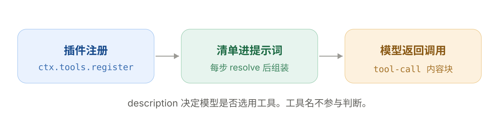
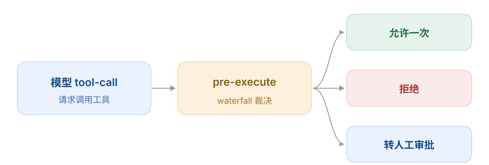
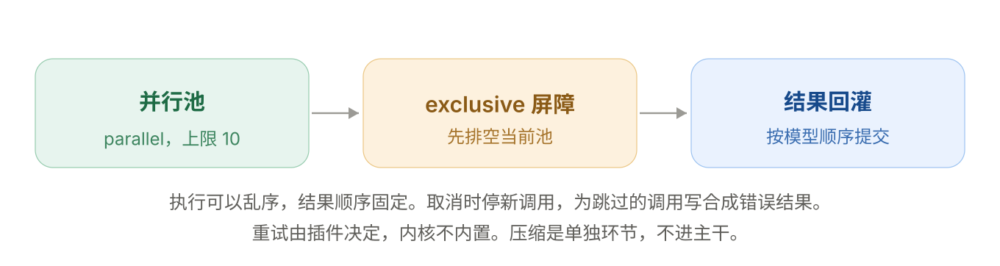

# 第 5 讲：工具调用，一次请求怎么穿过闸门

第 4 讲讲清了对话历史存在哪。这一讲回答下一个问题。模型说要调用一个工具之后，平台怎么让它安全地跑起来。

先给结论。工具不是模型自带的。插件把工具注册进平台，平台每步把清单写进提示词，模型只能从清单里挑。调用真正执行前，还要过一道裁决闸门。放行之后才进入调度，结果按顺序回灌给模型。四个环节各有一套机制，源码里都有对应落点。

## 工具由插件注册，每步写进提示词

工具由插件贡献，内核不内置工具。插件在 `apply(ctx)` 里调用 `ctx.tools.register(defineTool({...}))`，声明 name、description、parameters 和 execute（实测：[`adding-a-tool.zh.md:18-36`](https://github.com/deepseek-ai/deepseek-harness/blob/4b399c39a6d1479cd84ca591b4d7c88e24d38a96/docs/cookbook/adding-a-tool.zh.md#L18-L36)）。每一步由平台重新解析工具集，再由 `systemPrompt.assemble()` 把 schema 写进系统提示词（实测：[`agent.ts:295-297`](https://github.com/deepseek-ai/deepseek-harness/blob/4b399c39a6d1479cd84ca591b4d7c88e24d38a96/packages/core/agent-loop/src/agent.ts#L295-L297)）。模型产出 `block.type === 'tool-call'` 的内容块，平台按名字找到对应的 `execute` 函数（实测：[`agent.ts:576-583`](https://github.com/deepseek-ai/deepseek-harness/blob/4b399c39a6d1479cd84ca591b4d7c88e24d38a96/packages/core/agent-loop/src/agent.ts#L576-L583)）。

三个细节决定工具是否真的可用。

注册是副作用。卸载插件的 fiber，工具随之注销（实测：[`adding-a-tool.zh.md:39`](https://github.com/deepseek-ai/deepseek-harness/blob/4b399c39a6d1479cd84ca591b4d7c88e24d38a96/docs/cookbook/adding-a-tool.zh.md#L39)）。

`description` 是模型选择工具的依据，上游文档称其为 "what the model sees"（实测：[`adding-a-tool.zh.md:20`](https://github.com/deepseek-ai/deepseek-harness/blob/4b399c39a6d1479cd84ca591b4d7c88e24d38a96/docs/cookbook/adding-a-tool.zh.md#L20)）。工具名不参与模型判断，它只在执行阶段定位 `execute` 函数。

运行时不检索工具。每步都把当前清单全量写进提示词，schema token 在每次请求中重复（实测：[`system-prompt/README.zh.md:189-193`](https://github.com/deepseek-ai/deepseek-harness/blob/4b399c39a6d1479cd84ca591b4d7c88e24d38a96/packages/core/system-prompt/README.zh.md#L189-L193)）。检索只发生在专门的元数据工具上，例如 `cordis_inspect` 查运行时的 provider，`plugin_market` 查可安装的插件。模型先查目录，再决定是否安装插件，工具在安装后才进入提示词。

## 模型没有申请新工具的动作

模型侧的输出只有两种。文本，或者清单内工具的 tool-call。它不能创建新工具，也不能执行清单外的函数，没有第三种输出能表达添加工具的请求（实测：[`system-prompt/README.zh.md:99-101`](https://github.com/deepseek-ai/deepseek-harness/blob/4b399c39a6d1479cd84ca591b4d7c88e24d38a96/packages/core/system-prompt/README.zh.md#L99-L101)）。

用户要求查天气但清单里没有天气工具时，有四条路径。

| 路径 | 行为 | 是否常见 |
|---|---|---|
| 用文本回答 | 说明无法获取实时天气。文本没有 tool-call，完成判定记为 `completed` | 最常见 |
| 用现有工具间接满足 | 清单里有 `web_search` 时，模型读 description 判断并调用它 | 取决于清单 |
| 请求不存在的工具 | 框架回灌 `UNKNOWN_TOOL`，模型下一轮纠正 | 少数情况 |
| 执行器缺失 | 框架在 dispatch 前抛 `ToolExecutorUnavailableError`，模型没有决策机会 | 配置问题 |

第三种走正常回灌通道进入 `next-step` inbox（实测：[`agent.ts:584-586`](https://github.com/deepseek-ai/deepseek-harness/blob/4b399c39a6d1479cd84ca591b4d7c88e24d38a96/packages/core/agent-loop/src/agent.ts#L584-L586)）。错误也是一种数据，同样驱动下一轮。第四种源于执行器的有意设计。卸载执行器后保留不可用的选择，不让程序落到另一个执行器上，避免工具看似能调用却运行在错误后端（实测：[`tools/src/index.ts:347`](https://github.com/deepseek-ai/deepseek-harness/blob/4b399c39a6d1479cd84ca591b4d7c88e24d38a96/packages/core/tools/src/index.ts#L347)）。模型无法自愈这种配置问题。

模型卡在重复调用时，`repeat-tool-reminder` 插件在连续重复 3 次、5 次和 8 次时插入提醒，请模型检查上次结果、换方法或收尾（实测：[`repeat-tool-reminder/README.md:12`](https://github.com/deepseek-ai/deepseek-harness/blob/4b399c39a6d1479cd84ca591b4d7c88e24d38a96/packages/guard/repeat-tool-reminder/README.md#L12)）。提醒是建议性的，不阻断合法重复调用。第 3 讲的取消是硬性中断，两者都不替模型决策。

## 执行前先过裁决闸门

模型给出 tool-call 后，平台不会直接执行。调用先进入 `tools/pre-execute` waterfall，在 dispatch 前裁决（实测：[`tools/src/events.ts:14`](https://github.com/deepseek-ai/deepseek-harness/blob/4b399c39a6d1479cd84ca591b4d7c88e24d38a96/packages/core/tools/src/events.ts#L14)）。

审批走 `approval/request` waterfall。结果有四种。`allowed-once`、`rejected`、`cancelled` 和 `unavailable`（实测：[`contracts.ts:292-307`](https://github.com/deepseek-ai/deepseek-harness/blob/4b399c39a6d1479cd84ca591b4d7c88e24d38a96/packages/core/tools/src/contracts.ts#L292-L307)）。只有 `allowed-once` 放行，而且只授权当次操作。缺失的应答者、不负责该请求的应答者和抛异常的应答者都产生 `unavailable`。会话级策略 `never` 确定性拒绝所有请求，用于无人值守场景（实测：[`approval.zh.md`](https://github.com/deepseek-ai/deepseek-harness/blob/4b399c39a6d1479cd84ca591b4d7c88e24d38a96/docs/subsystems/approval.zh.md)）。闸门失败关闭，不默认放行。

审批用 waterfall，不用 serial。waterfall 让第一个能给出裁决的应答者认领请求，后续应答者仍可加工或否决。serial 在第一个非空值处停下，做不到这件事（实测：[`tools/src/events.ts`](https://github.com/deepseek-ai/deepseek-harness/blob/4b399c39a6d1479cd84ca591b4d7c88e24d38a96/packages/core/tools/src/events.ts)）。

只观察的监听器必须调用 `next()`。不调用会静默截断整条链，后面的应答者收不到值，默认处理也被绕过。放到审批场景，没有应答者认领，结果落到 `unavailable`，调用被拒绝。这是第 2 讲 waterfall 纪律在工具链路上的落点。

## 调度与回灌

一次返回多个 tool-call 时，调度器按两种模式分流（实测：[`tools/src/batch.ts:3`](https://github.com/deepseek-ai/deepseek-harness/blob/4b399c39a6d1479cd84ca591b4d7c88e24d38a96/packages/core/tools/src/batch.ts#L3)）。`parallel` 调用进入有界滚动池，默认上限 10 路，常量为 `DEFAULT_MAX_PARALLEL_TOOL_CALLS`（实测：[`constants.ts:5`](https://github.com/deepseek-ai/deepseek-harness/blob/4b399c39a6d1479cd84ca591b4d7c88e24d38a96/packages/core/agent-loop/src/constants.ts#L5)）。`exclusive` 调用作为屏障，必须等当前池排空才开始。

三个细节决定调度行为。执行可以乱序，结果按模型顺序提交（实测：[`batch.ts:4`](https://github.com/deepseek-ai/deepseek-harness/blob/4b399c39a6d1479cd84ca591b4d7c88e24d38a96/packages/core/tools/src/batch.ts#L4)）。每个调用启动前重新判定模式，注册表在半路改策略会影响尚未启动的调用（实测：[`batch.ts:76`](https://github.com/deepseek-ai/deepseek-harness/blob/4b399c39a6d1479cd84ca591b4d7c88e24d38a96/packages/core/tools/src/batch.ts#L76)）。取消时停止新启动，排空已启动的调用，并为跳过的调用写入合成错误结果，使重放保持有效（实测：[`batch.ts:5-7`](https://github.com/deepseek-ai/deepseek-harness/blob/4b399c39a6d1479cd84ca591b4d7c88e24d38a96/packages/core/tools/src/batch.ts#L5-L7)）。

结果写进 `next-step` inbox，接上第 3 讲的 turn 内 step 循环。模型在下一轮决定是否继续调用或收尾。

失败和上下文另有外挂。模型请求失败不触发内置重试，而是抛 `agent/request-error` waterfall，插件返回 `{ kind: 'retry' }` 时循环重跑这一步（实测：[`agent.ts:542-552`](https://github.com/deepseek-ai/deepseek-harness/blob/4b399c39a6d1479cd84ca591b4d7c88e24d38a96/packages/core/agent-loop/src/agent.ts#L542-L552)）。上下文过长由压缩 seam 处理，它是可选能力，不属于 agent loop 主干（实测：[`compaction.zh.md`](https://github.com/deepseek-ai/deepseek-harness/blob/4b399c39a6d1479cd84ca591b4d7c88e24d38a96/docs/subsystems/compaction.zh.md)）。取消或崩溃后的重放不会重复执行工具，因为被跳过的调用也有确定结果。

## 上游源码落点

本节事实来自本地源码副本（alpha.2，commit `4b399c39`）。完整链路与更多链接见[工具调用链路](../code/tool-invocation-lifecycle.md)。

| 事实 | 位置 |
|---|---|
| 工具定义字段与注册 | [`adding-a-tool.zh.md:18-36`](https://github.com/deepseek-ai/deepseek-harness/blob/4b399c39a6d1479cd84ca591b4d7c88e24d38a96/docs/cookbook/adding-a-tool.zh.md#L18-L36) |
| description 是模型所见 | 同文件 `:20` |
| 卸载即注销 | 同文件 `:39` |
| 解析工具集与清单进提示词 | [`agent.ts:295-297`](https://github.com/deepseek-ai/deepseek-harness/blob/4b399c39a6d1479cd84ca591b4d7c88e24d38a96/packages/core/agent-loop/src/agent.ts#L295-L297) |
| 模型返回 tool-call | 同文件 `:576` |
| 执行与结果回灌 | 同文件 `:578-586` |
| 失败重试 waterfall | 同文件 `:542-552` |
| pre-execute 闸门 | [`tools/src/events.ts:14`](https://github.com/deepseek-ai/deepseek-harness/blob/4b399c39a6d1479cd84ca591b4d7c88e24d38a96/packages/core/tools/src/events.ts#L14) |
| 审批四种结果 | [`contracts.ts:292-307`](https://github.com/deepseek-ai/deepseek-harness/blob/4b399c39a6d1479cd84ca591b4d7c88e24d38a96/packages/core/tools/src/contracts.ts#L292-L307) |
| 审批 waterfall 语义 | [`approval.zh.md`](https://github.com/deepseek-ai/deepseek-harness/blob/4b399c39a6d1479cd84ca591b4d7c88e24d38a96/docs/subsystems/approval.zh.md) |
| 并行池与屏障 | [`tools/src/batch.ts:3`](https://github.com/deepseek-ai/deepseek-harness/blob/4b399c39a6d1479cd84ca591b4d7c88e24d38a96/packages/core/tools/src/batch.ts#L3) |
| 乱序执行按序提交 | 同文件 `:4` |
| 取消合成错误结果 | 同文件 `:5-7` |
| 并发上限常量 | [`constants.ts:5`](https://github.com/deepseek-ai/deepseek-harness/blob/4b399c39a6d1479cd84ca591b4d7c88e24d38a96/packages/core/agent-loop/src/constants.ts#L5) |
| 执行器不可用选择 | [`tools/src/index.ts:347`](https://github.com/deepseek-ai/deepseek-harness/blob/4b399c39a6d1479cd84ca591b4d7c88e24d38a96/packages/core/tools/src/index.ts#L347) |
| 未知工具错误 | [`contracts.ts:292-307`](https://github.com/deepseek-ai/deepseek-harness/blob/4b399c39a6d1479cd84ca591b4d7c88e24d38a96/packages/core/tools/src/contracts.ts#L292-L307) |
| 重复调用提醒 | [`repeat-tool-reminder/README.md:12`](https://github.com/deepseek-ai/deepseek-harness/blob/4b399c39a6d1479cd84ca591b4d7c88e24d38a96/packages/guard/repeat-tool-reminder/README.md#L12) |
| 压缩 seam | [`compaction.zh.md`](https://github.com/deepseek-ai/deepseek-harness/blob/4b399c39a6d1479cd84ca591b4d7c88e24d38a96/docs/subsystems/compaction.zh.md) |

## 移植到骨架

本讲代码做一个最小的工具注册、审批裁决与默认拒绝实现，把注册进清单、闸门放行、乱序执行按序回灌各跑一遍。第 5 讲代码尚未编写，任务与实测待补入[第 5 讲实践篇](lecture-5-practice.md)。

设计上保留三件事。工具由插件注册，卸载即注销。调用执行前过一道可插拔的裁决闸门，失败关闭。并行调用有上限，结果按模型顺序回灌。省略的是真实执行器、并发池的取消合成结果与重放、压缩 seam 和多路审批应答者。这些留给后续讲次或实际平台实现。

## 要不要这样做

工具走插件注册、调用过裁决闸门，是有代价的设计。

代价是链路变长。每个工具调用多一道 waterfall，每一步都把清单重复写进提示词，schema token 在长会话里持续累积。换来的是能力可独立装卸，危险操作缺省不放行，换审批策略不用改内核。任务短、工具少、没有危险操作时，直接把函数写死进循环更简单。

对比另一条路。硬编码一串条件分支判断要不要放行，读写都直接。但每加一种审批来源就要改一次内核，漏掉一个分支就变成默认放行。可插拔 waterfall 把这条纪律变成插件作者的义务，代价是任何监听器不调用 `next()` 都会让裁决失效。

对要建的平台，建议保留「插件注册加裁决闸门」这一层。理由和前几讲一致。机制先加上成本可控，将来要接界面审批或自动化桥接时，不需要改循环。

## 动手任务

本讲代码待编写。以下代码任务在 mini-harness 第 5 讲目录建好后执行，全部离线运行，不需要网络。

1. 写一个最小工具注册表，支持 `register` 和 `resolve`，确认清单能按当前插件状态重建，卸载后工具从清单消失。
2. 加一道 `pre-execute` waterfall，实现 `allowed-once` 与拒绝两种裁决，确认未放行的调用不进入执行。
3. 模拟一次返回多个调用，让它们乱序完成，确认结果按调用提交顺序回灌。
4. 选做：加一个只观察不调用 `next()` 的监听器，观察下游裁决被吞掉、调用被默认拒绝的效果。

## 本讲小测

1. 工具从哪里来？模型凭什么知道它能调用哪些工具？`description` 和工具名分别起什么作用？
2. 用户要求查天气，但清单里没有天气工具。模型有哪几条路？哪条最常见？
3. `pre-execute` 为什么用 waterfall，不用 serial？只观察的监听器如果不调用 `next()`，会发生什么？
4. 一次返回多个 `tool-call`，执行顺序和结果回灌顺序是什么？`exclusive` 做什么？并发上限是多少？
5. 给自己的 mini-harness 加审批，会硬编码一串 `if else`，还是做成可插拔的 waterfall？给出理由，并说出代价。

批改见[第 5 讲实践篇](lecture-5-practice.md)。

## 事实边界

工具注册、清单组装、模型输出约束、裁决闸门、审批结果、调度与回灌均来自本地源码副本的实测行号，commit `4b399c39`。审批与压缩部分依据子系统文档和源码注释，设计意图类表述未逐行追踪全部执行分支。教学用的 mini-harness 不含真实工具执行链路，三张链路图为脱敏技术示意图。要不要给平台加审批、采用哪种审批源属于设计取舍，不是源码事实。
