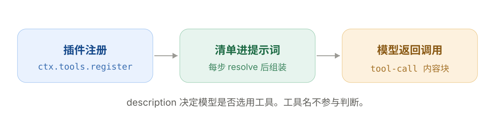
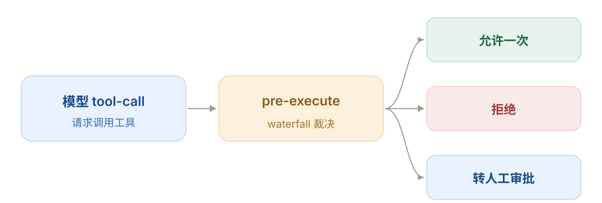

# 第 5 讲：实践篇

本文记录第 5 讲的链路走查与小测判定。讲义讲一次工具调用从注册到回灌经过哪些关卡，这篇对着三张图逐环节核对，并记录五道小测的作答与判定。

mini-harness 第 5 讲代码尚未编写，本篇不含实测输出。第 3、4 讲的实践篇都有可运行的 demo，本讲没有。代码完成后补入动手与验收部分。

三张图来自讲解环节，按技术示意图重绘，只保留机制名称、字段名和符号。第三张图底部在原始截图里被截断，重绘时按专题记录的结论补全。源码落点与 GitHub 链接见[工具调用链路](../code/tool-invocation-lifecycle.md)。

## 工具怎么进入模型视野

三步把工具送进模型视野。插件在 `apply(ctx)` 里调用 `ctx.tools.register(...)`，声明 name、description、parameters 和 execute。平台每步调用 `tools.resolve()` 解析工具集，再由 `systemPrompt.assemble()` 把 schema 全量写进提示词。模型返回 `tool-call` 内容块。

三个细节决定工具是否真的可用。

注册是副作用。卸载插件的 fiber，工具随之注销。

运行时不检索工具。每步都把当前清单全量写进提示词。用户问天气而清单里没有天气工具时，模型没有申请新工具的输出路径。

`description` 是模型选择工具的依据。工具名不参与模型判断，它只在执行阶段用来找到 `execute` 函数。小测第 1 题把这两者答成「定位和选择」，没有点明这层区别。

## 执行前的裁决闸门

模型给出 `tool-call` 后，平台不直接执行。调用先进入 `tools/pre-execute` waterfall。

审批结果有四种。`allowed-once`、`rejected`、`cancelled` 和 `unavailable`。只有 `allowed-once` 放行，而且只授权当次操作。缺失的应答者、不负责该请求的应答者和抛异常的应答者都产生 `unavailable`。会话策略 `never` 确定性拒绝所有请求。闸门失败关闭，不默认放行。

审批走 waterfall，不走 serial。waterfall 让第一个能给出裁决的应答者认领请求，后续应答者仍可加工或否决。serial 在第一个非空值处停下，做不到这件事。

只观察的监听器必须调用 `next()`。不调用会静默截断整条链，后面的应答者收不到值，默认处理也被绕过。放到审批场景，没有应答者认领，结果落到 `unavailable`，调用被拒绝。这是小测第 3 题漏掉的那一问。

## 执行调度与回灌

一次返回多个 `tool-call` 时，调度器按两种模式分流。`parallel` 调用进入有界滚动池，默认上限 10 路，常量为 `DEFAULT_MAX_PARALLEL_TOOL_CALLS`。`exclusive` 调用作为屏障，必须等当前池排空才开始。

执行可以乱序，结果按模型顺序提交。每个调用启动前重新判定模式，注册表在半路改策略会影响尚未启动的调用。取消时停止新启动，排空已启动的调用，并为跳过的调用写入合成错误结果，让重放保持有效。

重试由插件决定，内核不实现。压缩是单独环节，不进主干。

结果写进 `next-step` inbox，接上第 3 讲的循环。模型在下一轮决定是否继续。模型请求不存在的工具时，框架回灌 `UNKNOWN_TOOL`，模型可以自我纠正。执行器缺失则不同，框架在派发前抛错，模型没有决策机会。

小测第 4 题答对了乱序执行和排空屏障，把并发上限答成「工具数量」。正确答案是默认 10 路调用。结果按模型顺序提交，这一点也没答到。

## 小测与批改

第 5 讲共五题。首轮没有一题完整答对。第 2 题判断错误，第 1、3、4 题部分正确，第 5 题结论正确但论证笼统。每题先列题目和正确答案，再记录作答与判定。

### 第 1 题：工具来源与字段作用

**题目。** 工具从哪里来？模型凭什么知道它能调用哪些工具？`description` 和工具名分别起什么作用？

**正确答案。** 工具由插件在 `apply(ctx)` 中注册，平台每步把清单写进提示词，模型只能从清单里挑。`description` 是模型选择工具的依据，工具名不参与模型判断，只在执行阶段定位 `execute` 函数。

**当时的回答。** 插件把工具注册进平台，平台每步把清单写进提示词，模型只能从清单里挑工具。定位和选择。

**判定。** 部分正确。注册链路三句都对。末句用「定位和选择」概括两个字段，没有点明工具名对模型不可见，也没有说清 `description` 是唯一的判断依据。

### 第 2 题：清单里没有天气工具

**题目。** 用户要求查天气，但清单里没有天气工具。模型有哪几条路？哪条最常见？

**正确答案。** 四条。用文本回答，说明无法获取实时天气，这是最常见的结果。用现有工具间接满足，前提是清单里有 `web_search` 这类工具。请求不存在的工具，框架回灌 `UNKNOWN_TOOL`，模型下一轮纠正。执行器缺失，框架在派发前抛错，模型没有决策机会。

**当时的回答。** 一条路，启动外部搜索。

**判定。** 错误。实际有四条路径。外部搜索只是第二条，还需要清单里恰好有搜索工具。最常见的是文本回答。模型没有申请新工具的输出路径，这一点回答方向对了，落点错了。

### 第 3 题：审批为什么用 waterfall

**题目。** `pre-execute` 为什么用 waterfall，不用 serial？只观察的监听器如果不调用 `next()`，会发生什么？

**正确答案。** waterfall 让第一个能给出裁决的应答者认领，后续应答者仍可加工或否决。serial 在第一个非空值处停下，做不到。只观察的监听器不调用 `next()` 会静默截断链，后续应答者收不到值，默认处理被绕过。审批场景里，没有应答者认领会落到 `unavailable`，调用被拒绝。

**当时的回答。** 原因是需要第一个能裁决的应答者认领这次请求，后面的应答者仍可以加工或否决。审批结果有四种，只有 allowed-once 放行，而且只授权当次操作。

**判定。** 部分正确。waterfall 的理由完整准确，四种结果和 `allowed-once` 的语义也对。漏答第二问，也就是不调用 `next()` 的后果。

### 第 4 题：多个调用的调度

**题目。** 一次返回多个 `tool-call`，执行顺序和结果回灌顺序是什么？`exclusive` 做什么？并发上限是多少？

**正确答案。** 执行可以乱序，结果按模型顺序提交。`exclusive` 是屏障，等当前池排空才开始。并发上限默认 10 路，常量 `DEFAULT_MAX_PARALLEL_TOOL_CALLS`。

**当时的回答。** 乱序，排空屏障，工具数量。

**判定。** 部分正确。乱序执行和排空屏障答对。并发上限答成「工具数量」，既不是数字，也不是被约束的对象。约束的是同时执行的调用数，默认 10 路。另外漏答结果按模型顺序提交。

### 第 5 题：审批机制的平台取舍

**题目。** 给自己的 mini-harness 加审批，会硬编码一串 `if else`，还是做成可插拔的 waterfall？给出理由，并说出代价。

**正确答案。** 开放题。可插拔 waterfall 的好处是换审批策略不用改内核，应答者可以是界面通道或自动化桥接。代价是链上任何监听器不调用 `next()` 都会让裁决失效，插件作者必须遵守这条纪律，还要多一次裁决往返。

**当时的回答。** 可插拔的 waterfall，用户体验，增加一次循环，定义审批内容。

**判定。** 结论正确。理由「用户体验」过于笼统，没有落到「换策略不用改内核」这个具体收益。代价提到多一次循环和定义审批内容，方向对，缺了 `next()` 纪律这个更硬的代价。

### 批改说明

第 2 题是唯一的判断错误，把一条有前提的次要路径当成全部。第 1、3、4 题的核心概念都在，缺的是边界和精度。第 5 题是开放题，结论站得住，论证没有落到机制。

需要回看三处。工具缺失的四条路径见第 2 题答案。并发上限与回灌顺序见「执行调度与回灌」。`next()` 纪律见「执行前的裁决闸门」。这三处都是查文档就能确认的事实，不涉及设计判断。

## 验收记录

| 项 | 结果 |
|---|---|
| 三张链路图入库，脱敏检查通过 | 通过 |
| 工具进入模型视野的三步链路 | 通过 |
| 审批闸门四种结果与 waterfall 理由 | 通过 |
| 调度模式、并发上限与回灌顺序 | 通过 |
| 五道小测完成作答与判定 | 通过 |
| mini-harness 第 5 讲代码与实测输出 | 待补 |

前五项完成。代码与实测输出待第 5 讲动手任务完成后补入。

## 事实边界

源码行号来自 commit `4b399c39`。第 5 讲代码尚未编写，本篇不含实测输出，五个小节都是对讲义内容的走查。三张图为脱敏技术示意图，只含机制名称和字段名。第三张图末行在原截图里被截断，按[工具调用链路](../code/tool-invocation-lifecycle.md)的结论补全。并发上限 10 路、审批四种结果、失败关闭来自子系统文档和源码注释。要不要给骨架加审批属于设计取舍，不是源码事实。
