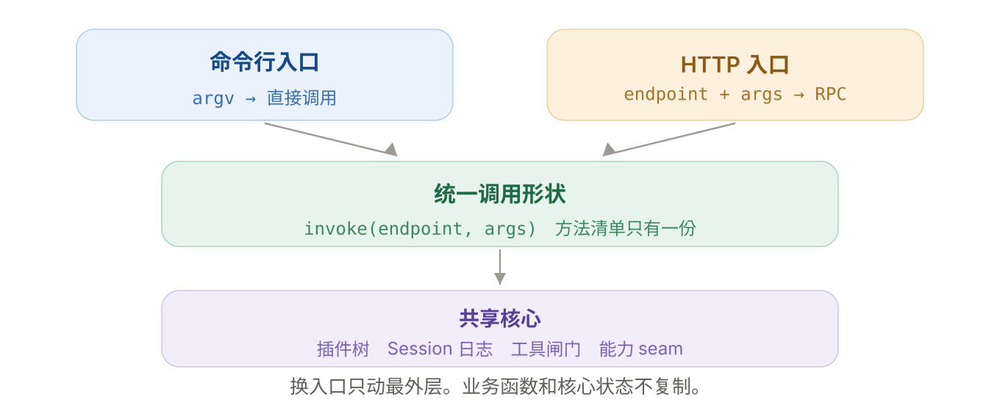

# 第 7 讲：进程与通信形态，同一套核心怎么变成多种产品

第 6 讲讲的是换实现不动调用方。这一讲回答下一个问题。同一套 Agent 核心，怎么同时做成命令行、一次性任务、网页和 SDK。入口不同，通信方式也不同。业务代码能不能不动。

先给结论。所有受支持的产品形态共用一个启动器和一份核心组合。形态只决定装哪些插件、用哪个协议。跨进程调用走一层 Remote 投影。业务 Service 只声明哪些方法可以远程调用，不认识物理连接。物理连接由独立的一层持有。换载体不改业务方法。

这一讲是六机制段的最后一讲。它把前六讲的东西放到进程边界上再看一遍。插件化决定装什么。seam 决定换哪个实现。Session 日志决定记忆存哪。工具闸门决定怎么执行。这一讲决定这些东西跑在哪个进程里，以及进程之间怎么说同一句话。

## 为什么要一个启动器

先说反面做法。每种产品形态写一个自己的可执行程序，各自读配置、各自装插件、各自决定关闭顺序。看起来直接，实际上会形成第二套生命周期。

文档里写得很清楚。带完整配置树的专用 bin 会在 profile 启动之外形成第二套生命周期。装到 profile 里的插件到不了它。它的行为会和 base 应用偏离。SDK 调用方还得学一套任意的进程参数，而不是产品的组合模型（实测：[`2026-08-22-single-dsh-application-launcher.zh.md:9`](https://github.com/deepseek-ai/deepseek-harness/blob/4b399c39a6d1479cd84ca591b4d7c88e24d38a96/.agents/notes/implemented/architecture/2026-08-22-single-dsh-application-launcher.zh.md#L9)）。

DSH 的选择是收口。所有受支持的 Node 应用都从 `dsh` 这一个 CLI 启动，带一个具名 profile。随附五个 profile：`web`、`headless`、`sdk`、`sdk-minimal`、`acp`。调用方式是 `dsh --profile <name>`，也可简写成 `dsh <name>`。同名 profile 叫 `plugin` 时必须写完整形式，因为 `dsh plugin` 是管理命令（实测：[`2026-08-22-single-dsh-application-launcher.zh.md:17`](https://github.com/deepseek-ai/deepseek-harness/blob/4b399c39a6d1479cd84ca591b4d7c88e24d38a96/.agents/notes/implemented/architecture/2026-08-22-single-dsh-application-launcher.zh.md#L17)）。

运行中的 `dsh` 是一棵插件树。这棵树由启动时按序叠加的各层组成（实测：[`docs/architecture.zh.md:14`](https://github.com/deepseek-ai/deepseek-harness/blob/4b399c39a6d1479cd84ca591b4d7c88e24d38a96/docs/architecture.zh.md#L14)）。叠加顺序是固定的。empty 根节点在最下面，往上依次是 profile 声明的组合包、profile 自己的配置文件、home 级配置文件、命令行传入的逐次覆盖。对同一行配置，后应用的层赢。patch 替换整行配置，不做键级合并（实测：[`apps/cli/reference/README.zh.md:13`](https://github.com/deepseek-ai/deepseek-harness/blob/4b399c39a6d1479cd84ca591b4d7c88e24d38a96/apps/cli/reference/README.zh.md#L13)）。

这里有一个前面讲过的机制在起作用。profile 是包的组合清单，seam 是包内的角色边界。第 6 讲说不要预防性拆分。这一讲补上另一半。当一个能力确实有多种后端时，用 profile 选中其中一种，消费方不用知道选了谁。

五个 profile 的职责各不相同。

| profile | 组合 | 对外形态 |
|---|---|---|
| `web` | base 加 web-app | 浏览器页面，监听端口 |
| `headless` | base 加 headless | 一次性任务，跑完退出 |
| `sdk` | base 加 sdk-app | stdio 上的 JSON-RPC |
| `sdk-minimal` | 独立组合包 | stdio 上的同一套 JSON-RPC |
| `acp` | base 加 acp-app | stdio 上的 ACP 协议 |

这张表来自启动器参考和架构文档（实测：[`apps/cli/reference/README.zh.md:17`](https://github.com/deepseek-ai/deepseek-harness/blob/4b399c39a6d1479cd84ca591b4d7c88e24d38a96/apps/cli/reference/README.zh.md#L17)、[`docs/architecture.zh.md:23`](https://github.com/deepseek-ai/deepseek-harness/blob/4b399c39a6d1479cd84ca591b4d7c88e24d38a96/docs/architecture.zh.md#L23)）。五个形态共用 base 里的模型、工具、持久化、沙箱、设置和凭据。差别只在最外面那一层协议和入口。

`sdk-minimal` 是刻意保留的例外。它不叠加 base，自己拥有完整的显式配置树。它的存在说明 profile 机制不强制共享实现，只强制共享启动方式（实测：[`docs/architecture.zh.md:23`](https://github.com/deepseek-ai/deepseek-harness/blob/4b399c39a6d1479cd84ca591b4d7c88e24d38a96/docs/architecture.zh.md#L23)）。

## 协议入口的三条纪律

进程形态一多，最先出问题的是输入输出通道。stdio 协议尤其明显。调用方在等一个 JSON-RPC 帧，进程却往 stdout 写了一句日志。这一句日志就毁了整个协议流。

DSH 给了三条纪律。

第一条，stdout 只放协议帧。随附的协议 profile 把 stdout 保留给协议帧。显示帮助时不启动 transport。stdin 收到 EOF 或进程收到信号时，通过有界的根节点 dispose 收尾（实测：[`2026-08-22-single-dsh-application-launcher.zh.md:37`](https://github.com/deepseek-ai/deepseek-harness/blob/4b399c39a6d1479cd84ca591b4d7c88e24d38a96/.agents/notes/implemented/architecture/2026-08-22-single-dsh-application-launcher.zh.md#L37)）。

第二条，需要给人看的内容走 stderr。一次性任务把推理增量写到 stderr，只在 stdout 打印最终文本。任务成功且最后一个终止原因是 `completed` 时退出码为 0，否则为 1。没有任务本身就是用法错误（实测：[`apps/cli/reference/README.zh.md:46`](https://github.com/deepseek-ai/deepseek-harness/blob/4b399c39a6d1479cd84ca591b4d7c88e24d38a96/apps/cli/reference/README.zh.md#L46)）。

第三条，协议 profile 不热重载服务器模块。SDK 和 ACP 无法在一个 stdio 连接内安全替换服务器、agent、持久化或工具注册表。因此 `sdk`、`acp` 等 profile 的 patch 只在启动时应用。`web` profile 允许配置热重载，但模块替换默认关闭（实测：[`2026-08-22-single-dsh-application-launcher.zh.md:35`](https://github.com/deepseek-ai/deepseek-harness/blob/4b399c39a6d1479cd84ca591b4d7c88e24d38a96/.agents/notes/implemented/architecture/2026-08-22-single-dsh-application-launcher.zh.md#L35)）。配置变更的采用边界是进程重启。这条纪律看起来保守，实际上是在保护在途协议帧。

信号处理的顺序也写明了。第一次收到 `SIGINT` 或 `SIGTERM` 时开始优雅排空，插件树最多有 5 秒完成 dispose。第二次收到信号立即强制退出（实测：[`apps/cli/reference/README.zh.md:129`](https://github.com/deepseek-ai/deepseek-harness/blob/4b399c39a6d1479cd84ca591b4d7c88e24d38a96/apps/cli/reference/README.zh.md#L129)）。第 2 讲讲过的 disposer 逆序清理，到这里才真正决定进程能不能干净退出。

## 业务方法怎么跨过进程边界

入口确定之后，下一个问题是调用。浏览器里的代码想让 Host 执行一次工具，怎么写出这行调用。

最直接的写法是手写一套接口。Host 改一个方法名，客户端改一处。参数类型复制一份，过一段时间就漂移。DSH 的笔记明确拒绝这条路。手写接口不能保证只包含 Remote 标记的方法，也会和 Host 签名、lookup ID 和 schema 漂移（实测：[`2026-08-02-typert-remote-method-calls.zh.md:467`](https://github.com/deepseek-ai/deepseek-harness/blob/4b399c39a6d1479cd84ca591b4d7c88e24d38a96/.agents/notes/implemented/architecture/2026-08-02-typert-remote-method-calls.zh.md#L467)）。

DSH 的做法是从 Host 代码生成消费端投影。业务 Service 继承 `TypertRemoteService`，用 `@Remote` 标记允许跨进程调用的方法。Typert 从 Host Program 生成两类产物。一类给 Host 自己用，一类给任意消费环境用（实测：[`2026-08-02-typert-remote-method-calls.zh.md:19`](https://github.com/deepseek-ai/deepseek-harness/blob/4b399c39a6d1479cd84ca591b4d7c88e24d38a96/.agents/notes/implemented/architecture/2026-08-02-typert-remote-method-calls.zh.md#L19)）。

消费端投影有三条规定。

第一，只暴露标记过的方法。投影里没有标 `@Remote` 的方法根本不会出现。消费端拿到的类型集合由 Host 的声明决定，不是由消费端自己写决定（实测：[`2026-08-02-typert-remote-method-calls.zh.md:21`](https://github.com/deepseek-ai/deepseek-harness/blob/4b399c39a6d1479cd84ca591b4d7c88e24d38a96/.agents/notes/implemented/architecture/2026-08-02-typert-remote-method-calls.zh.md#L21)）。

第二，描述方法的信息只在两端本地。`InvocationDescriptor` 记着 endpoint、服务键、参数顺序、类型和 codec。它不通过线路发送。线路上只有 endpoint 和具名参数对象（实测：[`2026-08-02-typert-remote-method-calls.zh.md:154`](https://github.com/deepseek-ai/deepseek-harness/blob/4b399c39a6d1479cd84ca591b4d7c88e24d38a96/.agents/notes/implemented/architecture/2026-08-02-typert-remote-method-calls.zh.md#L154)）。这件事很重要。如果描述随请求一起发，消费端就能自己声明一个不存在的 endpoint，Host 还得解释它。现在两端各自持有一份从同一份源码生成的描述，不一致在构建期就暴露。

第三，业务类型只有一份。消费端不复制业务 DTO，只从业务包的纯类型出口引用原始符号。因此跳转定义、重命名和引用查找都回到唯一源码位置（实测：[`2026-08-02-typert-remote-method-calls.zh.md:175`](https://github.com/deepseek-ai/deepseek-harness/blob/4b399c39a6d1479cd84ca591b4d7c88e24d38a96/.agents/notes/implemented/architecture/2026-08-02-typert-remote-method-calls.zh.md#L175)）。

下面这张图把两个入口和共享核心放在一起看。



两条入口的区别只在最外层。CLI 直接调核心函数。远程入口把调用变成 endpoint 加参数，通过连接层送进 Host。中间那个核心，包括插件树、Session、工具闸门和 seam，两边是同一份。

## 物理连接单独一层

再看远程入口里面。谁负责开 socket，谁负责记账，谁负责鉴权。

DSH 把物理连接交给 Connection。它独占 HTTP 服务器和唯一的 `/api` 通道，持有 RPC envelope、rpcId、序列化、信任检查和错误传输。Gateway 只在 `/api` 上注册一个 ownership 判断和一个处理器。它不注册 HTTP 路由（实测：[`2026-08-02-typert-remote-method-calls.zh.md:439`](https://github.com/deepseek-ai/deepseek-harness/blob/4b399c39a6d1479cd84ca591b4d7c88e24d38a96/.agents/notes/implemented/architecture/2026-08-02-typert-remote-method-calls.zh.md#L439)）。

这里有一条清晰的边界。Remote 层不暴露 `fetch`、HTTP request 或 route handle。原因写在笔记里。如果暴露了，将来从 HTTP 迁到 WebSocket 时，物理对象会再次穿透 Remote 层。现在这个载体替换只改 Connection 内部（实测：[`2026-08-02-typert-remote-method-calls.zh.md:515`](https://github.com/deepseek-ai/deepseek-harness/blob/4b399c39a6d1479cd84ca591b4d7c88e24d38a96/.agents/notes/implemented/architecture/2026-08-02-typert-remote-method-calls.zh.md#L515)）。

这正是第 6 讲的 seam 在进程边界上的又一次应用。约定的一端是业务方法，实现的一端是物理载体，中间由 Connection 承担切换点。业务 Service 不知道自己是被本地调用还是被 HTTP 调用。

一次完整调用按这个顺序走。

```text
ctx.remote.goals.create(sessionId, request, signal)
  → 消费端 descriptor 组装具名 args
  → 合并调用方 signal 与挂载生命周期
  → ctx.connection.rpc.call('/api', 'goals/create', { args })
  → Connection 创建 rpcId 和 envelope
  → 当前载体发出 POST /api/goals/create
  → Host 侧共享 trust 检查，创建标准 Request
  → 复合处理器判断 endpoint 归属，交给 Gateway
  → Gateway 解码、解析 receiver、注入 signal、调用业务方法
  → Connection 写入结果，按同一个 rpcId 回送
```

这段链路来自源码笔记（实测：[`2026-08-02-typert-remote-method-calls.zh.md:418`](https://github.com/deepseek-ai/deepseek-harness/blob/4b399c39a6d1479cd84ca591b4d7c88e24d38a96/.agents/notes/implemented/architecture/2026-08-02-typert-remote-method-calls.zh.md#L418)）。注意 Gateway 的工作只有认领和调用。它不处理逐方法权限，不处理幂等，不维护长连接状态。

## 一条流能读写两个方向

远程入口还有一种情况需要单独处理。有些调用不是一问一答。浏览器终端要把按键持续送上去，Host 要把屏幕帧持续送下来。审批弹窗要等用户回答。后台任务要一边跑一边回报进度。

DSH 把 Remote 流做成天生双工。一个 `streamId` 同时标识上行和下行。方法返回类型 `RemoteStream<Out, In>` 在一个位置声明两个方向的类型。Host 方法通过 `this.ctx.invocation.uplink()` 读上行，通过 `invocation.peer` 知道调用者是谁。客户端拿到的句柄能读、能写、能半关闭、能取消（实测：[`2026-09-19-remote-duplex-stream.zh.md:63`](https://github.com/deepseek-ai/deepseek-harness/blob/4b399c39a6d1479cd84ca591b4d7c88e24d38a96/.agents/notes/implemented/architecture/2026-09-19-remote-duplex-stream.zh.md#L63)）。

半关闭是这里最值得学的一个词。客户端 `end()` 之后，上行结束，下行还可以继续产出。这正好是 stdin EOF 的形状。反过来，Host 方法结束会关掉下行，客户端之后再调用 `send()` 会抛错。一个方向结束不代表另一个方向立刻结束（实测：[`2026-09-19-remote-duplex-stream.zh.md:274`](https://github.com/deepseek-ai/deepseek-harness/blob/4b399c39a6d1479cd84ca591b4d7c88e24d38a96/.agents/notes/implemented/architecture/2026-09-19-remote-duplex-stream.zh.md#L274)）。

背压靠有界 inbox。Host 每条逻辑流有一个上行队列，按帧的 UTF-8 字节计量，上限默认 262144 字节。超限时整条流带 `gateway/uplink-overflow` 失败。数据不丢弃，而是显式报错。笔记把不读上行却持续发送称为用法错误（实测：[`2026-09-19-remote-duplex-stream.zh.md:296`](https://github.com/deepseek-ai/deepseek-harness/blob/4b399c39a6d1479cd84ca591b4d7c88e24d38a96/.agents/notes/implemented/architecture/2026-09-19-remote-duplex-stream.zh.md#L296)）。

断线之后怎么办，答案取决于数据种类。三类数据的恢复规则不同，不能混用一套。

| 数据 | 恢复方式 | 原因 |
|---|---|---|
| Session 日志 | 按 seq 和 cursor 补齐缺口 | 有稳定顺序和持久化 |
| 进程内状态 | opening snapshot 整体替换旧镜像 | 需要基线才能收敛 |
| 即时通知 | 不重放 | 没有 cursor，也不该产生副作用 |

这张表来自会话传输笔记（实测：[`2026-08-18-session-history-and-event-transport.zh.md:9`](https://github.com/deepseek-ai/deepseek-harness/blob/4b399c39a6d1479cd84ca591b4d7c88e24d38a96/.agents/notes/implemented/architecture/2026-08-18-session-history-and-event-transport.zh.md#L9)）。笔记还有一条重要约束。打开页面、切换标签和网络重连都不许隐式恢复 Agent。观察操作不能因为参数里出现 Session 就产生执行副作用。激活权限属于具体方法，不属于载体（实测：[`2026-08-18-session-history-and-event-transport.zh.md:15`](https://github.com/deepseek-ai/deepseek-harness/blob/4b399c39a6d1479cd84ca591b4d7c88e24d38a96/.agents/notes/implemented/architecture/2026-08-18-session-history-and-event-transport.zh.md#L15)）。

第 4 讲的 append-only 日志在这里派上用场。日志有 seq，才能做 cursor 和分页。日志是唯一事实源，才能在上层做 snapshot 替换而不丢历史。

## 源码事实一览

本节事实来自本地源码副本（alpha.2，commit `4b399c39`）。

| 事实 | 位置 |
|---|---|
| 专用 bin 会形成第二套生命周期 | [`2026-08-22-single-dsh-application-launcher.zh.md:9`](https://github.com/deepseek-ai/deepseek-harness/blob/4b399c39a6d1479cd84ca591b4d7c88e24d38a96/.agents/notes/implemented/architecture/2026-08-22-single-dsh-application-launcher.zh.md#L9) |
| 统一从 dsh CLI 与具名 profile 启动 | 同文件 `:17` |
| 配置层叠加顺序 | [`apps/cli/reference/README.zh.md:13`](https://github.com/deepseek-ai/deepseek-harness/blob/4b399c39a6d1479cd84ca591b4d7c88e24d38a96/apps/cli/reference/README.zh.md#L13) |
| 五个随附 profile 的组合 | 同文件 `:17` |
| 协议 profile 保留 stdout 与有界 dispose | `2026-08-22` 笔记 `:37` |
| headless 只把最终文本写 stdout | `apps/cli/reference/README.zh.md:46` |
| 信号两次触发的关闭语义 | 同文件 `:129` |
| 手写客户端接口会漂移 | [`2026-08-02-typert-remote-method-calls.zh.md:467`](https://github.com/deepseek-ai/deepseek-harness/blob/4b399c39a6d1479cd84ca591b4d7c88e24d38a96/.agents/notes/implemented/architecture/2026-08-02-typert-remote-method-calls.zh.md#L467) |
| 投影只含标记方法 | 同文件 `:21` |
| descriptor 只在两端本地 | 同文件 `:154` |
| 业务类型只有一份 | 同文件 `:175` |
| Connection 独占物理载体 | 同文件 `:439` |
| 不向 Remote 暴露物理对象 | 同文件 `:515` |
| 一次调用的完整链路 | 同文件 `:418` |
| 双工流一个 streamId 与两端类型 | [`2026-09-19-remote-duplex-stream.zh.md:63`](https://github.com/deepseek-ai/deepseek-harness/blob/4b399c39a6d1479cd84ca591b4d7c88e24d38a96/.agents/notes/implemented/architecture/2026-09-19-remote-duplex-stream.zh.md#L63) |
| 半关闭语义 | 同文件 `:274` |
| 有界 inbox 与超限失败 | 同文件 `:296` |
| 三类数据的恢复规则 | [`2026-08-18-session-history-and-event-transport.zh.md:9`](https://github.com/deepseek-ai/deepseek-harness/blob/4b399c39a6d1479cd84ca591b4d7c88e24d38a96/.agents/notes/implemented/architecture/2026-08-18-session-history-and-event-transport.zh.md#L9) |
| 观察不激活 Agent | 同文件 `:15` |

## 移植到骨架

本讲代码做一个最小的双入口实现。核心逻辑放在一个模块里，命令行入口和本地 HTTP 入口共用它。目标是两个入口跑出同一份结果，业务函数不改。代码与实测见[第 7 讲实践篇](lecture-7-practice.md)，本篇先不写实践内容。

设计上保留三件事。第一，入口只负责解析参数和装配载体，不写业务逻辑。第二，跨入口调用统一走 `invoke(endpoint, args)` 这一个形状，进程内实现直接查表，远程实现走 RPC 信封。第三，stdout 纪律写进代码，协议输出和提示输出分开。

省略的是 DSH 的类型投影生成器、WebSocket mux、心跳、断线重连和 snapshot 恢复。骨架用 Python 写，没有 TypeScript Program。允许调用的方法用小注册表显式声明，效果是同一份清单同时供两个入口使用。

## 要不要这样做

统一启动器的代价是少了一个自由度。调用方不能再随手写一个 bin 来绕过 profile。收益是所有形态共用一套插件安装、环境发现、关闭流程和测试入口。形态之间的差异被压到最外面一层。

Remote 投影也有代价。多一层生成物和构建顺序。Host 约定变更后要先重新生成投影，消费端才能看到新方法。得到的是业务代码不认识载体，以及方法清单只有一份。

判断标准沿用第 6 讲。只有一个入口、也没有第二个入口计划时，直接函数调用最省事。一旦出现第二个入口，或者出现跨进程调用方，就把业务方法和物理连接切开。切开的位置是 Connection，不是每个业务方法。

对要建的平台，建议保留三项。一个统一启动入口，一份允许跨入口调用的方法清单，一个独占物理连接的层。暂时不需要双工流和 snapshot 恢复。等真有浏览器终端和断线续传需求时再加。不要预防性地把协议做全。

## 动手任务

代码放在 `mini-harness/lecture-7/`，全部离线运行。下面四条任务对应的场景与输出见[第 7 讲实践篇](lecture-7-practice.md)。

1. 写一个共享核心模块，暴露两三个业务函数，再写一张允许跨入口调用的清单。
2. 写一个命令行入口，从参数读取任务，调用共享核心，只把结果写到 stdout。
3. 写一个本地 HTTP 入口，把同一个清单映射成 endpoint，用标准库起服务，处理一次 POST 请求。
4. 选做：给远程入口加一个未知 endpoint 的用例，观察它和命令行入口的报错有什么不同。

## 本讲小测

1. 为什么要让所有产品形态共用一个启动器和 profile，而不是每种形态一个可执行程序？说出第二套生命周期带来的两个具体问题。
2. 协议 profile 为什么要把 stdout 留给协议帧？headless 模式怎么处理推理内容和最终结果？
3. 消费端投影为什么只暴露标记过的方法，描述信息为什么不上线路？
4. 一次远程调用从消费端方法到 Host 业务方法经过哪些层？哪一层独占物理连接，它为什么不把 `fetch` 暴露给上层？
5. 平台取舍题。你的 mini-harness 要同时提供命令行和本地 HTTP 两个入口。你会怎么切启动层、方法清单和物理连接，哪些机制可以先不做？

批改见[第 7 讲实践篇](lecture-7-practice.md)。

## 事实边界

统一启动器、五个 profile、配置层顺序和 stdout 纪律来自本地源码副本的启动器参考、架构文档与架构笔记，commit `4b399c39`。Remote 投影、 descriptor 本地性和 Connection 边界来自 Typert 方法调用的架构笔记。双工流、有界 inbox 与三类恢复规则来自 Remote 双工流和会话传输笔记。要不要在自建平台里采用这些机制属于设计取舍，不是源码事实。动手任务的实测输出见[第 7 讲实践篇](lecture-7-practice.md)。
