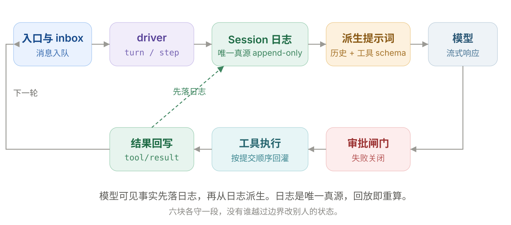

# 第 8 讲：把六块拼成一个能跑的任务

第 7 讲把核心放进了进程边界。到这里六块机制都讲完了。它们散落在六讲里，各解决一个问题。这一讲把它们接到一起，看一次带工具的任务从头走到尾。

先给结论。一次任务只走一条循环。driver 领输入，Session 记事实，提示词从日志派生，模型输出写回日志，工具闸门执行，结果再写回日志。下一步从同一份日志派生。六块不是六个并列功能，而是这条链上的六段。接缝是接口，不变量是任何模型可见事实都先落日志。

整合段的目标是把代码跑通。前面各讲的小骨架各自成立，这一讲要拼成一个能端到端跑一次任务的东西。能跑才算过关。

## 六块在一条链上的位置

先摆事实。核心子系统文档用一句话描述主干。一个轮次流经六个包。driver 认领排队的提示词，在会话日志上开启轮次，通过系统提示词组装请求前缀并从日志派生历史，经 LLM seam 流式拿到模型响应，经工具注册表分派调用，再把每个模型可见事实追加回日志供下一步派生（实测：[`docs/subsystems/core.zh.md:9`](https://github.com/deepseek-ai/deepseek-harness/blob/4b399c39a6d1479cd84ca591b4d7c88e24d38a96/docs/subsystems/core.zh.md#L9)）。

这句话把六块串起来了。

| 讲 | 机制 | 在链上管哪一段 |
|---|---|---|
| 2 | 插件化 | 装配整条链，决定装哪些实现 |
| 3 | Agent 循环与状态机 | driver 驱动轮次与步骤，决定何时停 |
| 4 | 上下文与 Session 日志 | 唯一事实源，派生消息历史 |
| 5 | 工具调用流水线 | 审批与调度，执行模型申请的工具 |
| 6 | 能力 seam | 让模型与工具换后端不改调用方 |
| 7 | 进程与通信形态 | 承载这条链，决定入口和物理载体 |

第 6 讲有个细节在这里很关键。扩展插件依赖 `agent`，不直接依赖 `agent-loop`。循环因此可以替换（实测：[`docs/subsystems/core.zh.md:20`](https://github.com/deepseek-ai/deepseek-harness/blob/4b399c39a6d1479cd84ca591b4d7c88e24d38a96/docs/subsystems/core.zh.md#L20)）。整合时你要换的是实现，不是调用方。

架构文档也确认没有特权内核。扩展方式是往插件树里挂插件，每项注册都是卸载时撤销的副作用（实测：[`docs/architecture.zh.md:11`](https://github.com/deepseek-ai/deepseek-harness/blob/4b399c39a6d1479cd84ca591b4d7c88e24d38a96/docs/architecture.zh.md#L11)）。所以整合不是写一个大入口把六块硬编码进去，而是让它们按装配顺序挂到同一棵树上。

图的读法是从左到右。入口把输入放进 inbox。driver 认领输入并打开步骤。Session 记下这一步的所有事实。提示词从日志派生。模型给出工具申请。闸门裁决并执行。结果写回日志。driver 再领下一步。六块各守一段，没有谁越过边界去改别人的状态。

## 接缝上交换什么

整合最容易出错的地方不是某块内部，而是两块之间传错了东西。逐个接缝看清楚。

| 接缝 | 传什么 | 不传什么 |
|---|---|---|
| 入口到 driver | inbox 消息 | 不直接调业务函数 |
| driver 到 Session | 带类型的事件 | 不写可变消息数组 |
| Session 到提示词 | `deriveMessages()` 的派生结果 | 不把内部事件原样发给模型 |
| 提示词到模型 | 请求头、派生历史、工具 schema | 不带执行器与审批策略 |
| 模型到闸门 | 完整的 `tool_calls` 批次 | 不让模型自己执行 |
| 闸门到 Session | 规范的 `tool/result` | 不跳过审批直接回灌 |

第二条和第六条是重点。Session 的写入口 `session.append()` 提交类型化事件，`deriveMessages()` 把日志投影成模型看到的消息数组（实测：[`packages/core/session/README.zh.md:52`](https://github.com/deepseek-ai/deepseek-harness/blob/4b399c39a6d1479cd84ca591b4d7c88e24d38a96/packages/core/session/README.zh.md#L52)）。surface 事件提供记录的消息身份和内容，插件 projection 只改派生内容，不改记录的消息（实测：[`packages/core/session/README.zh.md:142`](https://github.com/deepseek-ai/deepseek-harness/blob/4b399c39a6d1479cd84ca591b4d7c88e24d38a96/packages/core/session/README.zh.md#L142)）。这就是第 4 讲的投影边界。

第五条也有明确的边界。工具注册表持有定义，循环按允许列表构造给模型的 schema。`output`、`execute`、`finalizeContent`、`timeoutMs`、并发标记这些字段绝不进入模型请求（实测：[`docs/subsystems/tools.zh.md:11`](https://github.com/deepseek-ai/deepseek-harness/blob/4b399c39a6d1479cd84ca591b4d7c88e24d38a96/docs/subsystems/tools.zh.md#L11)）。第 5 讲讲的是闸门怎么裁决，这里补的是闸门之前那条线。模型只看得见名字和参数，看不见实现细节。

一句话记住整条链。模型看到的一切都来自日志，能改动模型输入的一切都要先写进日志。

## 顺序是一条不变量

六块接上之后，最容易被改坏的是顺序。这不是风格问题。源码笔记把顺序写成了回归测试固定的约定。

规则是这样的。agent loop 先领取 inbox 消息，再运行 `agent/pre-step`。只有作出 enter 决策后才打开 `step/start`。返回的 `user/message` 批次在请求派生前追加。提供方输出组装成 `assistant/message` 追加之后，才分派工具。这样持久日志记录的就是工具实际遵循的那批消息（实测：[`2026-06-11-event-sourced-sessions.zh.md:17`](https://github.com/deepseek-ai/deepseek-harness/blob/4b399c39a6d1479cd84ca591b4d7c88e24d38a96/.agents/notes/implemented/architecture/2026-06-11-event-sourced-sessions.zh.md#L17)）。

把顺序倒过来试试。先分派工具，再补记用户消息。工具执行时引用的历史就和日志里存的不一致。回放时模型看到一批没有对应工具结果的用户消息。崩溃恢复会走到另一条分支。所以顺序靠测试固定，不靠记忆。

笔记里还记录了被否决的方案。可变消息数组加事件仅作通知，写起来更简单，但状态和日志会分歧。采用事件溯源之后，日志本身是状态，分歧在结构上不可能发生（实测：[`2026-06-11-event-sourced-sessions.zh.md:21`](https://github.com/deepseek-ai/deepseek-harness/blob/4b399c39a6d1479cd84ca591b4d7c88e24d38a96/.agents/notes/implemented/architecture/2026-06-11-event-sourced-sessions.zh.md#L21)）。

Session 是唯一的真源。LLM 消息历史从日志派生，原始流分片也记录以保证 token 级回放，组装后的 `assistant/message` 才是派生权威（实测：[`2026-06-11-event-sourced-sessions.zh.md:13`](https://github.com/deepseek-ai/deepseek-harness/blob/4b399c39a6d1479cd84ca591b4d7c88e24d38a96/.agents/notes/implemented/architecture/2026-06-11-event-sourced-sessions.zh.md#L13)）。回放和 fork 就是拿已有日志初始化一个新会话。

领域状态和队列状态要分开。Goal 领域拥有持久的 `goal/change` 事件，每次变更带完整快照。激活态只存在于进程中，回放与外部追加的变更默认不激活。变更也不会自动投影成模型输入（实测：[`2026-07-31-goal-owned-durable-events.zh.md:15`](https://github.com/deepseek-ai/deepseek-harness/blob/4b399c39a6d1479cd84ca591b4d7c88e24d38a96/.agents/notes/implemented/architecture/2026-07-31-goal-owned-durable-events.zh.md#L15)）。这条边界在第 3 讲的 inbox 和第 4 讲的日志之间划了一道线。要持久的进日志，临时的留在进程。观察操作不产生执行副作用。

## 一轮里的真实步骤

顺序讲完了，再看驱动器怎么把一轮走完。下面每一步都能在 agent-loop 实现文档里找到位置。

轮次边界上，先打开持久轮次，再原子领取待处理的 next-step 输入和一条排队提示词。步骤之间只领取 next-step 输入（实测：[`packages/core/agent-loop/README.zh.md:122`](https://github.com/deepseek-ai/deepseek-harness/blob/4b399c39a6d1479cd84ca591b4d7c88e24d38a96/packages/core/agent-loop/README.zh.md#L122)）。

接纳后的首次尝试依次做这些事。记录 `step/start`。运行 `agent/request` waterfall 与 `prepareCall`。提交系统更新写入和已接纳的 `user/message` 批次。派生并冻结请求。发起流式请求。重试复用已提交历史，不重复组装、不重复准入用户消息。请求由请求头、`deriveMessages()` 和历史工具声明构成，不单独带 `system` 字段。

每次成功的模型调用恰好追加一个 message 锚点。被取消的流追加带 `interrupted` 标记的锚点，并带上已交付前缀，让下一次请求包含用户已经看到的内容。步骤内独占调用形成屏障，并行安全调用走有界滚动池，策略、持久结果与结果上下文保持模型顺序（实测：[`packages/core/agent-loop/README.zh.md:122`](https://github.com/deepseek-ai/deepseek-harness/blob/4b399c39a6d1479cd84ca591b4d7c88e24d38a96/packages/core/agent-loop/README.zh.md#L122)）。第 5 讲的乱序回灌在这里落地。

每个步骤发送派生的 Session 历史和可见工具 schema。系统消息含初始指令和后续段更新。工具调用经过受守卫的流水线。每项模型可见事实都在派生请求前记录。取消会中止当前活动，未设置 `keepInbox` 时清空待处理工作（实测：[`packages/core/agent-loop/README.zh.md:75`](https://github.com/deepseek-ai/deepseek-harness/blob/4b399c39a6d1479cd84ca591b4d7c88e24d38a96/packages/core/agent-loop/README.zh.md#L75)）。

有一件事要单独记住。循环没有内置轮次预算。工具调用和 steering 会让当前轮次继续。限制失控轮次必须从既有生命周期扩展点执行取消（实测：[`packages/core/agent-loop/README.zh.md:238`](https://github.com/deepseek-ai/deepseek-harness/blob/4b399c39a6d1479cd84ca591b4d7c88e24d38a96/packages/core/agent-loop/README.zh.md#L238)）。第 3 讲说过没有 `maxSteps`，这里是它的具体后果。你要自己决定何时停。

## 生命周期把六块绑在一起

整合之后，创建和销毁也要走一条路。不能各块自己开自己关。

创建和恢复共用一个受回滚保护的流程。构造具象 agent 与带作用域上下文，进入 SessionStore 并发出 `session/created`，等待可选 setup 及其 commit，进入 AgentRegistry，等待串行的 `agent/created` 监听器，然后才释放已排队输入。setup 失败、commit 抛出或所有者销毁都会回滚已准备的资源（实测：[`packages/core/agent-loop/README.zh.md:112`](https://github.com/deepseek-ai/deepseek-harness/blob/4b399c39a6d1479cd84ca591b4d7c88e24d38a96/packages/core/agent-loop/README.zh.md#L112)）。

关闭时顺序反过来。先停止并排空驱动器，再撤销作用域，关闭会话写路径，detach agent，最后 detach 会话。每次 detach 都绑定到确切进入的对象，陈旧 disposer 不能移除之后出现的同 id 替代项。架构文档补了一句。关闭时即使队列清理失败，也会取消并等待当前工作，再释放资源（实测：[`docs/architecture.zh.md:79`](https://github.com/deepseek-ai/deepseek-harness/blob/4b399c39a6d1479cd84ca591b4d7c88e24d38a96/docs/architecture.zh.md#L79)）。这是第 2 讲 disposer 逆序清理在整条链上的样子。

写入还有一个节奏问题。追加操作是同步的，热路径不阻塞在 I/O 上。持久化插件缓冲延后写入，在每个轮次结束时触发的 `session/flush` 检查点等待排空（实测：[`2026-06-11-event-sourced-sessions.zh.md:15`](https://github.com/deepseek-ai/deepseek-harness/blob/4b399c39a6d1479cd84ca591b4d7c88e24d38a96/.agents/notes/implemented/architecture/2026-06-11-event-sourced-sessions.zh.md#L15)）。需要立即持久屏障的生产方要显式等待 `flush`，不能假定延后写入已经排空（实测：[`packages/core/session/README.zh.md:100`](https://github.com/deepseek-ai/deepseek-harness/blob/4b399c39a6d1479cd84ca591b4d7c88e24d38a96/packages/core/session/README.zh.md#L100)）。

一句话记住生命周期。创建等所有监听器就位才放输入，销毁先停再排空最后释放，持久化在轮次边界对齐。

## 源码事实一览

本节事实来自本地源码副本（alpha.2，commit `4b399c39`）。

| 事实 | 位置 |
|---|---|
| 一个轮次流经六个包 | [`docs/subsystems/core.zh.md:9`](https://github.com/deepseek-ai/deepseek-harness/blob/4b399c39a6d1479cd84ca591b4d7c88e24d38a96/docs/subsystems/core.zh.md#L9) |
| 扩展插件不依赖具体循环 | 同文件 `:20` |
| 没有特权内核，注册即副作用 | [`docs/architecture.zh.md:11`](https://github.com/deepseek-ai/deepseek-harness/blob/4b399c39a6d1479cd84ca591b4d7c88e24d38a96/docs/architecture.zh.md#L11) |
| 关闭前取消并等待当前工作 | 同文件 `:79` |
| `append()` 与 `deriveMessages()` | [`packages/core/session/README.zh.md:52`](https://github.com/deepseek-ai/deepseek-harness/blob/4b399c39a6d1479cd84ca591b4d7c88e24d38a96/packages/core/session/README.zh.md#L52) |
| projection 不改记录的消息 | 同文件 `:142` |
| `flush` 是显式持久屏障 | 同文件 `:100` |
| 工具 schema 的允许列表边界 | [`docs/subsystems/tools.zh.md:11`](https://github.com/deepseek-ai/deepseek-harness/blob/4b399c39a6d1479cd84ca591b4d7c88e24d38a96/docs/subsystems/tools.zh.md#L11) |
| 步骤发送派生历史与工具 schema | [`packages/core/agent-loop/README.zh.md:75`](https://github.com/deepseek-ai/deepseek-harness/blob/4b399c39a6d1479cd84ca591b4d7c88e24d38a96/packages/core/agent-loop/README.zh.md#L75) |
| 轮次边界与步骤内顺序 | 同文件 `:122` |
| 受回滚保护的初始化与 teardown | 同文件 `:112` |
| 没有内置轮次预算 | 同文件 `:238` |
| 消息入日志与工具分派的顺序 | [`2026-06-11-event-sourced-sessions.zh.md:17`](https://github.com/deepseek-ai/deepseek-harness/blob/4b399c39a6d1479cd84ca591b4d7c88e24d38a96/.agents/notes/implemented/architecture/2026-06-11-event-sourced-sessions.zh.md#L17) |
| 日志是唯一真源 | 同文件 `:13` |
| 同步追加与轮末 flush | 同文件 `:15` |
| 可变消息数组方案被否决 | 同文件 `:21` |
| 领域状态与激活态分离 | [`2026-07-31-goal-owned-durable-events.zh.md:15`](https://github.com/deepseek-ai/deepseek-harness/blob/4b399c39a6d1479cd84ca591b4d7c88e24d38a96/.agents/notes/implemented/architecture/2026-07-31-goal-owned-durable-events.zh.md#L15) |
| seam 的三个角色 | [`2026-06-13-capability-seams.zh.md:15`](https://github.com/deepseek-ai/deepseek-harness/blob/4b399c39a6d1479cd84ca591b4d7c88e24d38a96/.agents/notes/implemented/architecture/2026-06-13-capability-seams.zh.md#L15) |
| 不要预防性拆分 | 同文件 `:25` |

## 移植到骨架

本讲代码把前七讲的小骨架拼起来，端到端跑一次带工具的任务。目标是一个输入进去，driver 驱动两轮以上，中间至少一次工具调用，最后给出结果。代码与实测见[第 8 讲实践篇](lecture-8-practice.md)，本篇先不写实践内容。

保留五件事。一条 driver 循环驱动 turn 与 step。一份 append-only 日志作唯一事实源，消息历史从日志派生。一张工具清单加一道闸门，审批失败关闭。一个 seam 让模型和工具能换实现。一个统一入口把结果写 stdout，诊断写 stderr。

省略四件事。真实模型调用用假模型替代，按预设脚本产出 `tool_calls` 和最终文本。持久化写成内存列表，不做 SQLite。不实现类型投影生成器、WebSocket mux 和 snapshot 恢复。不实现 goal 领域与 steering 消息。

拼装顺序固定。先建日志，再装工具清单和闸门，再建 driver，最后接入口。销毁按反序。假模型让整个链路离线可跑，任务语义和真实链路一致。

## 要不要这样做

日志作为唯一真源有代价。所有写入方必须走 append，不能直接改内存里的消息数组。调试要看日志事件，不是看变量快照。派生历史有成本，日志越长越慢，需要压缩来缓解，而不是改写日志（实测：[`2026-06-11-event-sourced-sessions.zh.md:28`](https://github.com/deepseek-ai/deepseek-harness/blob/4b399c39a6d1479cd84ca591b4d7c88e24d38a96/.agents/notes/implemented/architecture/2026-06-11-event-sourced-sessions.zh.md#L28)）。

换来的是回放和崩溃恢复不再是额外功能。日志有 seq，才能按 cursor 补齐缺口。事实先落日志，模型看到的和工具执行时就一致。第 4 讲的三条不变量在这里同时生效。

判断标准很简单。一次任务只调一次模型就结束，直接用函数调用，不需要这套日志和循环。任务要跨两个轮次，或者中间有工具调用，或者需要断线续跑，就把日志和循环接上。只有一种实现的工具不用拆 seam，出现第二种再拆。第 6 讲说过，不要预防性拆分。

对要建的平台，建议按五步走。先让一条循环跑通带工具的任务。再补 append-only 日志和派生。再补审批闸门。再把要换的后端切成 seam。最后按真实入口需求决定要不要做进程边界。顺序不要倒过来。先做协议再补核心，会得到一堆漂亮接口和跑不通的任务。

## 动手任务

代码放在 `mini-harness/lecture-8/`，全部离线运行。下面四条任务对应的场景与输出见[第 8 讲实践篇](lecture-8-practice.md)。

1. 把前几讲的日志、工具清单、闸门和 driver 拼到一个模块里，让一次输入能跑出两轮以上的轮次。
2. 用假模型产出一次工具申请，走完审批与执行，把结果回灌并让模型再答一次。
3. 跑一次取消，检查 `keepInbox` 开关对待处理工作的影响，检查退出时清理顺序。
4. 选做：故意把工具分派挪到用户消息入日志之前，观察回放时历史与工具结果对不上的问题。

## 本讲小测

1. 六块机制在一条任务链上各管哪一段？为什么说整合不是把六块硬编码进一个入口？
2. 一次模型可见事实从产生到进入下一轮请求，经过哪些接缝？哪两个接缝最容易传错东西？
3. 消息入日志、工具分派和请求派生之间有什么顺序约定？把顺序倒过来会出什么问题？
4. 创建和关闭各按什么顺序做？`session/flush` 解决什么问题，为什么不能假定延后写入已排空？
5. 平台取舍题。你要给自建平台接上这套链路，哪些机制必须先做，哪些可以等？说出判断标准和先做协议的代价。

批改见[第 8 讲实践篇](lecture-8-practice.md)。

## 事实边界

六包主干、循环替换规则、工具 schema 边界、初始化与关闭顺序来自本地源码副本的子系统文档与架构文档，commit `4b399c39`。消息入日志与工具分派的顺序、日志唯一真源、同步追加与轮末 flush 来自事件溯源会话笔记。领域状态与激活态分离来自 Goal 持久事件笔记。seam 三角色来自能力 seam 笔记。要不要在自建平台里采用这些机制属于设计取舍，不是源码事实。动手任务的实测输出见[第 8 讲实践篇](lecture-8-practice.md)。
