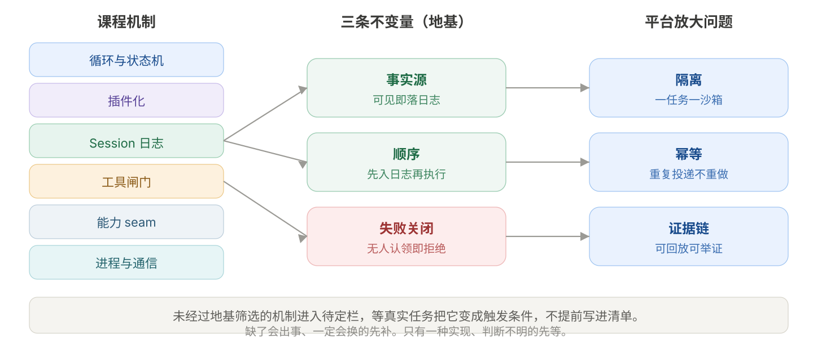

# 第 9 讲：把八讲机制变成一张平台取舍清单

第 8 讲把六块拼起来，端到端跑通了一次带工具的任务。到这里课程的技术部分讲完了。这一讲不再加新机制，换一个动作。把前面八讲的判断收拢成一张清单，拿它去量自己要建的平台，决定每一块补还是不补。

先给结论。平台取舍不是列功能，是给每个机制回答三个问题。它解决什么失效。你的平台现在有没有对应的东西。缺了它会在什么规模或什么故障下出事。三个问题都答得出，取舍才有依据。答不出就先不动，等真实任务把问题暴露出来。

这一讲是收官讲，产出不是代码，是一份清单。清单的写法在下面给全。

## 为什么最后一讲给清单不给代码

前面八讲每讲产出一块骨架。第 8 讲把它们拼成能跑的任务。到这里你已经有一个能跑的最小 harness，也知道每块背后的取舍。剩下的问题不在 harness 里，在你自己要建的平台里。

平台比 harness 多了三样东西。多用户，任务并发，故障要有人兜底。harness 里一个假设在一个任务上成立，放到几十个任务同时跑就会破。取舍清单就是把 harness 的每块机制拿出来，问它在平台上要不要放大，放大的代价是什么。

不给代码有两个原因。第一，平台的后端选择因人而异，写死的骨架只会误导。第二，取舍是判断，不是实现。判断错了，代码写得再漂亮也是沉没成本。课程的目标到 L3，能改造能移植。清单正是从理解走向改造的那一步。

## 一张对照表

把八讲的机制按平台关切重新排一遍。横轴是课程机制，纵轴是平台要问的问题。

| 课程机制 | 解决什么失效 | 平台要问的问题 |
|---|---|---|
| 第 0、1 讲 调用与循环 | 模型只输出文本，工具要程序执行再回灌 | 一次任务要不要跨多轮，中间有没有工具 |
| 第 2 讲 插件化 | 加功能不改内核 | 平台的扩展点在哪，谁能装插件 |
| 第 3 讲 循环与状态机 | 长任务怎么驱动、怎么停 | 谁来终止失控任务，取消怎么传播 |
| 第 4 讲 Session 日志 | 记忆只存一份，崩溃可恢复 | 任务状态能不能回放，断点能不能续 |
| 第 5 讲 工具闸门 | 防越权，审批失败关闭 | 谁能批，执行在谁的进程里 |
| 第 6 讲 能力 seam | 换实现不改调用方 | 哪些后端一定会换，换的代价落在哪 |
| 第 7 讲 进程与通信 | 同一核心多种形态 | 入口有几个，载体怎么切 |
| 第 8 讲 整合 | 六块接到一条链上 | 装配顺序与关闭顺序谁保证 |

这张表不是让你逐行打勾。逐行打勾会得到一份什么都想做的清单，那正是要避免的。表的用法是逐行问，先看失效在平台上会不会真实发生，再看现在有没有更省的办法兜住。

## 三条不变量先立住

清单里有三块机制没有商量余地。它们是平台能不能被信任的底线，不是性能优化项。

第一块是事实源。模型的可见事实必须先落成日志，再从日志派生请求（实测：[`2026-06-11-event-sourced-sessions.zh.md:13`](https://github.com/deepseek-ai/deepseek-harness/blob/4b399c39a6d1479cd84ca591b4d7c88e24d38a96/.agents/notes/implemented/architecture/2026-06-11-event-sourced-sessions.zh.md#L13)）。平台里这条翻译成一句话，谁在什么时候让 agent 做了什么，必须能回答。回答不了，出事之后就没有证据。

第二块是顺序。先入日志再分派工具，先派生请求再发模型调用（实测：[`2026-06-11-event-sourced-sessions.zh.md:17`](https://github.com/deepseek-ai/deepseek-harness/blob/4b399c39a6d1479cd84ca591b4d7c88e24d38a96/.agents/notes/implemented/architecture/2026-06-11-event-sourced-sessions.zh.md#L17)）。倒过来会得到孤儿结果和因果倒置的日志。平台里日志要供审计回放，顺序错了审计就是假的。

第三块是失败关闭。审批闸门上没人认领的请求一律拒绝，被拒的工具也要落成规范结果（实测：[`docs/subsystems/tools.zh.md:11`](https://github.com/deepseek-ai/deepseek-harness/blob/4b399c39a6d1479cd84ca591b4d7c88e24d38a96/docs/subsystems/tools.zh.md#L11)）。平台里这条翻译成权限边界，宁可少做一次，不可越权一次。

这三条对应第 4 讲反复强调的三条不变量。它们一起构成判断的地基。缺任何一条，规模上去之后都会变成信任问题，不是功能问题。

## 平台侧的三个放大问题

harness 跑通之后，把它放大成平台会撞上三个新问题。这三个问题不来自 harness 内部，来自多人多任务共享一套基础设施。

**第一个是隔离。** 一个任务一个沙箱，带超时、内存上限、网络出口白名单。凭据由运行时注入短时令牌，不落到 agent 手里。这一条对应第 5 讲的闸门，只是把进程内的权限判断放大成任务级的资源边界。代价是每个任务多一次环境准备，高任务量时这笔开销要算进成本。

**第二个是幂等。** 同一业务单据重复投递不重复执行。任务要有幂等键，回写要有幂等键，失败重试不能把外部副作用做两遍。这一条在 harness 里不存在，因为只有一个任务。平台里没有它，几十万单据的规模承诺就是空话。代价是每条链路多一次查重，多一张状态表。

**第三个是可回放的证据链。** 每条处理落一条记录，输入快照、工具轨迹、输出、判定、成本。记录能按同样的输入重跑一遍。这一条是第 4 讲日志机制的放大版。harness 里日志为了恢复，平台里日志为了举证。代价是存储增长，需要保留期和压缩策略（实测：[`2026-06-11-event-sourced-sessions.zh.md:28`](https://github.com/deepseek-ai/deepseek-harness/blob/4b399c39a6d1479cd84ca591b4d7c88e24d38a96/.agents/notes/implemented/architecture/2026-06-11-event-sourced-sessions.zh.md#L28)）。

图的读法。左边是八讲的机制，中间是三条不变量这道地基，右边是平台里对应的三个放大问题。机制经过地基筛选才变成平台能力。没有经过这道筛选的功能，先记在待定栏，不进清单。

## 判断标准：先补什么，等什么

照着一张表逐项问，最后一定会分出两组。一组现在补，一组先等。分组的标准要一致，否则清单会变成愿望列表。

先补的有三类。

第一类是不变量相关。事实源、顺序、失败关闭，这三条缺了就是信任问题，排在最先。

第二类是缺了会出事的。隔离和幂等属于这类。任务一并发就会撞隔离，单据一重复就会撞幂等。这类机制的触发条件很明确，不用等实测也能判断要不要补。

第三类是一定会换的后端。如果模型或执行环境确定会换，现在就切 seam，把约定和实现分开（实测：[`2026-06-13-capability-seams.zh.md:15`](https://github.com/deepseek-ai/deepseek-harness/blob/4b399c39a6d1479cd84ca591b4d7c88e24d38a96/.agents/notes/implemented/architecture/2026-06-13-capability-seams.zh.md#L15)）。等到换的时候再切，改动会扩散到全部调用方。

先等的有两类。

第一类是只有一种实现的机制。只有一种模型、一种执行载体、一个入口，就不要拆 seam 和协议层。第 6 讲说过不要预防性拆分，出现第二种再拆（实测：[`2026-06-13-capability-seams.zh.md:25`](https://github.com/deepseek-ai/deepseek-harness/blob/4b399c39a6d1479cd84ca591b4d7c88e24d38a96/.agents/notes/implemented/architecture/2026-06-13-capability-seams.zh.md#L25)）。

第二类是判断不明的。多入口、断线续跑、双工流、类型投影生成器这些，如果现在没有具体的任务需要它们，就记下来等。等真的有第二个入口，或者真的要断线续跑，再做。先做协议再补核心，会得到一堆漂亮接口和跑不通的任务。

一句话记住这个标准。缺了会出事或者一定会换的先补，只有一种实现或者判断不明的先等。

## 清单怎么写

清单不是功能列表。每一行是一个判断，要有依据。五行足够，多出来的行会稀释重点。

| 列 | 写什么 |
|---|---|
| 机制 | 哪一讲的哪一块，用机制名不用功能名 |
| 解决的失效 | 一句话说清缺了它在什么情况下出事 |
| 平台现状 | 已经有、部分有、没有，三选一 |
| 决定 | 现在补、等条件、不做，三选一 |
| 依据 | 触发条件或放弃理由，一句话 |

填表的纪律有两条。第一，决定是"现在补"的，依据那一列必须写出触发条件，不能只写"重要"。第二，决定是"等条件"的，依据那一列必须写清等什么，比如等第二个入口、等真实的多任务压测。写不出条件的行，把决定改成不做，或者先去补实测。

清单要能反驳。写完拿给一个不了解课程的人看，他应该能指出哪一行依据不足。指不出来的清单大概率是抄的原则，没经过自己的场景。

## 要不要这样做

清单有代价。它把一个模糊的目标变成一组有约束的决定，写的过程会暴露你还没想清楚的地方。这件事不舒服，但比开工之后返工便宜。

它换来的东西是范围可控。平台最容易犯的错是什么都想做，六项护栏守不住。清单把不做也写成决定，范围就有了边界。边界清楚，才能判断一个新需求该不该进。

有一个边界要说明。清单是判断工具，不是架构设计文档。它告诉你哪些机制要补，不告诉你模块怎么拆、契约怎么定。那些要在决定补之后，按真实任务再做。清单写完就开工最小的第一步，拿真实任务去证伪。别在清单上迭代太久。

## 动手任务

这一讲不产出课程代码。前面八讲的代码已经在 `mini-harness/lecture-0/` 到 `mini-harness/lecture-8/`，这一讲只用它们作参照。下面四条任务对应的示范与批改进第 9 讲实践篇。

1. 拿一张空清单，把八讲机制逐行填进去。平台现状那一列只准写已经有、部分有、没有，不准写不清楚。
2. 从清单里挑三行决定为现在补的，逐行写出触发条件。写不出来的改成等条件。
3. 从清单里挑两行决定为不做的，写出放弃理由。理由里要指出什么条件下会重新考虑。
4. 选做：把清单交给一个不了解课程的人看，请他圈出依据不足的行，逐条补。

## 本讲小测

1. 为什么收官讲的产出是清单而不是代码？说出一个平台比 harness 多出来的约束。
2. 事实源、顺序、失败关闭这三条为什么没有商量余地？各说一句它在平台上对应的失效。
3. 平台侧的三个放大问题是什么？每个说一句它的代价。
4. 判断一个机制先补还是先等的标准是什么？举一个先补的例子和一个先等的例子。
5. 平台取舍题。你手上的平台现在只有一个入口、一种模型、一个用户。按这一讲的标准，你会把哪些机制写进"现在补"，哪些写进"等条件"？说出至少一项的判断理由，并指出一个会让你改变决定的触发条件。

批改见[第 9 讲实践篇](lecture-9-practice.md)。

## 事实边界

三条不变量对应的源码事实来自本地源码副本的子系统文档与架构笔记，commit `4b399c39`。事实源、顺序、失败关闭、不要预防性拆分、日志压缩需求都能在该基线下定位。平台侧的三个放大问题，即隔离、幂等、证据链，来自通用平台工程判断，不是 DSH 源码事实，也不是某个具体平台的设计结论。清单写法与判断标准是教学判断。动手任务的示范与批改见[第 9 讲实践篇](lecture-9-practice.md)。
