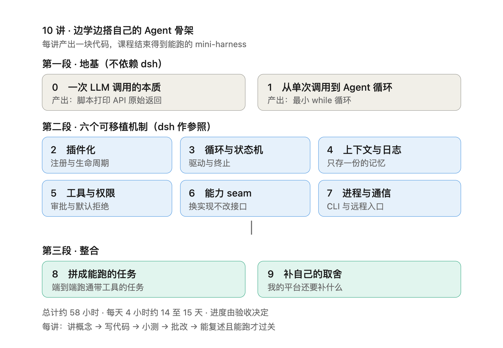

# 10 讲：边学边搭自己的 Agent 骨架

这套课程以 DeepSeek Harness（DSH）为参照实现。学习者从零开始，每讲产出一块代码。课程结束时得到一个能运行的最小 Agent 骨架，称为 mini-harness。

## 课程目标

课程分三层。每层有明确的验收方式。

| 层 | 能力 | 验收方式 |
|---|---|---|
| L1 能复述 | 说得出架构分层和机制 | 不看文档讲出流程 |
| L2 能定位 | 给功能名能找到源码文件与行号 | 小测指向代码位置 |
| L3 能改造 | 能替换实现，能移植到自己的平台 | 自己写的骨架跑通一个任务 |

课程目标是 L3。只到 L2 的方案不覆盖平台搭建。

## 三段结构

课程分三段，共 10 讲。

### 第一段：地基

这一段不依赖 DSH，先建立心智模型。每讲从概念解决的问题讲起，用生活类比说明，再看 DeepSeek API 的原始行为，最后讨论平台取舍。

| 讲 | 主题 | 讲清什么 | mini-harness 产出 |
|---|---|---|---|
| 0 | 一次 LLM 调用的本质 | messages 三种角色、模型只输出文本、tool_calls 是结构化文本、API 无状态 | 用脚本调一次 API，打印原始返回 |
| 1 | 从单次调用到 Agent 循环 | 模型说要调工具，程序执行，结果回灌，再问模型 | 写一个最小 while 循环 |

### 第二段：六个可移植机制

DSH 在这一段作为参照实现。每个机制按「每讲节奏」一节的五步展开。

| 讲 | 机制 | 解决什么问题 | mini-harness 产出 |
|---|---|---|---|
| 2 | 插件化（一切皆插件） | 功能怎么加入又不改内核 | 插件注册与生命周期 |
| 3 | Agent 循环与状态机 | 长任务怎么被驱动、怎么停 | 会话驱动与终止条件 |
| 4 | 上下文与 Session 日志 | 记忆只存一份，怎么保证不乱 | append-only 日志与投影 |
| 5 | 工具调用流水线与权限 | 一次工具调用经过哪些关卡、怎么防越权 | 工具注册、审批、默认拒绝 |
| 6 | 能力 seam | 换实现不改接口，怎么切 | 一个工具的 Definition、Provider、Consumer |
| 7 | 进程与通信形态 | 同一套代码怎么变成多种产品形态 | 一个 CLI 入口与一个远程入口 |

### 第三段：整合

| 讲 | 主题 | 产出 |
|---|---|---|
| 8 | 把六块拼成一个能跑的任务 | mini-harness 端到端跑通一次带工具的任务 |
| 9 | 对照自有平台设计，补自己的取舍 | 一份平台能力补全清单 |

## 时间估算

按零基础起点估算。每讲保留完整的概念和动手环节。

| 段 | 内容 | 耗时 | 依据 |
|---|---|---|---|
| 地基 | 2 讲，概念多，动手少 | 约 7 小时 | 概念 4 小时，动手 3 小时 |
| 六机制 | 每讲约 5.5 小时 | 约 33 小时 | 概念 1.5 小时，源码 2 小时，移植 2 小时 |
| 整合 | 2 讲 | 约 8 小时 | 拼装与取舍 |
| 缓冲 | 答错重走、卡壳 | 约 20% | 不单列 |
| 合计 | 全部 10 讲 | 约 58 小时 | |

每天 4 小时，约 14 至 15 天。这是中位数估算。实际进度以验收为准。

## 每讲节奏

每讲按五步推进。

1. 讲授概念。先讲概念，再给图，最后给代码。DSH 源码行号只作证据，不作起点。术语首次出现时解释。实测与推断分开标注。
2. 动手写代码。往 mini-harness 加一块代码。照着写可以，但要能说清每一行的作用。
3. 用小测检验。3 至 5 题。地基段考概念，机制段考平台场景下的设计取舍。
4. 批改错题。错题定位到概念或代码位置。说明是理解错还是设计取舍没想透。
5. 过关进入下一讲。能自己复述，且骨架代码能跑。两个条件都满足才进入下一讲。

## 术语约定

第一次出现的专业术语即时解释，不预设前置知识。

| 术语 | 含义 |
|---|---|
| Cordis | DSH 的插件框架，负责注册插件与分发事件 |
| fiber | Cordis 里的任务执行单元 |
| seam | 接口与实现之间的切换点，换实现不改调用方 |
| waterfall | 按注册顺序依次执行的事件派发方式 |
| projection | 从 append-only 日志派生出当前状态的读模型 |

## 验收标准

- 地基段：不看文档能讲清一次 LLM 调用与一次 Agent 循环的区别。
- 六机制：每个机制能回答三问，即它解决什么问题、DSH 怎么解、自己的平台要不要这样做。
- 整合段：mini-harness 端到端跑通一次带工具调用的任务。
- 全程：小测错题重做后能答对。

## 素材与边界

素材包括 DeepSeek API 一手文档、本地源码副本（alpha.2，commit `4b399c39`）、产品功能地图、技术架构与源码对应、子模块鱼骨大纲、自有平台设计资料。

能力域划分是分析判断，不是源码原生分类。DSH 是参照实现，不是照抄目标。自有平台的取舍以设计资料与课程中形成的判断为准。
