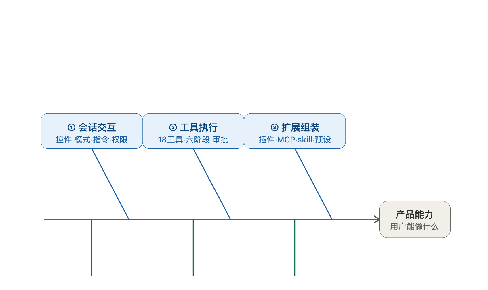

# DeepSeek Harness 子模块鱼骨大纲

## 证据范围

本文把 DeepSeek Harness 的功能按用户能力域分为六组。每组列出功能、类别、复用机制和源码位置。

源码位置来自 commit `4b399c39`，版本 `0.2.3-alpha.2`。界面版本为 `0.2.2-rc.5`，与源码基线不完全一致。源码位置标到包或目录级的条目需重新对齐 commit 才能用于行号核对。

截图中上方三根骨带文字标签，下方三根骨只显示竖线，文字标签未出现在截图内。下方三根骨的名称与功能见本文对应章节。

## 分类定义

| 类别 | 定义 |
|---|---|
| 机制锚点 | 该功能是一项底层机制的主要入口。 |
| 挂靠功能 | 该功能复用已有机制，不单独引入新机制。 |

复用机制列记录功能背后实际起作用的架构机制。多个功能可指向同一机制。

## 会话交互

入口为输入框与消息流。对应能力是从输入到模型可见消息的转换。

| 功能 | 类别 | 复用机制 | 源码位置 |
|---|---|---|---|
| 新会话六控件（工作区、模式、指令、权限、模型、团队） | 挂靠功能 | 配置层 patch 叠加 | `apps/cli/src/args.ts:146`、`profile-context.ts:75-85` |
| 四种模式预设（standard、ptc、minimal、cordis） | 机制锚点 | patch 按 id 整块替换 config | `bundle/web-app/presets/*.patch.yml` |
| 七项斜杠指令（goal、plan、feedback、compact、permission、model、file） | 挂靠功能 | 包的 command 入口暴露 | `packages/client/ui-commands`、`command-*` |
| 权限三档（只读、工作区写、完全访问） | 挂靠功能 | 权限四层的执行层与审批层 | `permission-presets/src/index.ts:118-120,185-190` |
| 消息发送与流式回显 | 机制锚点 | inbox 唤醒、Agent 循环、事件域 | `agent-loop/src/agent.ts:168-175,232-254` |
| 智能体团队协作 | 挂靠功能 | 共享任务板 | `packages/team` |

## 工具执行

入口为模型返回的 tool_call。对应能力是一次工具调用经过的关卡。

| 功能 | 类别 | 复用机制 | 源码位置 |
|---|---|---|---|
| 18 个内置工具 | 挂靠功能 | 能力 seam 三段式 | `packages/shell/fs/subprocess/...` |
| 工具调用六阶段流水线 | 机制锚点 | pre、审批、守卫、execute、post、result | `packages/core/tools/src/pipeline.ts:192,201,204-206,214,311,509` |
| 审批弹窗与默认拒绝 | 机制锚点 | 缺席即拒绝，5 处 `approvalDenial()` | `pipeline.ts:460,466,481,485,489,712` |
| PTC 批量模式 | 挂靠功能 | 调度骨架 pre 有序、execute 并发、post 按序 | `packages/core/tools/src/batch.ts:139-218`、`ptc-runtime` |
| bash 三 Provider（local、sandbox、pwsh） | 挂靠功能 | seam 换 Provider 不改 schema | `bash-local`、`bash-sandbox`、`pwsh-local` |

## 扩展组装

入口为插件页与创造模式。对应能力是插件化扩展。

| 功能 | 类别 | 复用机制 | 源码位置 |
|---|---|---|---|
| 插件系统（内置 4、实验 14、已安装） | 机制锚点 | Cordis Service 子类即插件 | `docs/cordis-tutorial/03-services.zh.md:20-42` |
| 创造模式 | 机制锚点 | 预设也是一棵 patch 树 | `cordis.patch.yml`、`tool-cordis`、`ui-cordis` |
| MCP 接入 | 挂靠功能 | 工具注册统一走注册表 | `packages/mcp` |
| skill 与 bundle-skill | 挂靠功能 | 插件树的打包形态 | `packages/skill` |
| hook 协议（codex、claude-code 改造） | 挂靠功能 | 事件瀑布的旁路监听 | `experimental/hook-protocol`、`hooks-*` |
| patch 叠加与替换 | 机制锚点 | 按 id 替换整块，不深度合并 | `docs/architecture.zh.md:25` |

## 自动化集成

入口为自动化任务页与设置页集成项。对应能力是定时任务与外部系统接入。

| 功能 | 类别 | 复用机制 | 源码位置 |
|---|---|---|---|
| 自动化任务（创建、编辑、运行记录） | 机制锚点 | 到期任务作为 follow-up 投递到 Session | `packages/schedule/schedule/src/` |
| 重复规则八项对七类型 | 机制锚点 | `after/at/every/daily/weekly/cron/rrule` | `schedule/src/types.ts:17-317` |
| 执行位置三态 | 挂靠功能 | `target` 判别联合 | `schedule/src/storage.ts:52-56` |
| 连接器与 OAuth | 挂靠功能 | 统一鉴权代理层 | `packages/connector` |
| API 网关（一元 /api 与流式 mux） | 挂靠功能 | 路径重组为 gateway 与 remotes | `packages/api/gateway/src/index.ts:257,280,287` |
| liveshare 与 deliverables | 挂靠功能 | Remote 方法按 role 限制 | `experimental/liveshare-*`、`packages/deliverables` |

## 状态数据

入口为会话历史与持久化。对应能力是会话事实的单一存储。

| 功能 | 类别 | 复用机制 | 源码位置 |
|---|---|---|---|
| Session 日志与 `deriveMessages()` | 机制锚点 | 模型可见即已记录，只从日志投影 | `core/session/src/index.ts:778` |
| 会话持久化（JSONL 与可选 SQLite） | 机制锚点 | append-only、zstd、迁移链 | `session-persistence-jsonl/src/format.ts`、`session-persistence-sqlite/README.md` |
| 上下文压缩 compaction | 挂靠功能 | 三个 waterfall 挂载点 | `compaction/compaction-basic/src/index.ts:172,198,228` |
| checkpoint 与中断 | 挂靠功能 | `raceAbort` 与 checkpoint policy | `agent-loop/src/index.ts:112,128`、`session-checkpoint-policy/src/index.ts:20-83` |
| 会话全文检索 | 挂靠功能 | SQLite 只做索引，不存会话 | `packages/session-query` |

## 运行边界

入口为产品形态与多进程。对应能力是同一套代码派生多种产品形态。

| 功能 | 类别 | 复用机制 | 源码位置 |
|---|---|---|---|
| 五种随附 profile（web、headless、sdk、sdk-minimal、acp） | 机制锚点 | profile 是一棵插件树 | `util/official-bundles/src/bundles.ts:10-24` |
| 双 Cordis 树（Host 与浏览器 client） | 机制锚点 | 单 Node 进程与浏览器树 | `host/webserver/src/index.ts:15,672`、`client/web/src/boot-client.ts` |
| 通信契约 | 挂靠功能 | Typert 从 Host 生成两侧描述符 | `typert/generator/src/analyzer.ts:384,625,666` |
| 权限四层 | 挂靠功能 | seam、执行、审批、传输 | `docs/architecture.zh.md:148,161,167`、`api/remote-access/src/index.ts:38` |
| 鉴权栅栏 | 挂靠功能 | token 到签名 cookie 与 Host、Origin 栅栏 | `host/authentication-token/src/browser-auth.ts:197,203,257` |

## 三条不变量

三条不变量不属于单一分组。下表记录各组与不变量的对应关系。

| 不变量 | 对应组 |
|---|---|
| 模型可见即已记录 | 会话交互、状态数据 |
| 注册即副作用，dispose 即撤销 | 扩展组装 |
| 策略不进工具本体，缺席即拒绝 | 工具执行、运行边界 |

## 文档关系

| 文档 | 内容 |
|---|---|
| 产品功能地图 | 界面字段与原文，界面视角的功能清单。 |
| 技术架构与源码对应 | 五层架构与源码行号，源码视角的机制清单。 |
| 本文 | 功能到机制的索引，六组分类。 |

## 记录边界

六组能力域为本文的分类方式，源码中无对应原生分类。

机制锚点与挂靠功能的类别依据复用关系判定。同一功能在不同分析目标下可归入不同类别。

源码位置优先使用已核实的行号。标到包或目录级的条目未逐行核对。图中下方三根骨的标签未在截图内出现。
